# Software Architecture Document
## For SecondHelping

Version 1.1

Prepared by Bianca Zavadisk, Geming Wu, Gabriel Silva, Marwen Jadlaoui and Zamo Rzgar

Beihang University · Software Engineering · Team: The Debuggers

| Content owner | Document number | Release/Revision | Release/Revision date |
|---------------|-----------------|------------------|-----------------------|
| The Debuggers | SH-SAD-001 | 1.1 | 2026/11/21 |

*All future revisions to this document shall be approved by the content owner prior to release.*

This document follows the SEI "Views and Beyond" Architecture Documentation Template of 05 February 2006 [SEI 2006]. It describes the architecture of the SecondHelping prototype on branch `main`, and traces it to the Software Requirements Specification v1.5 [SRS].

## Table of Contents
* [Revision History](#revision-history)
* [1. Documentation Roadmap](#1-documentation-roadmap)
  * [1.1 Document Management and Configuration Control Information](#11-document-management-and-configuration-control-information)
  * [1.2 Purpose and Scope of the SAD](#12-purpose-and-scope-of-the-sad)
  * [1.3 How the SAD Is Organized](#13-how-the-sad-is-organized)
  * [1.4 Stakeholder Representation](#14-stakeholder-representation)
  * [1.5 Viewpoint Definitions](#15-viewpoint-definitions)
    * [1.5.1 Module Decomposition Viewpoint Definition](#151-module-decomposition-viewpoint-definition)
    * [1.5.2 Layered Viewpoint Definition](#152-layered-viewpoint-definition)
    * [1.5.3 Data Model Viewpoint Definition](#153-data-model-viewpoint-definition)
    * [1.5.4 Runtime Component-and-Connector Viewpoint Definition](#154-runtime-component-and-connector-viewpoint-definition)
    * [1.5.5 Deployment Viewpoint Definition](#155-deployment-viewpoint-definition)
  * [1.6 How a View Is Documented](#16-how-a-view-is-documented)
  * [1.7 Relationship to Other SADs](#17-relationship-to-other-sads)
  * [1.8 Process for Updating this SAD](#18-process-for-updating-this-sad)
* [2. Architecture Background](#2-architecture-background)
  * [2.1 Problem Background](#21-problem-background)
    * [2.1.1 System Overview](#211-system-overview)
    * [2.1.2 Goals and Context](#212-goals-and-context)
    * [2.1.3 Significant Driving Requirements](#213-significant-driving-requirements)
  * [2.2 Solution Background](#22-solution-background)
    * [2.2.1 Architectural Approaches](#221-architectural-approaches)
    * [2.2.2 Analysis Results](#222-analysis-results)
    * [2.2.3 Requirements Coverage](#223-requirements-coverage)
    * [2.2.4 Summary of Background Changes Reflected in Current Version](#224-summary-of-background-changes-reflected-in-current-version)
  * [2.3 Product Line Reuse Considerations](#23-product-line-reuse-considerations)
* [3. Views](#3-views)
  * [3.1 Module Decomposition View](#31-module-decomposition-view)
    * [3.1.1 View Description](#311-view-description)
    * [3.1.2 View Packet Overview](#312-view-packet-overview)
    * [3.1.3 Architecture Background](#313-architecture-background)
    * [3.1.4 Variability Mechanisms](#314-variability-mechanisms)
    * [3.1.5 View Packets](#315-view-packets)
      * [3.1.5.1 View Packet 3.1-A: Top-Level Decomposition](#3151-view-packet-31-a-top-level-decomposition)
      * [3.1.5.2 View Packet 3.1-B: Presentation and Application Entry Points](#3152-view-packet-31-b-presentation-and-application-entry-points)
      * [3.1.5.3 View Packet 3.1-C: Domain Logic and Infrastructure](#3153-view-packet-31-c-domain-logic-and-infrastructure)
  * [3.2 Layered View](#32-layered-view)
    * [3.2.1 View Description](#321-view-description)
    * [3.2.2 View Packet Overview](#322-view-packet-overview)
    * [3.2.3 Architecture Background](#323-architecture-background)
    * [3.2.4 Variability Mechanisms](#324-variability-mechanisms)
    * [3.2.5 View Packets](#325-view-packets)
      * [3.2.5.1 View Packet 3.2-A: Layers of SecondHelping](#3251-view-packet-32-a-layers-of-secondhelping)
  * [3.3 Data Model View](#33-data-model-view)
    * [3.3.1 View Description](#331-view-description)
    * [3.3.2 View Packet Overview](#332-view-packet-overview)
    * [3.3.3 Architecture Background](#333-architecture-background)
    * [3.3.4 Variability Mechanisms](#334-variability-mechanisms)
    * [3.3.5 View Packets](#335-view-packets)
      * [3.3.5.1 View Packet 3.3-A: Core Marketplace](#3351-view-packet-33-a-core-marketplace)
      * [3.3.5.2 View Packet 3.3-B: Rescue Routing and Audit](#3352-view-packet-33-b-rescue-routing-and-audit)
      * [3.3.5.3 View Packet 3.3-C: Impact Measurement](#3353-view-packet-33-c-impact-measurement)
      * [3.3.5.4 View Packet 3.3-D: Forward-Provisioned Entities](#3354-view-packet-33-d-forward-provisioned-entities)
  * [3.4 Runtime Component-and-Connector View](#34-runtime-component-and-connector-view)
    * [3.4.1 View Description](#341-view-description)
    * [3.4.2 View Packet Overview](#342-view-packet-overview)
    * [3.4.3 Architecture Background](#343-architecture-background)
    * [3.4.4 Variability Mechanisms](#344-variability-mechanisms)
    * [3.4.5 View Packets](#345-view-packets)
      * [3.4.5.1 View Packet 3.4-A: Runtime Topology](#3451-view-packet-34-a-runtime-topology)
      * [3.4.5.2 View Packet 3.4-B: Marketplace Transactions](#3452-view-packet-34-b-marketplace-transactions)
      * [3.4.5.3 View Packet 3.4-C: Scheduled Background Processing](#3453-view-packet-34-c-scheduled-background-processing)
      * [3.4.5.4 View Packet 3.4-D: Local AI Services](#3454-view-packet-34-d-local-ai-services)
      * [3.4.5.5 View Packet 3.4-E: Rescue Routing Workflow](#3455-view-packet-34-e-rescue-routing-workflow)
  * [3.5 Deployment View](#35-deployment-view)
    * [3.5.1 View Description](#351-view-description)
    * [3.5.2 View Packet Overview](#352-view-packet-overview)
    * [3.5.3 Architecture Background](#353-architecture-background)
    * [3.5.4 Variability Mechanisms](#354-variability-mechanisms)
    * [3.5.5 View Packets](#355-view-packets)
      * [3.5.5.1 View Packet 3.5-A: Reference Local Deployment](#3551-view-packet-35-a-reference-local-deployment)
      * [3.5.5.2 View Packet 3.5-B: CI and Quality Environment](#3552-view-packet-35-b-ci-and-quality-environment)
* [4. Relations Among Views](#4-relations-among-views)
  * [4.1 General Relations Among Views](#41-general-relations-among-views)
  * [4.2 View-to-View Relations](#42-view-to-view-relations)
* [5. Referenced Materials](#5-referenced-materials)
* [6. Directory](#6-directory)
  * [6.1 Index](#61-index)
  * [6.2 Glossary](#62-glossary)
  * [6.3 Acronym List](#63-acronym-list)
* [Appendix A: Configuration Parameters and Business-Rule Constants](#appendix-a-configuration-parameters-and-business-rule-constants)
  * [A.1 Configuration Parameters](#a1-configuration-parameters)
  * [A.2 Business-Rule and Operational Constants](#a2-business-rule-and-operational-constants)

## List of Figures
* [Figure 1: System context of SecondHelping](#211-system-overview)
* [Figure 2: Module decomposition of SecondHelping (outline notation; each leaf shows its source location)](#31511-primary-presentation)
* [Figure 3: Context of packet 3.1-B](#31523-context-diagram)
* [Figure 4: Layer diagram. Solid arrows are allowed uses; dashed arrows are documented bridges or deviations](#32511-primary-presentation)
* [Figure 5: Core marketplace data model (timestamps `createdAt` and `updatedAt` omitted except where they carry meaning)](#33511-primary-presentation)
* [Figure 6: Listing lifecycle](#33512-element-catalog)
* [Figure 7: Order lifecycle (consistent with the diagram in SRS §3.3.3)](#33512-element-catalog)
* [Figure 8: Rescue routing and audit data model. The dotted line is a logical link held in JSON metadata, not a foreign key](#33521-primary-presentation)
* [Figure 9: Rescue dispatch lifecycle](#33522-element-catalog)
* [Figure 10: Impact measurement data model](#33531-primary-presentation)
* [Figure 11: Forward-provisioned entities and their associations (attributes omitted; see `prisma/schema.prisma`)](#33541-primary-presentation)
* [Figure 12: Runtime components and connectors. Boxes are components, cylinders are data stores, and arrows point from the initiator of each connector](#34511-primary-presentation)
* [Figure 13: Reservation and simulated payment](#34521-primary-presentation)
* [Figure 14: Pickup confirmation](#34521-primary-presentation)
* [Figure 15: One scheduler tick](#34531-primary-presentation)
* [Figure 16: Conversational assistant with tool calling](#34541-primary-presentation)
* [Figure 17: Meal image matching](#34541-primary-presentation)
* [Figure 18: Voice listing input](#34541-primary-presentation)
* [Figure 19: Rescue routing workflow](#34551-primary-presentation)
* [Figure 20: Reference local deployment. N4 runs on the application host by default; `OLLAMA_BASE_URL` can place it on another host](#35511-primary-presentation)
* [Figure 21: Continuous-integration environment](#35521-primary-presentation)

## List of Tables
* [Table 1: Suggested reading paths](#1-documentation-roadmap)
* [Table 2: Stakeholder roles and their principal concerns](#14-stakeholder-representation)
* [Table 3: Stakeholder-concern matrix](#14-stakeholder-representation)
* [Table 4: Stakeholders and relevant viewpoints](#15-viewpoint-definitions)
* [Table 5: Relationship to other project documents](#17-relationship-to-other-sads)
* [Table 6: Architectural goals](#212-goals-and-context)
* [Table 7: Architectural constraints](#212-goals-and-context)
* [Table 8: Quality-attribute scenarios that drive the architecture](#213-significant-driving-requirements)
* [Table 9: Summary of architectural approaches](#221-architectural-approaches)
* [Table 10: Automated test evidence](#222-analysis-results)
* [Table 11: Degradation analysis](#222-analysis-results)
* [Table 12: Deviations found by the architecture conformance review](#222-analysis-results)
* [Table 13: Requirements coverage](#223-requirements-coverage)
* [Table 14: Architecture evolution before baseline 1.0](#224-summary-of-background-changes-reflected-in-current-version)
* [Table 15: Views presented in this SAD](#3-views)
* [Table 16: View packets of the Module Decomposition view](#312-view-packet-overview)
* [Table 17: Top-level modules](#31512-element-catalog)
* [Table 18: External software the modules depend on](#31513-context-diagram)
* [Table 19: Leaf modules of M1 and M2](#31521-primary-presentation)
* [Table 20: Server-action interface (M2.1, M2.2, M2.3)](#31522-element-catalog)
* [Table 21: HTTP API interface (M2.4 to M2.7)](#31522-element-catalog)
* [Table 22: Leaf modules of M3 and M4](#31531-primary-presentation)
* [Table 23: Exported interfaces of the library modules](#31532-element-catalog)
* [Table 24: Layers](#32512-element-catalog)
* [Table 25: Observed uses, by module](#32512-element-catalog)
* [Table 26: Documented layer bridges](#32512-element-catalog)
* [Table 27: View packets of the Data Model view](#332-view-packet-overview)
* [Table 28: Core marketplace entities](#33512-element-catalog)
* [Table 29: Core marketplace invariants](#33512-element-catalog)
* [Table 30: Personal data stored](#33512-element-catalog)
* [Table 31: Rescue-routing events and their metadata](#33522-element-catalog)
* [Table 32: Forward-provisioned entities](#33542-element-catalog)
* [Table 33: View packets of the Runtime C&C view](#342-view-packet-overview)
* [Table 34: Runtime components](#34512-element-catalog)
* [Table 35: Runtime connectors](#34512-element-catalog)
* [Table 36: Concurrency-control mechanism of every state transition](#34522-element-catalog)
* [Table 37: Guardrails of the AI integrations](#34542-element-catalog)
* [Table 38: View packets of the Deployment view](#352-view-packet-overview)
* [Table 39: Environment elements](#35512-element-catalog)
* [Table 40: Allocation of software elements](#35512-element-catalog)
* [Table 41: Mapping of modules to layers, runtime components, and deployment nodes](#42-view-to-view-relations)
* [Table 42: Access matrix (modules × entities)](#42-view-to-view-relations)
* [Table 43: Referenced materials](#5-referenced-materials)
* [Table 44: Index of architectural elements, relations, and properties](#61-index)
* [Table 45: Glossary](#62-glossary)
* [Table 46: Acronyms](#63-acronym-list)
* [Table 47: Environment variables](#a1-configuration-parameters)
* [Table 48: Business-rule and operational constants](#a2-business-rule-and-operational-constants)

## Revision History

| Name | Date | Reason for changes | Version |
|------|------|--------------------|---------|
| Initial baseline | 2026/11/21 | First release: documentation roadmap, architecture background, five views (module decomposition, layered, data model, runtime component-and-connector, deployment), relations among views, and an architecture conformance review of the prototype at commit `9bf5f5b` | 1.0 |
| SRS alignment | 2026/11/21 | Traced to SRS v1.5. Updated the coverage of REQ-FUNC-025 and the status of deviations D-10 and D-15, whose SRS parts were corrected by SRS v1.5; removed the corresponding known inconsistency. The architecture is unchanged | 1.1 |
| Minor Text Changes | 2026/11/23 | WRITE HERE | 1.2 |

## 1. Documentation Roadmap

New readers should start with this Documentation Roadmap.

- Section 1.1 ("Document Management and Configuration Control Information") gives the revision history. Use it to check that you are reading the correct version of the SAD.
- Section 1.2 ("Purpose and Scope of the SAD") explains what the SAD covers and what it leaves out. Use it to decide whether the information you need is likely to be here.
- Section 1.3 ("How the SAD Is Organized") summarizes each section, pointing you to the one most likely to hold what you need.
- Section 1.4 ("Stakeholder Representation") lists the stakeholders the SAD is written for and the concerns of each. Use it to see how the SAD can support your role.
- Section 1.5 ("Viewpoint Definitions") defines the five viewpoints used in this SAD, as IEEE Standard 1471-2000 defines the term. Each viewpoint has a matching view in Section 3, so this section shows how the architectural information is divided up.
- Section 1.6 ("How a View Is Documented") gives the standard outline used for every view. Use it to find the part of a view that holds what you need.
- Section 1.7 ("Relationship to Other SADs") and Section 1.8 ("Process for Updating this SAD") relate this document to other project documents and explain how to report a problem in it.

*Table 1: Suggested reading paths.*

| If you are… | Read first | Then |
|-------------|------------|------|
| A course instructor, teaching assistant, or peer reviewer | Section 2 (Architecture Background) | Sections 3.1 and 3.4, then the conformance review in Section 2.2.2 |
| A developer adding or changing a feature | Sections 3.1 (Module Decomposition) and 3.2 (Layered) | Section 3.3 (Data Model) and the behavior of the packet you touch in Section 3.4 |
| A tester | Section 3.4 (sequence diagrams and consistency mechanisms) | Section 3.3 (invariants and state machines) and Section 2.1.3 (quality-attribute scenarios) |
| Deploying or operating the system | Section 3.5 (Deployment) | Appendix A (configuration and constants) and Section 3.4.4 (variability) |
| Reviewing security or privacy | Section 2.1.3 (QAS-3 and QAS-5) and the trust boundary in Section 3.4.5.1 | The personal-data classification in Section 3.3.5.1 and the deviations in Section 2.2.2 |

### 1.1 Document Management and Configuration Control Information

- **Revision number:** 1.1
- **Revision release date:** 2026/11/21
- **Purpose of revision:** Align the SAD with SRS v1.5, which corrected the SRS statements reported by deviations D-10 and D-15. Version 1.0 was the initial baseline: it recorded the as-built architecture of the prototype and stated the architectural rules the code is expected to follow, so that later deviations can be detected and tracked.
- **Scope of revision:** Sections 1.1, 1.2, 1.7, 2.1.2, 2.2.2 (deviations D-10 and D-15), 2.2.3 (REQ-FUNC-025), 4.1 (known inconsistencies), and 5 (reference to the SRS). The architecture itself is unchanged.
- **Baseline:** Source code at commit `9bf5f5b` on `main` (2026-11-21); requirements in SRS v1.5 (2026/11/21).
- **Location and control:** This SAD is stored as `docs/SAD.md` in the project repository (`bhsei/26C`) and is version-controlled with Git together with the code. All diagrams are embedded as Mermaid source, so diagrams and text are versioned and reviewed together.
- **Status:** Baseline for course and peer review.

### 1.2 Purpose and Scope of the SAD

This SAD specifies the software architecture of **SecondHelping**, the campus surplus-food marketplace developed by The Debuggers. It covers the operational prototype: the web application, the scheduler, the persistent data model, and the local AI integrations. It also covers the architectural provisions already made for the planned AI roadmap (REQ-FUNC-021, REQ-FUNC-022, and REQ-FUNC-023) and for completing the partially implemented impact estimator (REQ-FUNC-025). All information about the software architecture can be found in this document, although much of it is incorporated by reference to other documents, chiefly the SRS v1.5 [SRS].

**What is software architecture?** The software architecture of a system is the structure or structures of that system, which comprise software elements, the externally visible properties of those elements, and the relationships among them [Bass 2003]. "Externally visible" properties are the assumptions other elements can make about an element, such as its provided services, performance characteristics, fault handling, and shared resource usage. This definition is the basic test for deciding what is included in this SAD and what is left to the source code and other documents.

**Elements, relationships, and multiple structures.** An architecture is an abstraction: it suppresses the details of elements that do not affect how they use, are used by, relate to, or interact with other elements. No single structure is *the* architecture. A code-oriented structure (how functionality is divided into modules), a runtime structure (which processes run and how they communicate), and an allocation structure (where the software runs) each answer different questions. Following [Clements 2010], this SAD documents the architecture as a set of views, one per relevant structure, plus information that applies to more than one view (Sections 2 and 4).

**Behavior.** The behavior of an element is part of the architecture insofar as other elements can observe it. Such behavior is documented in the "Behavior" part of each element catalog, using sequence diagrams and state machines.

**Criteria for architectural decisions.** For this SAD, a design decision is *architectural* if it does at least one of the following:

1. It affects how two or more modules, processes, or external services interact.
2. It affects a quality attribute named in SRS §3.3 (performance, security, reliability, availability) or the privacy constraint of SRS §2.3 and §3.4.
3. It constrains the persistent data model shared by several modules.
4. It is visible to someone who deploys or operates the system.

Decisions internal to a single module are *not* architectural and are left to the source code and the SRS. Examples include visual design and CSS classes, the wording of notification messages, and the internal state of a React component. The business rules of automatic pricing and rescue routing are summarized here because they are part of the externally visible behavior of their modules. Their authoritative statement remains in the SRS.

**Out of scope.** Source-level class design; the project-management process; and the features the SRS places out of scope for the current phase, namely real payment processing, push and e-mail notifications, and multi-campus operation (SRS §1.2).

### 1.3 How the SAD Is Organized

This SAD is organized into the following sections:

- **Section 1 ("Documentation Roadmap")** describes this document and its intended audience, and gives the roadmap and document overview. Every reader should begin here. Section 1 also defines the viewpoints the SAD uses to communicate the architecture.
- **Section 2 ("Architecture Background")** explains why the architecture is what it is. It gives a system overview and establishes the goals, context, constraints, and driving requirements. It describes the major architectural approaches and the alternatives that were rejected. It presents the analysis performed so far, including automated test evidence and a conformance review of the code against this architecture, and it maps every requirement to the architectural elements that address it.
- **Sections 3 ("Views") and 4 ("Relations Among Views")** specify the architecture. Section 3 contains five views: module decomposition, layered, data model, runtime component-and-connector, and deployment. Section 4 maps elements across views and lists known inconsistencies.
- **Sections 5 ("Referenced Materials") and 6 ("Directory")** provide reference information: citations, an index of architectural elements, a glossary, and an acronym list.
- **Appendix A** lists the configuration parameters and the business-rule constants that act as variability mechanisms.

### 1.4 Stakeholder Representation

This section lists the stakeholder roles considered in developing and documenting the architecture, and the concerns of each that this SAD can address. ANSI/IEEE 1471-2000 requires at least users, acquirers, developers, and maintainers to be considered. All four are represented below: students and staff members as users, course staff and campus operations as acquirers, the development team as developers, and future contributors as maintainers.

*Table 2: Stakeholder roles and their principal concerns.*

| Stakeholder role | Description | Principal concerns addressed by this SAD |
|------------------|-------------|------------------------------------------|
| Students (end users) | Browse, reserve, pay for, and collect discounted meals | That reservations and refunds are never lost or duplicated; that personal data stays private; that the service stays available without the AI features |
| Dining-hall staff members (end users) | Publish listings, confirm pickups, route unsold food, read reports | Correct inventory and settlement; reliable pickup confirmation; safe, explainable rescue routing; trustworthy metrics |
| Campus operations and administrators (acquirers and operators) | Would run SecondHelping as a campus service and rely on its impact figures | Deployment requirements; data integrity; privacy compliance (PIPL); accuracy and provenance of impact metrics |
| Course instructors and teaching assistants (acquirers and evaluators) | Assess the project against the course's software-engineering criteria | Traceability from requirements to design; soundness of architectural decisions; evidence of analysis and verification |
| Peer reviewers | Other course teams that review the SRS and SAD | Completeness and internal consistency of the documentation; clarity of rationale |
| Development team (The Debuggers) | Implement new features and fixes | Module boundaries and interfaces; where new code belongs; data model; concurrency rules to follow |
| Maintainers and future contributors | Will extend the prototype, for example with the AI roadmap features | Modifiability; dependencies between modules; extension points; known design debt |
| Testers | Plan and run verification activities (SRS §4) | Testable units; state machines; consistency mechanisms; scenarios with measurable responses |
| Deployers and system administrators | Install and run the system on a host | Runtime processes; ports; configuration; external services (PostgreSQL, Ollama, Python) |
| Security and privacy reviewers | Check authentication, authorization, and data handling | Trust boundaries; authorization points; local-only AI processing; personal data stored |
| Future AI operators and analysts | Will monitor forecasting, pricing, and routing models (SRS §2.4) | Where AI modules plug in; human-oversight points; data available for models |

The matrix below rates how serious each concern is for each stakeholder role (**H** = high, **M** = medium, **L** = low). It motivates the choice of viewpoints in Section 1.5.

*Table 3: Stakeholder-concern matrix.*

| Stakeholder | Functional correctness and traceability | Data integrity and consistency | Security and privacy | Availability and graceful degradation | Performance | Modifiability and extensibility | Testability | Deployability and operability | Work allocation and effort |
|---|---|---|---|---|---|---|---|---|---|
| Students | H | H | H | M | M | L | L | L | L |
| Staff members | H | H | M | H | M | L | L | L | L |
| Campus operations | H | H | H | H | M | M | L | H | M |
| Instructors and TAs | H | M | M | L | L | H | H | M | H |
| Peer reviewers | H | M | M | L | L | M | H | L | L |
| Development team | H | H | M | M | M | H | H | M | H |
| Maintainers | M | H | M | M | M | H | H | H | M |
| Testers | H | H | M | M | H | L | H | M | L |
| Deployers | L | M | H | H | H | L | L | H | L |
| Security and privacy reviewers | M | M | H | L | L | L | M | M | L |
| Future AI operators | M | M | H | M | M | H | M | M | L |

### 1.5 Viewpoint Definitions

The SAD takes a stakeholder-focused, multiple-view approach to architecture documentation, as ANSI/IEEE 1471-2000 requires [IEEE 1471], an approach carried forward by its successor ISO/IEC/IEEE 42010 [ISO 42010]. As Section 1.2 explains, an architecture comprises several structures, each giving an engineering handle on different qualities. A *view* specifies one or more of these structures. A *viewpoint* specifies the conventions for constructing and using a view: the concerns it addresses, its element and relation types, its notation, and its analysis techniques. A view, then, is a viewpoint applied to a system. Together, the chosen views show the whole architecture and its relevant properties.

The remainder of Section 1.5 defines the viewpoints used in this SAD. The following table summarizes the stakeholders and the viewpoints that address their concerns.

*Table 4: Stakeholders and relevant viewpoints.*

| Stakeholder | Viewpoint(s) that apply to that class of stakeholder's concerns |
|-------------|------------------------------------------------------------------|
| Students and staff members | Represented through the requirements. Their concerns are addressed mainly by the Runtime C&C viewpoint (behavior, degradation) and the Data Model viewpoint (integrity rules) |
| Campus operations | Deployment, Runtime C&C, Data Model |
| Instructors, TAs, and peer reviewers | All five viewpoints, starting with Module Decomposition and Runtime C&C, together with Section 2 |
| Development team | Module Decomposition, Layered, Data Model, Runtime C&C |
| Maintainers and future contributors | Module Decomposition, Layered, Data Model, Deployment |
| Testers | Runtime C&C (behavior, consistency), Data Model (invariants, state machines), Module Decomposition (test units) |
| Deployers | Deployment, Runtime C&C |
| Security and privacy reviewers | Runtime C&C (connectors, trust boundary), Data Model (personal data), Deployment |
| Future AI operators | Layered (extension points), Data Model (forward-provisioned entities), Runtime C&C (AI packet) |

#### 1.5.1 Module Decomposition Viewpoint Definition

##### 1.5.1.1 Abstract

Views conforming to the module decomposition viewpoint partition the system into a unique, non-overlapping set of hierarchically decomposable implementation units (modules), each with an assigned responsibility.

##### 1.5.1.2 Stakeholders and Their Concerns Addressed

- Developers and maintainers: Where is the code that implements requirement X? Which modules does a change affect? What is the public interface of each module?
- Instructors and peer reviewers: Does the decomposition cover all requirements without overlapping responsibilities?
- Testers: Which modules are units of test, and which are pure enough to unit-test without a database?
- The team, for work allocation: Which units can be developed in parallel?

This viewpoint does not answer runtime questions (which processes exist, how they communicate) or deployment questions.

##### 1.5.1.3 Elements, Relations, Properties, and Constraints

- **Elements:** modules, which are directories, source files, or cohesive groups of files.
- **Relation:** *is-part-of*.
- **Properties:** name and identifier (M-number), responsibility, source location, allocated requirements, public interface, and purity (whether the module performs I/O).
- **Constraints:** every module has exactly one parent, and every source file belongs to exactly one leaf module.

##### 1.5.1.4 Language(s) to Model/Represent Conforming Views

Indented outline notation [Clements 2010] and tables.

##### 1.5.1.5 Applicable Evaluation/Analysis Techniques and Consistency/Completeness Criteria

Completeness and consistency criteria:

1. No module has more than one parent.
2. Every major responsibility is assigned to exactly one module.
3. Together, the modules' responsibilities cover the requirements (checked by the coverage table in Section 2.2.3).
4. Every source file in the repository maps to a module (generated code and static assets excepted).

Applicable analysis: requirements-to-module mapping, and change-impact analysis for the modification scenarios in Section 2.1.3.

##### 1.5.1.6 Viewpoint Source

[Clements 2010], decomposition style of the module viewtype.

#### 1.5.2 Layered Viewpoint Definition

##### 1.5.2.1 Abstract

Views conforming to the layered viewpoint group modules into layers, ordered by an *allowed-to-use* relation. They also document any exceptions to that relation (bridges).

##### 1.5.2.2 Stakeholders and Their Concerns Addressed

- Developers and maintainers: Which modules may a module depend on? Where does new logic belong?
- Future AI operators: Where do new AI modules plug in without touching the transaction core?
- Instructors and peer reviewers: Does the code follow the layered architecture required by SRS §3.5?

##### 1.5.2.3 Elements, Relations, Properties, and Constraints

- **Elements:** layers (L1 to L4), each containing modules from the decomposition view.
- **Relations:** *allowed-to-use*, which points downward, and *uses*, which is observed in the import graph.
- **Properties:** layer contents, layer responsibility, layer interface, and documented bridges with their justification.
- **Constraints:** no upward use; no dependency cycles between layers; every module belongs to exactly one layer.

##### 1.5.2.4 Language(s) to Model/Represent Conforming Views

A layer diagram (Mermaid flowchart with one subgraph per layer), a rules table, and a uses matrix.

##### 1.5.2.5 Applicable Evaluation/Analysis Techniques and Consistency/Completeness Criteria

- Compare the import graph with the allowed-to-use rules. Every use that skips a layer must be listed as a bridge with its justification.
- Check that pure rule modules import nothing but type definitions.

##### 1.5.2.6 Viewpoint Source

[Clements 2010], layered style and uses style of the module viewtype.

#### 1.5.3 Data Model Viewpoint Definition

##### 1.5.3.1 Abstract

Views conforming to the data model viewpoint describe the structure of the persistent data entities, their attributes, their relationships, the integrity rules that govern them, and the lifecycle of entities that have states.

##### 1.5.3.2 Stakeholders and Their Concerns Addressed

- Developers and maintainers: What data exists? Who writes it? Which invariants must every write preserve?
- Testers: Which state transitions are legal?
- Campus operations: Which records do the reports come from?
- Security and privacy reviewers: Which personal data is stored?
- Future AI operators: Which data is already available for models?

##### 1.5.3.3 Elements, Relations, Properties, and Constraints

- **Elements:** data entities (Prisma models, which are PostgreSQL tables), their attributes, and enumerations.
- **Relations:** associations with cardinality (one-to-many, optional or mandatory). Generalization is not used.
- **Properties:** keys, uniqueness constraints, indexes, invariants, lifecycle state machine, personal-data classification, and runtime status (*in use* or *forward-provisioned*).
- **Constraints:** each integrity rule is documented as enforced either by the database (foreign key, unique, cascade) or by the application (conditional updates, validation).

##### 1.5.3.4 Language(s) to Model/Represent Conforming Views

- Crow's-foot entity-relationship diagrams (Mermaid `erDiagram`).
- UML state machines (Mermaid `stateDiagram-v2`).
- Tables.

The authoritative definition of the data model is `prisma/schema.prisma`.

##### 1.5.3.5 Applicable Evaluation/Analysis Techniques and Consistency/Completeness Criteria

- The view must be consistent with `prisma/schema.prisma`, and the committed migrations must produce that schema.
- Every entity is either written by at least one runtime module or explicitly marked forward-provisioned.
- The create/read/update/delete matrix in Section 4.2 covers every entity in use.
- The data model is reviewed for normalization and for the deliberate denormalizations, which must be justified.

##### 1.5.3.6 Viewpoint Source

[Clements 2010], data model style of the module viewtype.

#### 1.5.4 Runtime Component-and-Connector Viewpoint Definition

##### 1.5.4.1 Abstract

Views conforming to the runtime component-and-connector (C&C) viewpoint show the components that exist at runtime (processes, services, and subprocesses), the connectors through which they interact, and the interaction behavior that matters to other elements: sequences, concurrency control, and failure handling.

##### 1.5.4.2 Stakeholders and Their Concerns Addressed

This viewpoint answers the following questions:

- What runs, and how do the parts communicate?
- How is inventory and order consistency maintained when requests run concurrently?
- What happens when Ollama, the scheduler, or Python is unavailable?
- Where is the trust boundary, and where is authorization checked?

These questions concern developers, testers, deployers, security reviewers, campus operations, instructors, and peer reviewers.

##### 1.5.4.3 Elements, Relations, Properties, and Constraints

- **Elements:** components (web client, application server, scheduler, database server, model server, classifier subprocess) and connectors (page request, server-action call, API call, database connection, inference call, process invocation, periodic trigger).
- **Relation:** *attachment* of component ports to connector roles.
- **Properties:** protocol and data exchanged, synchronous or asynchronous interaction, initiator, authentication, timeout, and failure behavior.
- **Constraints:**
  - AI components are never on the critical path of a marketplace transaction.
  - Every state change enters through an authorized server action or route handler.

##### 1.5.4.4 Language(s) to Model/Represent Conforming Views

- Boxes-and-lines diagrams with a key (Mermaid flowchart).
- UML sequence diagrams (Mermaid `sequenceDiagram`).
- Tables.

##### 1.5.4.5 Applicable Evaluation/Analysis Techniques and Consistency/Completeness Criteria

- Walk through the quality-attribute scenarios of Section 2.1.3.
- Every connector must have defined authentication and failure behavior.
- Every component must be allocated to an environment element in the deployment view.
- Every state transition must name its concurrency-control mechanism.

##### 1.5.4.6 Viewpoint Source

[Clements 2010]: component-and-connector viewtype (client-server, call-return, shared-data, and publish-subscribe styles), and the chapter on documenting behavior.

#### 1.5.5 Deployment Viewpoint Definition

##### 1.5.5.1 Abstract

Views conforming to the deployment viewpoint map runtime software elements to the hardware and execution environment. They also describe the continuous-integration environment in which the software is built and checked.

##### 1.5.5.2 Stakeholders and Their Concerns Addressed

- Deployers and campus operations: What must be installed, and on which machine? Which ports and configuration values are needed? What persists across restarts?
- Developers: How do I reproduce the environment locally?
- Security reviewers: Which network paths exist?
- Instructors: Can the system be run from the repository?

##### 1.5.5.3 Elements, Relations, Properties, and Constraints

- **Elements:** software elements (processes, containers, build artifacts) and environment elements (hosts, containers, external services, CI runners).
- **Relations:** *allocated-to* and *communicates-via* (network paths with ports).
- **Properties:** resource requirements, runtime versions, ports, configuration parameters, and persistent volumes.
- **Constraints:** co-location requirements and required software versions.

##### 1.5.5.4 Language(s) to Model/Represent Conforming Views

A deployment diagram (Mermaid flowchart with nested subgraphs for nodes) and allocation tables.

##### 1.5.5.5 Applicable Evaluation/Analysis Techniques and Consistency/Completeness Criteria

- Every runtime component of Section 3.4 is allocated to an environment element.
- Every configuration parameter read by the code is documented (Appendix A).
- A fresh environment can be built by following the documented steps (a reproducibility walkthrough).

##### 1.5.5.6 Viewpoint Source

[Clements 2010], deployment style of the allocation viewtype.

### 1.6 How a View Is Documented

Section 3 of this SAD contains one view for each viewpoint listed in Section 1.5. Each view is documented as a set of view packets. A view packet is the smallest bundle of architectural documentation that might be given to an individual stakeholder.

Each view is documented as follows, where *i* stands for the number of the view:

- **Section 3.i: Name of view.**
- **Section 3.i.1: View description.** Describes the purpose and contents of the view. It refers to, and matches, the viewpoint definition in Section 1.5 to which the view conforms.
- **Section 3.i.2: View packet overview.** Lists the view packets in the view, with a rationale for why the set is complete and non-duplicative.
- **Section 3.i.3: Architecture background.** Gives the background that applies to this view, including driving requirements, design approaches, patterns, and analysis results. Background that applies to the whole architecture is in Section 2.
- **Section 3.i.4: Variability mechanisms.** Describes any architectural variability mechanisms in the view, such as configuration parameters, constants, or data-driven configuration, with how and when each can be exercised.
- **Section 3.i.5: View packets.** Presents each view packet *j* using the following outline:
  - **3.i.5.j: View packet name.**
  - **3.i.5.j.1: Primary presentation.** The elements and relations of the packet, in a diagram or table.
  - **3.i.5.j.2: Element catalog.** Additional information needed to complete the architectural picture, organized into five parts: **Elements** (responsibilities and property values), **Relations** (additional relations, or specializations of those shown), **Interfaces** (the software interfaces that other elements may rely on), **Behavior** (significant behavior of elements or groups of elements), and **Constraints** (rules not otherwise described).
  - **3.i.5.j.3: Context diagram.** The context of the part of the system the packet represents.
  - **3.i.5.j.4: Variability mechanisms.** Variability specific to the packet.
  - **3.i.5.j.5: Architecture background.** Rationale for significant decisions whose scope is limited to the packet.
  - **3.i.5.j.6: Related view packets.** The parent, children, and siblings of the packet, in the same view or in other views.

No section is left blank. Where a subsection has nothing specific to add, it says so and refers to the place where the information is given.

### 1.7 Relationship to Other SADs

Not applicable. SecondHelping has a single SAD; there is no system-of-systems or subsystem SAD.

This SAD relates to the following project documents:

*Table 5: Relationship to other project documents.*

| Document | Relationship to this SAD |
|----------|--------------------------|
| Software Requirements Specification v1.5 (`docs/SRS.md`) | The requirements baseline. This SAD traces architectural elements to its requirement IDs (Section 2.2.3) and supplies the "detailed sequence and class diagrams" that SRS §3.4 assigns to a design document |
| `README.md` | Setup and operating instructions. Section 3.5 documents the same environment architecturally and notes where the README is incomplete |
| `docs/TEAM_LOG.md` | Record of who implemented what. Used as evidence for the architecture evolution in Section 2.2.4 |
| `docs/database/*.png`, `*.drawio` | Entity-relationship diagrams dated 2026-10-17. Superseded by Section 3.3 and `prisma/schema.prisma` (see deviation D-15) |
| `docs/ppts/*.pdf` | Progress-report slides presented during the course. Informative only |

### 1.8 Process for Updating this SAD

**Reporting a problem.** Report a discrepancy, error, inconsistency, or omission by opening an issue in the project repository (`bhsei/26C`) titled `SAD: <section number> – <short summary>`. The issue should give the section, a description of the problem, the evidence (file and line, or commit), and a proposed correction if one is known. A problem found while reviewing a pull request can be reported as a review comment instead.

**Mandatory updates.** A pull request must update this SAD in the same change when it does any of the following:

1. Changes `prisma/schema.prisma` or adds a migration: update Section 3.3 and the matrix in Section 4.2.
2. Adds or removes a page, server action, route handler, or library module: update Sections 3.1, 3.2, and 3.4.
3. Adds an external service, runtime dependency, or configuration parameter: update Section 3.5 and Appendix A.1.
4. Changes a business-rule constant: update Appendix A.2.
5. Changes a requirement in the SRS: update Section 2.2.3.

**Approval and versioning.** Changes are made only through pull requests. At least one team member other than the author must review and approve, acting for the content owner. Each approved change adds a row to the revision history. Corrections and additions increase the minor version (1.1, 1.2, …). Adding, removing, or restructuring a view increases the major version.

**Disposition.** The submitter is notified through the issue, which is closed either with a reference to the pull request that resolved it or with an explanation of why no change was made. Open SAD issues are reviewed at the team's progress reviews.

## 2. Architecture Background

### 2.1 Problem Background

The subsections of Section 2.1 explain the constraints that most influenced the architecture: what the system is for, the goals and context of its development, and the requirements that drove the main design decisions.

#### 2.1.1 System Overview

SecondHelping is a campus food-recovery web application for Beihang University. It reduces surplus-food waste while helping students obtain low-cost meals before dining halls close. Dining-hall staff members publish discounted *closing bags* (listings) that reference a shared food catalog. Students browse and filter the listings by dining hall and allergen, reserve one unit at a time, and complete a simulated WeChat-style payment. Each paid reservation receives a pickup code that the student shows at the counter, and a staff member enters that code to confirm the pickup.

Time-based rules keep the marketplace consistent:

- Unpaid reservations release their unit after a 10-minute payment hold.
- Paid orders that cannot be fulfilled receive a full simulated refund.
- Students receive in-app reminders before their pickup window opens and closes.

The prototype adds four capabilities to this core:

- **Local AI assistance.** A chat assistant answers questions over live data. Staff members can also use a meal photo or a short voice recording to pre-fill the listing form. All inference runs on a locally hosted Ollama server.
- **Rule-based automatic discounts.** A deterministic policy can lower the price of opted-in listings in 5-point steps when demand lags.
- **Rule-based rescue routing.** Unsold food is directed to a pantry, a shelter, the staff kitchen, or compost under food-safety, capacity, and timing rules, with staff approval for high-impact routes.
- **Impact reporting.** Reports show rescued meals and student savings, and, through the Impact Estimator, estimated CO₂e, water, and land savings.

There are four actors: **Guest** (unauthenticated visitor), **Student**, **Staff Member** (stored as role `SUPERVISOR`), and the **local scheduler**, a system actor that triggers time-based processing every minute. Figure 1 shows the system in its context.

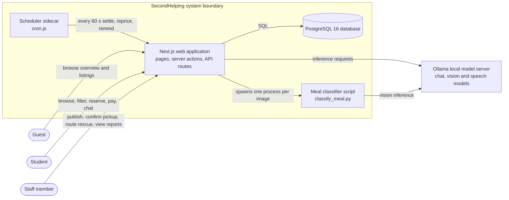

*Figure 1: System context of SecondHelping.*

**Scale.** The system targets a single campus with a small number of dining halls (the demonstration data has two), tens of concurrent users, and the reference workload of REQ-NFR-01: 20 concurrent users, 50 listings, 500 orders, and 200 user accounts.

#### 2.1.2 Goals and Context

**Architectural goals.**

*Table 6: Architectural goals.*

| ID | Goal | Origin |
|----|------|--------|
| G1 | Deliver the reactive marketplace (all Must-have requirements), with strong consistency for inventory, orders, payments, and refunds | SRS §3.2 (REQ-FUNC-001 to 014) |
| G2 | Allow the product to evolve toward the AI-driven food-circulation network "without replacing the underlying transaction infrastructure" | SRS §1, §2.1 |
| G3 | Keep personal data on campus: AI features use only locally hosted models | SRS §2.3, §3.4 |
| G4 | Be buildable, testable, and operable by a five-person student team within one semester, on the mandated technology stack | Course context; SRS §2.3 |
| G5 | Keep decisions that affect students or recipients (price, donation destination) deterministic, explainable, and under human oversight | SRS §2.3, §3.6 |

**Role of the architecture in the life cycle.** The project followed evolutionary prototyping. The architecture grew with the code over roughly nine weeks (Section 2.2.4), while the SRS was baselined in parallel (v0.1 on 2026/10/12 to v1.5 on 2026/11/21). This SAD is therefore mainly *descriptive*: it documents the system as built. It is also *prescriptive* where it states rules the code must follow, such as the layering rules in Section 3.2 and the concurrency rules in Section 3.4. Where the code does not follow these rules, the deviation is recorded in Section 2.2.2 so that it can be resolved deliberately rather than silently.

**Technical constraints.** The following constraints were imposed rather than chosen.

*Table 7: Architectural constraints.*

| ID | Constraint | Source |
|----|------------|--------|
| CON-1 | Use the existing web stack: Next.js, React, TypeScript, Prisma, and PostgreSQL | SRS §2.3 |
| CON-2 | Keep secure, session-based access and role-based authorization | SRS §2.3 |
| CON-3 | Never store passwords in plaintext | SRS §2.3 |
| CON-4 | Run in standard web browsers; no mobile app in the initial release | SRS §2.3 |
| CON-5 | Run AI features against locally hosted models (Ollama); send no user data to external AI services | SRS §2.3 |
| CON-6 | Simulate payments; integrate no real payment provider in this phase | SRS §2.3 |
| CON-7 | Incorporate human oversight and fairness protections in AI-based features that affect prices or allocations | SRS §2.3 |
| CON-8 | Handle personal data in accordance with the Personal Information Protection Law of the PRC (PIPL) | SRS §3.4 |

**Organizational context.** The team has five part-time members, uses a single GitHub repository with continuous integration, and has no operations staff. This favors one deployable unit, minimal infrastructure (no message broker, cache, or job queue), and rules that can be verified by unit tests.

#### 2.1.3 Significant Driving Requirements

**Functional drivers.** The following functional requirements had the greatest influence on the structure of the system:

- **FD-1 Atomic reservation (REQ-FUNC-010).** Checking inventory, creating the order, and decrementing inventory must happen atomically under concurrent requests. This drives the database concurrency approach (AA-5).
- **FD-2 Time-driven lifecycle (REQ-FUNC-011, 012, 018, 026).** Payment holds, settlement and refunds, reminders, and automatic discounts all depend on the passage of time, not on user actions. This drives the scheduling approach (AA-6, AA-7).
- **FD-3 Authorization and dining-hall scoping (REQ-FUNC-003).** Every action must be authorized by role, and staff may act only within their own dining hall. This drives the per-entry-point authorization rule (AA-2).
- **FD-4 AI assistance over live data that never writes (REQ-FUNC-019, 020).** This drives the bounded, local AI integration (AA-8).
- **FD-5 Rule-based rescue routing with approval and audit (REQ-FUNC-024).** This drives the functional core (AA-4), human approval (AA-9), and the event log (AA-11).
- **FD-6 Impact measurement with an explicit estimation basis (REQ-FUNC-016, 025).** This drives the separation of the pure estimator from its persistence (AA-4) and the method versioning of impact records.

**Quality-attribute scenarios.** The scenarios below use the six-part form of the Quality Attribute Workshop [Barbacci 2003]: source, stimulus, artifact, environment, response, and response measure. The source and artifact are folded into the first two columns.

*Table 8: Quality-attribute scenarios that drive the architecture.*

| ID | Quality | Stimulus and environment | Response | Response measure | Traces to |
|----|---------|--------------------------|----------|------------------|-----------|
| QAS-1 | Integrity under concurrency | During normal operation, 20 students concurrently try to reserve the last unit of a listing through `claimListing` | Exactly one order is created; the other requests are rejected without changing inventory | `quantityRemaining` never becomes negative; the open orders of a listing never exceed `quantityTotal`; a student never has more than 2 open orders for the same listing | REQ-FUNC-010 AC2–3, AC10 |
| QAS-2 | Idempotent state transitions | A student submits the payment twice, or a page render and a scheduler tick settle the same order at the same time | Each transition is applied once; repeating it has no effect | One PENDING_PAYMENT to RESERVED transition per order; at most one refund per order; at most one successful pickup confirmation | REQ-FUNC-011 AC3, 012 AC4, 014 AC6 |
| QAS-3 | Privacy | A user chats with the assistant, or a staff member uploads a meal photo or records a voice description | All inference is performed by the configured local Ollama server. Images and catalog files are deleted after processing; audio and transcripts are not persisted | Zero requests to external AI services; temporary directories removed on every code path, including errors | SRS §2.3, §3.4; REQ-FUNC-020 AC7, AC9 |
| QAS-4 | Availability and graceful degradation | The Ollama process is stopped or unreachable while the marketplace is in use | AI endpoints answer with an "unavailable" error (HTTP 503) and the interface shows a fallback message; all marketplace workflows continue | 100% of listing, reservation, payment, and pickup workflows succeed with Ollama stopped | REQ-NFR-05; REQ-FUNC-019 AC7, 020 AC6 and AC14 |
| QAS-5 | Security (authorization) | An authenticated student, or an unauthenticated client, sends a crafted POST request directly to a staff server action or a staff-only API route | The request is rejected (redirect, HTTP 401, or HTTP 403) before any data is read or written | Zero unauthorized state changes; staff actions affect only the staff member's own dining hall | REQ-FUNC-003 AC1–4 |
| QAS-6 | Timeliness | A pickup window ends, a payment hold expires, or a reminder or price review falls due while the scheduler is running and nobody is using the application | Listings expire, orders are settled and refunded, stock is released, reminders are created, and opted-in prices are reviewed | Within 2 minutes of the due time | REQ-NFR-04; REQ-FUNC-012 AC5, 018 AC1 |
| QAS-7 | Auditability and safety of rescue routing | A staff member requests a route for unsold food | A deterministic recommendation is produced with its safety, capacity, and timing factors, and is recorded together with its final disposition. High-impact routes wait for approval | The same input always gives the same output (unit tests); 100% of created routes are recorded in `ListingEvent`; no route that requires approval reaches DISPATCHED without approval | REQ-FUNC-024 |
| QAS-8 | Pricing fairness | The scheduler reviews an opted-in listing with weak paid demand | The discount increases by at most 5 points, at most once every 10 minutes. Every shopper sees the same price, and prices already captured by orders do not change | Discount at most 80%; price never increases; concurrent reviews never apply the same change twice | REQ-FUNC-026 |
| QAS-9 | Modifiability | At design time, a developer adds the predictive surplus engine (REQ-FUNC-021) | The engine is added as a new domain module with its own entry point, using the forward-provisioned forecasting tables | No change to the reservation, payment, settlement, or pickup modules; no destructive migration | SRS §2.1; REQ-FUNC-021 |
| QAS-10 | Performance | 20 concurrent users browse, reserve, pay, and confirm pickups on the reference local setup, with 50 listings, 500 orders, and 200 users | Pages and actions are served | p95 response time of at most 1.0 s (not yet measured) | REQ-NFR-01 |
| QAS-11 | Honest metrics | The impact estimator processes an order whose food has no category or weight | The affected metric is reported as UNAVAILABLE with a note, or as ESTIMATED with a recorded assumption | Never silently reported as 0; each order counted at most once (unit tests) | REQ-FUNC-025 AC5–7 |

### 2.2 Solution Background

The subsections of Section 2.2 explain why the architecture has its current form and argue that it satisfies the behavioral and quality-attribute goals above. Where it currently falls short, the gap is stated.

#### 2.2.1 Architectural Approaches

Table 9 summarizes the approaches whose scope is the whole system. Each one is then explained with its rationale, its consequences, and the alternatives that were considered.

*Table 9: Summary of architectural approaches.*

| ID | Approach | Addresses |
|----|----------|-----------|
| AA-1 | Modular monolith on the Next.js App Router | G4, CON-1 |
| AA-2 | Server-first user interface: React Server Components for reads, Server Actions for writes | QAS-5, QAS-10, G4 |
| AA-3 | Route handlers only for machine-to-machine and binary interfaces | QAS-4, QAS-5 |
| AA-4 | Layered architecture with a functional core of pure rule modules | QAS-7, QAS-11, QAS-9, SRS §3.5 |
| AA-5 | Database-enforced consistency through conditional updates and row locks | QAS-1, QAS-2, QAS-8 |
| AA-6 | Lazy plus periodic settlement | QAS-6, QAS-2 |
| AA-7 | Sidecar scheduler calling a secret-protected HTTP endpoint | QAS-6, G4 |
| AA-8 | Local-first AI with bounded capabilities | QAS-3, QAS-4, CON-5 |
| AA-9 | Deterministic rules as the authority, with human approval for high-impact decisions | QAS-7, QAS-8, G5, CON-7 |
| AA-10 | Database-backed opaque sessions and scrypt password hashing | QAS-5, CON-2, CON-3 |
| AA-11 | Forward-provisioned schema and an append-only event log | QAS-9, QAS-7 |
| AA-12 | Money as integer cents, with price snapshots in orders | QAS-8, G1 |

**AA-1 Modular monolith on the Next.js App Router.**

- **Decision.** A single TypeScript code base runs in one Node.js server process, which serves pages, mutations, and HTTP APIs. A small sidecar process provides scheduling (AA-7), and one PostgreSQL database holds all persistent data.
- **Rationale.** The stack is mandated (CON-1). One deployable unit is the smallest operational footprint a student team can manage (G4). Prisma-generated types are shared end to end by pages, actions, and domain modules, which catches schema mismatches at compile time.
- **Consequences.** The server process is a single point of failure, and scaling means a larger host or replicating the whole application. Replication is safe for transactions (AA-5) but not yet for reminders (D-9).
- **Alternatives rejected.**
  - A single-page application with a separate REST or GraphQL backend: it would duplicate validation and authorization and add a second deployable unit.
  - One microservice per capability (AI, routing, pricing): the operational overhead is not justified at campus scale.

**AA-2 Server-first user interface: React Server Components for reads, Server Actions for writes.**

- **Decision.** Every page is a dynamic React Server Component (`export const dynamic = "force-dynamic"`) that queries the database on the server and returns rendered HTML. Every mutation is a Server Action bound to an HTML form. After a mutation, the action calls `revalidatePath` so that affected pages are rendered again. Client components are used only where browser APIs are needed: the chat panel, the notifications dropdown, the image-upload preview, and microphone recording.
- **Rationale.**
  - Authorization and validation run only on the server.
  - The core forms work without client-side JavaScript.
  - There is no public CRUD API to secure, version, or document.
- **Consequences.**
  - Server Actions are framework-managed RPC endpoints that anyone can reach with a direct POST request. **Each action must therefore check authorization itself**: the code calls `requireRole` or `getCurrentUser` at the start of every action, and the one exception is deviation D-3.
  - Every page view queries the database, because nothing is cached.
  - There is no middleware: protection lives at each entry point, where it is visible in code review.
- **Alternative rejected.** A REST API consumed by client-side fetching, for the reasons given under AA-1.

**AA-3 Route handlers only for machine-to-machine and binary interfaces.**

- **Decision.** Exactly four HTTP route handlers exist: `/api/chat` (JSON conversation), `/api/food-image-match` (multipart image upload), `/api/voice-listing-assistant` (multipart WAV upload), and `/api/notifications` (the scheduler endpoint).
- **Rationale.** These interfaces need non-form payloads; explicit HTTP status codes that client code can act on (401, 403, 413, 415, 422, 503); or a caller that is not a browser.
- **Consequences.** The external interface is small and easy to review (Section 3.1.5.2).

**AA-4 Layered architecture with a functional core.**

- **Decision.** Modules are organized in four layers (Section 3.2). The highest-risk business rules, food-safety routing (`lib/rescue-routing.ts`) and environmental estimation (`lib/estimator.ts`), are written as pure functions that perform no I/O. Thin persistence modules (`lib/rescue-dispatch.ts`, `lib/sync.ts`) wrap them and receive the database client as a parameter.
- **Rationale.**
  - Deterministic, unit-testable rules (QAS-7, QAS-11).
  - Satisfies the separation of user interface, service logic, and persistence required by SRS §3.5.
  - The same pure function is used both for the preview on the staff dashboard and for the action that creates the route, so the preview always matches the result.
- **Consequences.**
  - The approach is not yet applied uniformly. `lib/order-lifecycle.ts` and `lib/dynamic-pricing.ts` mix rules with queries, so the deterministic pricing scenarios required by REQ-FUNC-026 can only be tested against a database. Extracting their decision functions is the natural next step.
  - Pages are allowed some documented bridges across layers (Section 3.2).
- **Alternative rejected.** A strict service layer for every read. It would add pass-through code for little benefit in a small code base.

**AA-5 Database-enforced consistency through conditional updates and row locks.**

- **Decision.** Every state transition is a compare-and-set operation: an `updateMany` call whose `where` clause restates the expected current state (status, remaining quantity, timestamp, or price). The number of rows affected decides whether the transition succeeded. Where a read-modify-write spans several statements, it runs inside an interactive transaction that first locks the listing row with `SELECT … FOR UPDATE`. This applies to reservation and to rescue-route creation.
- **Rationale.** Correctness under concurrent requests, and under settlement started from many entry points, without distributed locks or a job queue (QAS-1, QAS-2, QAS-8). PostgreSQL's default READ COMMITTED isolation is enough, because every write re-checks its own precondition.
- **Consequences.** Correctness depends on developers always writing the state predicate. This is stated as a constraint in Section 3.4.5.2, and the mechanism used for each transition is listed there.
- **Alternatives rejected.**
  - In-process mutexes: they do not work across processes, so they would fail once the server and the scheduler-triggered work run concurrently.
  - SERIALIZABLE isolation everywhere: every caller would need retry logic.

**AA-6 Lazy plus periodic settlement.**

- **Decision.** `settleUnavailableOrders()` is idempotent. It is called (a) at the start of every page render and state-changing action that depends on order or listing state, and (b) every minute through the scheduler.
- **Rationale.** Users never see a stale state, even when the scheduler is not running. The scheduler guarantees timeliness when nobody is using the application (QAS-6).
- **Consequences.** Page renders, which are HTTP GET requests, perform writes. Every render pays the cost of settlement, which is one `UPDATE` and one `SELECT` when nothing is due. This is a documented bridge in the layered view (B-2).
- **Alternatives rejected.**
  - PostgreSQL triggers or the `pg_cron` extension: business logic would live in SQL, where it is harder to test, and `pg_cron` is not part of the stock `postgres:16-alpine` image.
  - A Redis-backed job queue: it adds infrastructure (G4).

**AA-7 Sidecar scheduler calling a secret-protected HTTP endpoint.**

- **Decision.** `cron.js` runs as a separate Node.js process, launched together with the server by `concurrently` (`pnpm dev` and `pnpm start`). Every 60 seconds it sends `GET /api/notifications` with an `x-cron-secret` header. The endpoint runs settlement, the automatic-pricing review, and the reminder sweeps.
- **Rationale.** All business logic stays in the Next.js code base and shares the same modules and database client. No operating-system cron configuration is needed, and the setup works the same way on Windows, macOS, and Linux development machines.
- **Consequences.**
  - The scheduler and the server must share `CRON_SECRET`.
  - The target URL is hard-coded to `http://localhost:3000` (D-11).
  - The endpoint is a GET request with side effects. Its secret protects it, but it should be changed to POST if the API is ever exposed beyond the local host.
  - Ticks are not serialized: a tick that takes longer than 60 seconds overlaps the next one (D-9).

**AA-8 Local-first AI with bounded capabilities.**

- **Decision.** All inference goes to a local Ollama server, whose base URL is configurable. Three integration patterns are used:
  1. A tool-calling loop over four read-only tools whose queries run on the server with the caller's identity (the assistant).
  2. JSON output constrained by a schema, with temperature 0, followed by server-side validation against the food catalog (image and voice input).
  3. Prompts that declare their inputs, such as transcripts and text in images, to be untrusted data rather than instructions.

  AI output never writes to the database. It only answers questions or pre-fills a form that a staff member reviews and submits.
- **Rationale.**
  - Privacy and PIPL (QAS-3, CON-5).
  - Graceful degradation (QAS-4).
  - Containment of prompt injection: even a fully manipulated model can read only what the signed-in user may read, and can change nothing.
- **Consequences.**
  - The reference host needs at least 16 GB of RAM (REQ-NFR-07).
  - Answer quality depends on small local models.
  - The integration code currently contains three separate Ollama clients (D-14).
- **Alternatives rejected.**
  - Cloud LLM APIs: personal data would leave the campus, and they bring cost and key management.
  - A custom-trained image classifier: no labeled dataset exists.

**AA-9 Deterministic rules as the authority, with human approval for high-impact decisions.**

- **Decision.** Automatic discounts and rescue routing are deterministic, documented rule sets. Each stores a plain-language reason next to its result. Rescue routes require explicit staff approval when any of the following holds:
  - the estimated weight is 8 kg or more;
  - the destination is an external donation;
  - a human-facing destination has less than 60 minutes of safe handling time left;
  - only an unchecked fallback is available.
- **Rationale.** Human oversight (CON-7, G5), explainability, and testability. Future AI components may rank options or generate explanations, but they must not override the rule filters (SRS §3.6).
- **Consequences.** The rules are less adaptive than a learned policy. That trade-off is accepted until the planned AI modules (REQ-FUNC-021 and REQ-FUNC-023) are designed and evaluated.

**AA-10 Database-backed opaque sessions and scrypt password hashing.**

- **Decision.**
  - **Session token.** A 32-byte random token is stored in an HTTP-only, `SameSite=Lax` cookie, which is also marked `Secure` in production.
  - **Server-side record.** Only the token's SHA-256 hash is stored, in `AuthSession`, with a 7-day expiry. The record is deleted at logout or when it is found to have expired.
  - **Passwords.** Passwords are hashed with scrypt, using a random 16-byte salt and a 64-byte key, and are verified with a timing-safe comparison.
- **Rationale.** Sessions can be revoked (REQ-FUNC-004), and a database leak reveals neither usable tokens nor passwords (CON-3).
- **Alternative rejected.** Stateless JWTs, which cannot be revoked on the server without a deny-list.

**AA-11 Forward-provisioned schema and an append-only event log.**

- **Decision.** The schema already defines ten tables for planned capabilities: forecasting inputs and outputs, model versions, pricing policies, price history, listing drafts, media assets, and simulation scenarios. The seed populates them for demonstrations, but no runtime code reads or writes them yet. Separately, rescue routing records its audit trail in `ListingEvent`, an append-only log whose metadata is stored as JSON.
- **Rationale.** Future modules can be added without restructuring the core tables (QAS-9). The event log provides a complete record of each rescue decision (QAS-7).
- **Consequences.**
  - The unused tables enlarge the schema and may drift from the eventual design.
  - The link between a rescue dispatch and its listing lives in JSON metadata rather than a foreign key, so the database cannot enforce it and a JSON-path query is needed to resolve it.
  - Several of these tables have no committed migration (D-1).

**AA-12 Money as integer cents, with price snapshots in orders.**

- **Decision.** All amounts are stored as integer cents. At reservation time, an `Order` copies the listing's `originalPriceCents`, `discountRate`, `finalPriceCents`, both fees, and the pickup window.
- **Rationale.**
  - No floating-point rounding errors.
  - Later markdowns (AA-9) can never change a price already captured by an order (REQ-FUNC-026 AC5).
  - Refunds are computed from the snapshot.
- **Consequences.** The pickup window is duplicated in `Order`. This is harmless today, because a listing's window cannot be edited after publication.

#### 2.2.2 Analysis Results

**Automated tests.** Both unit-test suites were run on 2026-11-21 against commit `9bf5f5b`, using Node's built-in test runner through `tsx`.

*Table 10: Automated test evidence.*

| Suite | Scope | Cases | Result | Command |
|-------|-------|-------|--------|---------|
| `lib/rescue-routing.test.ts` | Priority, safety, allergen, deadline, capacity, fallback, and approval rules; listing-quantity helpers; two end-to-end listing scenarios | 15 | 15 passed, 0 failed | `npx tsx --test lib/rescue-routing.test.ts` |
| `estimator.test.ts` | Metric calculation, emission-factor versioning, UNAVAILABLE and fallback handling, non-negative savings, countable orders, deduplication, aggregation | 9 | 9 passed, 0 failed | `npx tsx --test estimator.test.ts` |

Neither suite is part of continuous integration, and `package.json` defines no `test` script. Adding `"test": "tsx --test lib/*.test.ts estimator.test.ts"` and a CI step would turn this evidence into a regression gate.

**Continuous integration and static analysis.**

- `.github/workflows/ci.yml` runs on every push and pull request to `main`. It installs dependencies with a frozen lockfile, generates and validates the Prisma client and schema, applies the migrations to a PostgreSQL 16 service container, and then runs lint and a production build.
- `.github/workflows/codeql.yml` runs CodeQL security analysis on pushes, on pull requests, and weekly.
- The build does not query the database, because every page is dynamic. CI therefore cannot detect drift between the schema and the migrations (D-1).

**Concurrency and consistency.** Every state transition was reviewed for its concurrency-control mechanism. Table 36 in Section 3.4.5.2 gives the result. All marketplace transitions are compare-and-set or lock-protected, which satisfies QAS-1, QAS-2, and QAS-8 by construction, subject to the measurement still pending in SRS §4.1. The one transition that uses check-then-act is the reminder sweep (D-9).

**Degradation.** The table below traces each failure of a dependency to its effect on the system.

*Table 11: Degradation analysis.*

| Failure | Effect | Mechanism |
|---------|--------|-----------|
| Ollama unreachable | Chat, image, and voice endpoints return HTTP 503 and the interface shows a fallback message. All marketplace workflows continue | No transaction path calls Ollama (AA-8). Satisfies QAS-4 |
| Ollama slow or hung | A chat request can wait indefinitely; image matching can wait up to 180 s; voice processing up to 210 s | No timeout on chat (D-7); long timeouts elsewhere (D-8) |
| Python or Pillow missing | The image endpoint returns HTTP 503; staff select the food manually | `execFile` failure is caught; temporary files are still removed |
| Scheduler stopped or `CRON_SECRET` unset | Settlement still happens lazily on page views and actions. Reminders and automatic pricing stop. Orders of listings that nobody views are settled late | AA-6; the endpoint returns HTTP 401 when the secret is unset |
| PostgreSQL unavailable | The whole application is unavailable | Single point of failure; no cache or read replica (accepted for the prototype) |

**Performance.** REQ-NFR-01 to REQ-NFR-04 have not been measured yet. An architectural review identifies the following factors:

- Every page render runs settlement before its own queries.
- `/merchant` loads every listing of the dining hall with all of its orders, and the overview loads every paid order and aggregates them in memory. Both grow with history and will eventually need pagination or SQL aggregation.
- The main access paths are indexed (for example, `Listing(diningHallId, status, pickupWindowStart)`, `Order(listingId, status)`, `Order(pickupWindowEnd, status)`, and `Notification(userId, createdAt)`).
- No AI call is on a transaction path.

**Conformance review.** The architecture was compared with the implementation at commit `9bf5f5b` and with the SRS. Table 12 lists every deviation found.

Severity levels:

- **High:** breaks a documented workflow.
- **Medium:** violates a stated requirement or constraint in a way that can be reached in practice.
- **Low:** design debt or drift in the documentation.

*Table 12: Deviations found by the architecture conformance review.*

| ID | Severity | Type | Finding and evidence | Requirement or rule affected | Suggested remedy |
|----|----------|------|----------------------|------------------------------|------------------|
| D-1 | High | Deployability, data | The committed migrations create only 9 of the 22 tables in `prisma/schema.prisma` and 6 of its 10 enumerations. `ListingDraft`, `ListingEvent`, `PriceChange`, `PricingPolicy`, `ModelVersion`, `DailyProduction`, `WeatherObservation`, `CampaignEvent`, `SurplusForecast`, `RescueDestination`, `RescueDispatch`, `SimulationScenario`, and `MediaAsset` exist only in the schema. On a database built with `pnpm db:migrate`, as the README instructs, the seed fails at `listingEvent.deleteMany()` and `/merchant` and the rescue-routing actions fail with missing-table errors. CI does not detect the drift | Data-model consistency criterion (Section 1.5.3.5); README setup; REQ-FUNC-024 | Generate the missing migration from the existing history (`prisma migrate dev --name add_rescue_and_roadmap_tables`) and commit it. Add a drift check to CI (`prisma migrate diff` with `--exit-code`) and a smoke test that seeds and renders `/merchant` |
| D-2 | Medium | Privacy | The overview page (`app/page.tsx`) lists the six most recent orders of *all* dining halls, with student names, meals, and amounts, to any visitor, including guests | REQ-FUNC-005 AC3 ("guests cannot … view other users' orders"); PIPL data minimization (SRS §3.4) | Show guests and students only aggregate figures, or only their own orders. Keep the detailed table for staff, scoped to their dining hall |
| D-3 | Low | Security | `markNotificationAsRead(id)` updates a notification by ID without checking the session or the owner. The IDs (cuid) are hard to guess and the impact is limited to the read flag | REQ-FUNC-017 AC5; SRS §3.3.2 ("notification … mutations shall be scoped to the signed-in user") | Call `getCurrentUser()` and use `updateMany({ where: { id, userId } })` |
| D-4 | Low | Security | `/pay/[ref]` loads an order by `paymentRef` without checking that it belongs to the current user, and shows the pickup code of RESERVED orders. Payment references are random UUIDs, so exploitation requires a leaked URL | REQ-FUNC-013 AC4 ("codes are never exposed to other students") | Add `studentId: user.id` to the lookup and return 404 otherwise |
| D-5 | Medium | Correctness | `syncImpactRecords()` is called only by `prisma/seed.ts`. Pickups confirmed after seeding never produce `ImpactRecord` rows, so the CO₂e, water, and land figures on `/` are stale | REQ-FUNC-025 AC1–2 (Impact Estimator); QAS-11 | Call the sync, which is idempotent, from the scheduler tick or after `confirmPickup` |
| D-6 | Low | Consistency | `/impact` estimates CO₂ as a fixed 0.8 kg per meal, while `/` uses the Impact Estimator's emission factors (method `impact-v1.0`). The two pages can report different figures for the same pickups | REQ-FUNC-025 AC4 and AC6 (identifiable factors; consistent methods) | Use `getImpactReport()` on `/impact` |
| D-7 | Medium | Performance, availability | `lib/ollama.ts` calls Ollama without a timeout, for up to 5 rounds. A hung model server holds the request indefinitely | REQ-NFR-02 (time out within 60 s with an "unavailable" message) | Add `AbortSignal.timeout` per call and an overall time budget |
| D-8 | Low | Performance | Image matching allows 180 s (the route's `execFile` timeout and Python's `urlopen` timeout); voice processing allows 120 s plus 90 s | REQ-NFR-03 (time out within 60 s) | Align the timeouts with the NFR targets, or revise the targets with measurements |
| D-9 | Low | Reliability | The reminder sweep reads the orders whose reminder flag is false, creates the notification, and only then sets the flag. If two scheduler ticks overlap, or the process crashes between the two writes, a reminder can be sent twice | REQ-FUNC-018 AC3 ("sent at most once") | Claim the reminder first with `updateMany({ where: { id, reminderOpenSent: false } })` and notify only if one row changed |
| D-10 | Low | Deployability | `app/scripts/classify_meal.py` imports Pillow (`PIL`) to resize images, but the README does not mention installing it. (SRS v1.5 now lists the dependency.) Without Pillow, image matching fails (degrading to manual selection) | README setup | Add `requirements.txt` (`pillow`) and a setup step to the README |
| D-11 | Low | Deployability | `cron.js` calls `http://localhost:3000/api/notifications`, so the scheduler must run on the same host as the server, which must listen on port 3000 | Deployment flexibility (Section 3.5) | Read the base URL from an environment variable (for example `APP_BASE_URL`) |
| D-12 | Low | Coupling | `signUp` connects every new student to the dining hall with the hard-coded ID `hall-main`, which only the seed creates. On a database without that record, every signup fails. Students do not need a dining hall | REQ-FUNC-002; data-model semantics (a dining hall is the scope of a staff member) | Remove the connection (`diningHallId` is nullable) |
| D-13 | Low | Auditability | Automatic pricing keeps only the latest review reason on the listing (`lastAutoPriceReason`); the `PriceChange` table exists but is never written, so the history of markdowns is lost | REQ-FUNC-026 AC6 (every review stores a reason) | Write a `PriceChange` row for each applied markdown |
| D-14 | Low | Modifiability | There are three separate Ollama clients: `lib/ollama.ts`, an inline `fetch` in the voice route, and `urllib` in the Python script. The 10-minute payment hold is written as a literal in both `app/actions.ts` and `lib/order-lifecycle.ts` | Layer rule LC-5 (Section 3.2); single source of truth for business rules | Route all text and audio inference through one adapter in `lib/`, and share the hold constant |
| D-15 | Low | Documentation | The entity-relationship diagrams in `docs/database/` (2026-10-17) predate the impact, pricing, and rescue additions. (The outdated SRS status of REQ-FUNC-025, also reported here in SAD v1.0, was corrected in SRS v1.5.) | Consistency between documents (Section 4.1) | Regenerate the diagrams from the schema, or refer to Section 3.3 |

**Open items carried over from the SRS.** Login rate limiting, account deletion, enforcement of retention periods, a backup policy, and a separate approver role for rescue routing are still open (SRS §4.3). They must be resolved before any deployment beyond a local machine (Section 3.5.5.1).

#### 2.2.3 Requirements Coverage

The table maps each requirement to the architectural elements that address it. Element identifiers are defined in Section 3 and indexed in Section 6.1.

*Table 13: Requirements coverage.*

| Requirement | Addressed by (elements) | Views | Notes |
|-------------|-------------------------|-------|-------|
| REQ-FUNC-001 User login | M2.2 `login`, M4.1 `createSession`, M4.2 `verifyPassword`, M1.2 | 3.1, 3.4 | Redirects only to safe internal paths; students cannot be redirected to `/merchant` or `/impact` |
| REQ-FUNC-002 Student registration | M2.2 `signUp`, M4.2 `hashPassword` | 3.1 | See D-12 |
| REQ-FUNC-003 Role-based access control | M4.1 `requireRole` and `getCurrentUser`, called at every page, action, and route; dining-hall predicates in queries | 3.1, 3.2, 3.4 | AA-2. See D-3 and D-4 |
| REQ-FUNC-004 Session management | M4.1; entity `AuthSession` | 3.3, 3.4 | AA-10 |
| REQ-FUNC-005 Guest browsing | M1.1, M1.3 (both render for anonymous users); M1.7 guest mode | 3.1 | See D-2 |
| REQ-FUNC-006 Listing publication | M2.1 `createListing`, M1.5; entities `Listing` and `Food` | 3.1, 3.3 | Invariants I-1 to I-4 |
| REQ-FUNC-007 Withdrawal and lifecycle | M2.1 `withdrawListing`, M3.1 | 3.3, 3.4 | Listing state machine (Figure 6) |
| REQ-FUNC-008 Listing browsing | M1.3 (filters on status, quantity, and pickup window) | 3.1 | Shared food catalog (Section 3.3.3) |
| REQ-FUNC-009 Listing filtering | M1.3 (URL query parameters translated into Prisma filters) | 3.1 | Listings with no allergen data are hidden when any exclusion is active |
| REQ-FUNC-010 Reservation | M2.1 `claimListing` | 3.4 | AA-5; QAS-1 |
| REQ-FUNC-011 Simulated payment | M1.4, M2.1 `confirmPayment`, M1.8 `FakeQR` | 3.4 | QAS-2. See D-4 |
| REQ-FUNC-012 Settlement and refunds | M3.1, triggered by M1, M2.1, M2.7, and M3.8 | 3.4 | AA-6; Order state machine (Figure 7) |
| REQ-FUNC-013 Pickup code | M2.1 `generatePickupCode` (cryptographic random bytes, 30-character alphabet) | 3.4 | Invariant I-6 |
| REQ-FUNC-014 Pickup confirmation | M2.1 `confirmPickup` | 3.4 | Compare-and-set from RESERVED |
| REQ-FUNC-015 Operational summary | M1.5 (term metrics), M1.1 | 3.1 | Metrics computed in pages; see the background of Section 3.2 |
| REQ-FUNC-016 Impact reporting | M1.6 | 3.1 | See D-6 |
| REQ-FUNC-017 In-app notifications | M3.7, M2.1, M3.1, M2.3, M1.8 `Notifications` | 3.1, 3.4 | Notifications are rows written by the code that causes the event. See D-3 |
| REQ-FUNC-018 Timed reminders | M2.7, M5 | 3.4 | See D-9 |
| REQ-FUNC-019 Conversational assistant | M2.4, M4.4, M3.8, M1.8 `ChatWidget` | 3.4 | AA-8. See D-7 |
| REQ-FUNC-020 Multimodal listing assistant | M2.5, M4.5, M2.6, M1.8 `FoodImageMatcher` and `VoiceListingAssistant` | 3.4 | AA-8. See D-8 and D-10 |
| REQ-FUNC-024 Rescue routing | M3.3, M3.4, M2.1 rescue actions, M1.5 rescue panel; entities `RescueDestination`, `RescueDispatch`, `ListingEvent` | 3.3, 3.4 | AA-4, AA-9, AA-11. See D-1 |
| REQ-FUNC-026 Automatic discounts | M3.2 (through M2.7 and M5); opt-in in M2.1 `createListing` | 3.4 | QAS-8. See D-13 |
| REQ-FUNC-021 Predictive surplus engine (planned) | Forward-provisioned entities `DailyProduction`, `WeatherObservation`, `CampaignEvent`, `SurplusForecast`, `ModelVersion` | 3.3 | Future domain module in L3 (QAS-9) |
| REQ-FUNC-022 Prep copilot (planned) | Forward-provisioned entity `SimulationScenario` | 3.3 | Future domain module in L3 |
| REQ-FUNC-023 Dynamic pricing agent (planned) | Forward-provisioned entities `PricingPolicy`, `PriceChange`; would sit behind the interface of M3.2 | 3.3 | Must keep the fairness constraints of AA-9 |
| REQ-FUNC-025 Impact estimator (partially implemented) | M3.5, M3.6; entities `EmissionFactor` and `ImpactRecord`; display in M1.1 | 3.3 | See D-5 and D-6 |
| REQ-NFR-01 Performance | AA-2; database indexes; no AI on transaction paths | 3.4 | Not yet measured |
| REQ-NFR-02 Chat latency | M4.4 | 3.4 | See D-7 |
| REQ-NFR-03 Image matching latency | M2.5, M4.5 | 3.4 | See D-8 |
| REQ-NFR-04 Settlement timeliness | M5 (60 s tick) and lazy settlement | 3.4 | AA-6, AA-7 |
| REQ-NFR-05 Degraded operation | AI isolated in M2.4–M2.6 | 3.4 | Degradation analysis above |
| REQ-NFR-06 Browsers and accessibility | M1 (labels, `aria-live` regions, screen-reader-only labels) | 3.1 | Not an architectural driver beyond CON-4 |
| REQ-NFR-07 Reference environment | Deployment node N2 | 3.5 | At least 16 GB RAM; Ollama as a separate service |
| REQ-NFR-08 Availability target | Single-host deployment | 3.5 | PostgreSQL and the server are single points of failure |
| SRS §3.3.2 Security | M4.1, M4.2; secret-protected M2.7; file validation in M2.5 and M2.6 | 3.4 | See D-3 and D-4; rate limiting still open |
| SRS §3.4 Compliance (PIPL) | AA-8; personal-data classification in Section 3.3.5.1 | 3.3, 3.4 | See D-2; retention still open |

#### 2.2.4 Summary of Background Changes Reflected in Current Version

Not applicable: version 1.0 is the first release of this SAD. Later versions will summarize here the decisions, drivers, and requirement changes that made the architecture change.

To give context to readers, the table below records how the architecture evolved before this baseline. It is reconstructed from the Git history, the migration history, and `docs/TEAM_LOG.md`.

*Table 14: Architecture evolution before baseline 1.0.*

| Date | Architectural change | Evidence |
|------|----------------------|----------|
| 2026-09-21 | Baseline Next.js application created | First commits |
| 2026-09-27 | Login page; initial schema (`DiningHall`, `Listing`, `Order`, `User`, `AuthSession`) | Migration `20260927035643_init` |
| 2026-10-12 | SRS v0.1, first entity-relationship diagram, GitHub Actions workflow | Commits of 2026-10-12 |
| 2026-10-16/17 | Simulated payment (pending-payment status, payment fields, QR page); food catalog extracted from `Listing` into `Food` | Migrations `add_pending_payment_status`, `add_payment_fields`, `add_food_model` |
| 2026-10-19 | Refunds; public overview page before login | Migration `add_order_refunds` |
| 2026-10-21 | In-app notifications and the scheduler sidecar; local AI chat assistant using Ollama tool calling | Migration `add_notifications`; commit `1553611` |
| 2026-10-26 | Meal image matching through a Python script and a local vision model | Commit `6455f30` |
| 2026-11-08 | Voice listing input; peer-review remediation (SRS v1.2 and v1.3) | Commit `f9b008d` |
| 2026-11-10 to 16 | Impact Estimator (pure core, sync layer, `EmissionFactor` and `ImpactRecord`) | Commit `29470eb`; migration `add_impact_tracking` |
| 2026-11-16 | Rule-based automatic discounts | Commit `8d6fd2d`; migration `add_rule_based_pricing` |
| 2026-11-18 to 21 | Rule-based rescue router, with its unit tests | Commits `dfe73da`, `9bf5f5b` |

### 2.3 Product Line Reuse Considerations

Not applicable: SecondHelping is a single product, not a software product line. No pre-planned variants are produced or supported.

The following reuse is possible but not currently planned:

1. The pure rule modules (`lib/rescue-routing.ts` and `lib/estimator.ts`) are framework-independent TypeScript and could be reused by another food-recovery system.
2. The minimal Ollama client with its tool-calling loop (`lib/ollama.ts`) has no dependencies.
3. Because the data model supports several dining halls, another campus could be supported by seeding different dining halls, rescue destinations, and emission factors. Multi-campus operation, however, is outside the scope of the current phase (SRS §1.2).

## 3. Views

This section contains the views of the software architecture. A view is a representation of a whole system from the perspective of a related set of concerns [IEEE 1471]. Concretely, a view shows one kind of architectural element that occurs in the system, its properties, and the relations among the elements. Each view conforms to one of the viewpoints defined in Section 1.5.

Architectural views fall into three groups, depending on the broad nature of the elements they show:

- **Module views** show units of implementation and their responsibilities. They answer questions such as: What is each module responsible for? What may each module use? Where does a given piece of functionality live?
- **Component-and-connector views** show runtime components and the connectors through which they interact. They answer questions such as: What executes? How does data move between parts? What happens when a part fails? What runs concurrently?
- **Allocation views** show how software elements map to the non-software environment: hosts, containers, external services, and build infrastructure.

The views presented in this SAD are the following:

*Table 15: Views presented in this SAD.*

| Name of view | Viewtype that defines this view | Types of elements and relations shown | Module view? | C&C view? | Allocation view? |
|--------------|---------------------------------|---------------------------------------|--------------|-----------|------------------|
| 3.1 Module Decomposition | Module | Modules; *is-part-of* | Yes | No | No |
| 3.2 Layered | Module | Layers and modules; *allowed-to-use*, observed *uses* | Yes | No | No |
| 3.3 Data Model | Module (data model style) | Data entities, attributes, enumerations; associations with cardinality; entity state machines | Yes | No | No |
| 3.4 Runtime Component-and-Connector | Component-and-connector | Processes, services, and subprocesses; page-request, server-action, API, SQL, inference, process-invocation, and periodic-trigger connectors | No | Yes | No |
| 3.5 Deployment | Allocation | Runtime components, hosts, containers, services, CI runners; *allocated-to*, network paths | No | No | Yes |

### 3.1 Module Decomposition View

#### 3.1.1 View Description

This view conforms to the Module Decomposition viewpoint (Section 1.5.1). It partitions SecondHelping into seven top-level modules (M1 to M7) and their leaf modules, assigns each leaf a responsibility, maps every source file in the repository to exactly one leaf module, and records the public interface of each module that others depend on. Generated code (`app/generated/prisma/`) is assigned to M4.3. Static assets (`public/`) and documentation (`docs/`) are not modules.

#### 3.1.2 View Packet Overview

This view has been divided into the following view packets for convenience of presentation:

*Table 16: View packets of the Module Decomposition view.*

| Packet | Content | Section |
|--------|---------|---------|
| 3.1-A Top-level decomposition | M1 to M7, with the external libraries and services the system depends on | 3.1.5.1 |
| 3.1-B Presentation and application entry points | Leaf modules of M1 and M2; the interfaces of pages, server actions, and HTTP APIs | 3.1.5.2 |
| 3.1-C Domain logic and infrastructure | Leaf modules of M3 and M4; the exported interfaces of the library modules | 3.1.5.3 |

The set is complete: packet A covers every top-level module, and M5 to M7 are leaves documented in packet A. It is also non-duplicative: every leaf module is detailed in exactly one packet.

#### 3.1.3 Architecture Background

The decomposition follows two conventions:

1. **Next.js App Router conventions.** The `app/` directory holds routing, pages, server actions, and route handlers. The `lib/` directory holds shared server-side logic.
2. **One module per capability within `lib/`.** Each file owns one business capability: settlement, pricing, rescue routing, impact estimation, notifications, assistant tools, session handling, passwords, data access, or Ollama access.

Server actions and route handlers (M2) are separated from rendering (M1), even though both live under `app/`, because they are the system's *entry points*. Every authorization check and input validation for a mutation happens in M2 (AA-2, AA-3).

The Prisma client is generated into `app/generated/prisma/` by `pnpm db:generate`. That directory is ignored by Git and must not be edited by hand.

#### 3.1.4 Variability Mechanisms

- **Environment variables.** These select the database, the Ollama server and its models, the Python executable, and the scheduler secret (Appendix A.1).
- **Named constants.** Business-rule parameters (fees, payment hold, pricing thresholds, routing thresholds, size limits, and timeouts) are named constants in their modules (Appendix A.2). Changing one requires a code change and a new build.
- **Per-listing opt-in.** The `autoPricingEnabled` flag, chosen by staff when publishing a listing, decides whether M3.2 reviews that listing.
- **Data-driven configuration.** Rescue destinations (type, capacity, active flag) and emission factors (per category, versioned by `validFrom`) are database records. Changing them requires no code change. Seed data is currently the only way to maintain them.
- **Estimator options.** `ImpactEstimator` accepts `allowFallback` and `fallbackCategory`. Fallback is off by default, which yields the honest UNAVAILABLE basis (QAS-11).

#### 3.1.5 View Packets

##### 3.1.5.1 View Packet 3.1-A: Top-Level Decomposition

###### 3.1.5.1.1 Primary Presentation

```text
SecondHelping
├── M1  Presentation .............................. app/ (pages and components)
│   ├── M1.1  Overview page ....................... app/page.tsx  (route /)
│   ├── M1.2  Authentication pages ................ app/login/page.tsx, app/signup/page.tsx
│   ├── M1.3  Student marketplace page ............ app/orders/page.tsx, app/student/page.tsx (redirect)
│   ├── M1.4  Simulated payment page .............. app/pay/[ref]/page.tsx
│   ├── M1.5  Staff dashboard ..................... app/merchant/page.tsx
│   ├── M1.6  Impact report page .................. app/impact/page.tsx
│   ├── M1.7  Layout and dashboard shell .......... app/layout.tsx, app/globals.css,
│   │                                               app/components/DashboardShell.tsx
│   └── M1.8  Interactive client components ....... app/components/ChatWidget.tsx, Notifications.tsx,
│                                                   FoodImageMatcher.tsx, VoiceListingAssistant.tsx,
│                                                   ClearFiltersLink.tsx, FakeQR.tsx, LocalClock.tsx
├── M2  Application entry points
│   ├── M2.1  Marketplace server actions .......... app/actions.ts
│   ├── M2.2  Authentication server actions ....... app/auth-actions.ts
│   ├── M2.3  Notification server actions ......... app/notifications/actions/notifications-actions.ts
│   ├── M2.4  Assistant API ....................... app/api/chat/route.ts
│   ├── M2.5  Image-matching API .................. app/api/food-image-match/route.ts
│   ├── M2.6  Voice-listing API ................... app/api/voice-listing-assistant/route.ts
│   └── M2.7  Scheduler API ....................... app/api/notifications/route.ts
├── M3  Domain logic .............................. lib/
│   ├── M3.1  Order lifecycle and settlement ...... lib/order-lifecycle.ts
│   ├── M3.2  Automatic pricing policy ............ lib/dynamic-pricing.ts
│   ├── M3.3  Rescue routing rules (pure) ......... lib/rescue-routing.ts
│   ├── M3.4  Rescue dispatch store ............... lib/rescue-dispatch.ts
│   ├── M3.5  Impact estimator (pure) ............. lib/estimator.ts
│   ├── M3.6  Impact sync and reporting ........... lib/sync.ts
│   ├── M3.7  Order notifications ................. lib/notifications.ts
│   └── M3.8  Assistant tools ..................... lib/chat-tools.ts
├── M4  Infrastructure
│   ├── M4.1  Session and access control .......... lib/auth.ts
│   ├── M4.2  Password hashing .................... lib/password.ts
│   ├── M4.3  Data access ......................... lib/prisma.ts, app/generated/prisma/ (generated)
│   ├── M4.4  Ollama chat client .................. lib/ollama.ts
│   └── M4.5  Meal image classifier ............... app/scripts/classify_meal.py
├── M5  Scheduler ................................. cron.js
├── M6  Persistence definition and data tooling ... prisma/schema.prisma, prisma/migrations/,
│                                                   prisma/seed.ts, prisma/migrate-passwords.ts,
│                                                   prisma7.config.ts
└── M7  Build, verification and operations ........ package.json, pnpm-lock.yaml, pnpm-workspace.yaml,
                                                    tsconfig.json, eslint.config.mjs, next.config.ts,
                                                    postcss.config.mjs, docker-compose.yml, .env.example,
                                                    .github/workflows/, lib/rescue-routing.test.ts,
                                                    estimator.test.ts
```

*Figure 2: Module decomposition of SecondHelping (outline notation; each leaf shows its source location).*

###### 3.1.5.1.2 Element Catalog

**Elements.**

*Table 17: Top-level modules.*

| Module | Responsibility | Principal requirements |
|--------|----------------|------------------------|
| M1 Presentation | Renders every page on the server from live data and provides the few interactive widgets that need browser APIs. Contains no authorization logic of its own beyond calling M4.1 guards before rendering | REQ-FUNC-005, 008, 009, 015, 016; REQ-NFR-06 |
| M2 Application entry points | The only places where requests from outside can change state. Each entry point authenticates and authorizes the caller, validates input, invokes domain logic or data access, and revalidates the affected pages | REQ-FUNC-001 to 014, 017 to 020, 024, 026 |
| M3 Domain logic | Business rules and the services that apply them: settlement, pricing, rescue routing, impact estimation, notification composition, and assistant tools | REQ-FUNC-007, 012, 017, 019, 024, 025, 026 |
| M4 Infrastructure | Technical services used by the layers above: sessions, password hashing, the database client, and the Ollama adapters | REQ-FUNC-001, 004, 019, 020; CON-2, CON-3, CON-5 |
| M5 Scheduler | A separate process that triggers time-based processing every 60 seconds | REQ-FUNC-012, 018, 026; REQ-NFR-04 |
| M6 Persistence definition and data tooling | The authoritative data model, its migration history, the demonstration seed (which is destructive), and the one-off password-migration script | All data-bearing requirements; SRS §3.3.2 |
| M7 Build, verification and operations | Package and dependency management, TypeScript and lint configuration, the local database container, CI workflows, and the unit tests for M3.3 and M3.5 | SRS §4 (verification) |

**Relations.** The only relation is *is-part-of*, shown by indentation in Figure 2. No module has more than one parent.

**Interfaces.**

- Interfaces of M1 and M2: packet 3.1-B. Interfaces of M3 and M4: packet 3.1-C.
- M5 has no provided interface; it is a client of M2.7.
- M6 provides the Prisma schema, from which the typed client of M4.3 is generated, and the commands `pnpm db:migrate`, `pnpm db:generate`, `pnpm db:seed`, `pnpm db:validate`, and `pnpm db:migrate-passwords`.
- M7 provides the commands `pnpm dev`, `pnpm build`, `pnpm start`, and `pnpm lint`.

**Behavior.** Not applicable at this level. Runtime behavior is documented in Section 3.4.

**Constraints.**

- The generated client in `app/generated/prisma/` is regenerated, never edited by hand.
- `prisma/seed.ts` deletes all application data before recreating the demonstration records, so it must never be run against data that must be kept.
- Pure modules (M3.3 and M3.5) must not import the database client or perform I/O.

###### 3.1.5.1.3 Context Diagram

Figure 1 (Section 2.1.1) shows the system in its environment. At the module level, the system depends on the external software listed below.

*Table 18: External software the modules depend on.*

| External software | Version (from `package.json` or configuration) | Used by |
|-------------------|------------------------------------------------|---------|
| Next.js (App Router) | 16.3.5 | M1, M2, M4.1 (cookies, redirects) |
| React and React DOM | 19.2.8 | M1 |
| Prisma ORM and client, with `@prisma/adapter-pg` and `pg` | 7.10, with pg 8.23 | M4.3, M6 |
| PostgreSQL | 16 (Docker image `postgres:16-alpine`) | Through M4.3 |
| Tailwind CSS | 4 | M1 |
| Ollama HTTP API (`/api/chat`) | Local service; models `qwen2:7b`, `qwen2.5vl:3b`, `frozenlab/qwen3-asr:0.6b` | M4.4, M2.6, M4.5 |
| Python with Pillow | Python 3.10 or later | M4.5 |
| Node.js and pnpm | Node.js 20 or later (CI uses 22); pnpm 12.5.1 | All TypeScript modules, M5, M7 |
| `concurrently`, `dotenv`, `tsx` | 10, 18, 4 | M7 (process launch), M5 (environment), M6 and the tests |

###### 3.1.5.1.4 Variability Mechanisms

None beyond those described in Section 3.1.4.

###### 3.1.5.1.5 Architecture Background

The top-level split mirrors the four layers of Section 3.2 (M1 to M4), plus three modules that are not layers: a separate process (M5), the data definition (M6), and build tooling (M7). This makes the layer of any source file evident from its top-level module, as Section 4.2 shows.

###### 3.1.5.1.6 Related View Packets

- Children: 3.1-B and 3.1-C.
- In other views: the layered view 3.2-A (layer assignment of M1 to M4) and the runtime view 3.4-A (where each module executes).

##### 3.1.5.2 View Packet 3.1-B: Presentation and Application Entry Points

###### 3.1.5.2.1 Primary Presentation

The leaf modules of M1 and M2 are shown in Figure 2. Table 19 lists them with the route each serves and the access rule it enforces.

*Table 19: Leaf modules of M1 and M2.*

| Module | Route or trigger | Access rule enforced | Responsibility | Requirements |
|--------|------------------|----------------------|----------------|--------------|
| M1.1 Overview page | `GET /` | Public. Hall-scoped for staff; everything else for others (see D-2) | Marketplace statistics, sales chart, community-impact panel (from M3.6), recent orders | REQ-FUNC-005, 015, 025 |
| M1.2 Authentication pages | `GET /login`, `GET /signup` | Public; signed-in users are redirected to their workspace | Login and signup forms; error messages from `?error=` | REQ-FUNC-001, 002 |
| M1.3 Student marketplace | `GET /orders` (`/student` redirects here) | Public browsing; reserving requires a signed-in user | Available listings with the dining-hall filter (`?hall=`) and allergen exclusions (`?avoid=`); the signed-in user's five most recent orders and pickup codes | REQ-FUNC-005, 008, 009, 013 |
| M1.4 Simulated payment page | `GET /pay/[ref]` | Signed-in user (no ownership check; D-4) | Order summary, total with fees, simulated QR code, pay button; result pages for paid, picked-up, expired, and cancelled orders | REQ-FUNC-011 |
| M1.5 Staff dashboard | `GET /merchant` | `SUPERVISOR` with an assigned dining hall | Term metrics, listing form, image and voice assistants, listings with their orders, pickup confirmation, rescue-routing panel, recent dispatches | REQ-FUNC-006, 007, 014, 015, 020, 024, 026 |
| M1.6 Impact report page | `GET /impact` | `SUPERVISOR` | Seven-day rescued-meal chart; meals, savings, recovered value, and estimated CO₂ for the staff member's dining hall | REQ-FUNC-016 |
| M1.7 Layout and dashboard shell | Wraps every workspace page | Shows navigation by role and a guest mode | Sidebar navigation, top bar, notifications bell, chat bubble for signed-in users, logout | REQ-FUNC-003, 017, 019 |
| M1.8 Client components | Run in the browser | n/a (they call M2) | `ChatWidget` (calls M2.4), `Notifications` (calls M2.3), `FoodImageMatcher` (calls M2.5), `VoiceListingAssistant` (calls M2.6 and converts audio to 16 kHz mono WAV in the browser), `ClearFiltersLink`, `FakeQR` (deterministic placeholder QR code). `LocalClock` is not used by any page | REQ-FUNC-011, 017, 019, 020 |
| M2.1 Marketplace server actions | Form submissions from M1.3, M1.4, M1.5 | Per action (Table 20) | Listing, reservation, payment, pickup, withdrawal, and rescue-routing mutations | REQ-FUNC-006, 007, 010, 011, 013, 014, 024, 026 |
| M2.2 Authentication server actions | Form submissions from M1.2 and M1.7 | Public (`login`, `signUp`); any user (`logout`) | Credential verification, account creation, session start and end | REQ-FUNC-001, 002, 004 |
| M2.3 Notification server actions | Called by M1.8 `Notifications` | Signed-in user (see D-3) | List own notifications; mark one as read | REQ-FUNC-017 |
| M2.4 Assistant API | `POST /api/chat` | Signed-in user | Validates the conversation, builds the system prompt, runs the tool loop | REQ-FUNC-019 |
| M2.5 Image-matching API | `POST /api/food-image-match` | `SUPERVISOR` | Validates the upload, stages files in a temporary directory, runs M4.5, checks the result against the catalog | REQ-FUNC-020 |
| M2.6 Voice-listing API | `POST /api/voice-listing-assistant` | `SUPERVISOR` | Validates the WAV recording, transcribes it, extracts listing fields with a constrained schema, validates them | REQ-FUNC-020 |
| M2.7 Scheduler API | `GET /api/notifications` | Shared secret in the `x-cron-secret` header | One scheduler tick: settlement, automatic-pricing review, three reminder sweeps | REQ-FUNC-012, 018, 026 |

###### 3.1.5.2.2 Element Catalog

**Elements.** See Table 19.

**Relations.**

- The M1 pages *use* M2.1 and M2.2 by binding server actions to `<form action>`.
- The M1.8 components *call* M2.3 through server-action RPC, and M2.4 to M2.6 through `fetch`.
- M5 *calls* M2.7 over HTTP.
- No M2 module uses an M1 module.

**Interfaces.** The interfaces that other elements and external callers rely on are listed below.

*Table 20: Server-action interface (M2.1, M2.2, M2.3).*

| Action | Required caller | Inputs (form fields) | Effect when the preconditions hold | Result, and behavior on rejection |
|--------|-----------------|----------------------|------------------------------------|-----------------------------------|
| `createListing` | `SUPERVISOR` with a dining hall | `foodId`, `originalPriceCents`, `discountRate`, `autoPricingEnabled`, `quantityTotal`, `pickupWindowStart`, `pickupWindowEnd` | Validates the input: integers; price and quantity greater than 0; discount between 0 and 100, and at most 80 when automatic pricing is on; window starts in the future and ends after it starts; the food exists; no active listing of the same food in the same hall. Then creates an ACTIVE listing | Revalidates `/merchant`, `/orders`, `/`. Invalid input is silently ignored (no error message) |
| `claimListing` | `STUDENT` | `listingId` | Atomic reservation of one unit (Figure 13) | Redirects to `/pay/[ref]`. If no unit is available, the limit of 2 open orders is reached, or the listing is unavailable, nothing changes and no redirect happens |
| `confirmPayment` | Signed-in owner of the order | `ref` | Compare-and-set from PENDING_PAYMENT to RESERVED within the hold; issues a pickup code; sends notifications; sends the "open now" reminder if the window is open | Revalidates the pay page. Repeated calls have no effect (idempotent) |
| `confirmPickup` | `SUPERVISOR` of the order's dining hall | `orderId`, `pickupCode` | Compare-and-set from RESERVED to PICKED_UP if the code matches and the window is open; notifies the student | Revalidates. A wrong code or an ineligible order is silently ignored |
| `withdrawListing` | `SUPERVISOR` of the listing's dining hall | `listingId` | ACTIVE or SOLD_OUT changes to WITHDRAWN before the window ends; then settlement cancels the listing's open orders and refunds the paid ones | Revalidates |
| `recommendRescueRoute` | `SUPERVISOR` of the listing's dining hall | `listingId` | Under a lock on the listing: evaluates the route, creates a `RescueDispatch` (PLANNED if approval is required, otherwise DISPATCHED), takes unclaimed units off sale, and records `RESCUE_ROUTE_CREATED`. If no target exists, records `RESCUE_ROUTE_NO_DESTINATION` | Revalidates |
| `approveRescueRoute` | `SUPERVISOR` of the dispatch's dining hall | `dispatchId` | PLANNED changes to DISPATCHED; the approver is recorded | Revalidates |
| `completeRescueRoute` | Same | `dispatchId`, optional `deliveredKg` (at least 0) | DISPATCHED changes to COMPLETED, with the delivered weight | Revalidates |
| `cancelRescueRoute` | Same | `dispatchId` | PLANNED (rejected) or DISPATCHED (cancelled) changes to CANCELLED; units are returned to sale if the window is still open | Revalidates |
| `changePage` | `SUPERVISOR` | `from` | Redirects between `/merchant` and `/orders` | Not referenced by any page at this baseline |
| `login` | Anyone | `email`, `password`, `next` | Verifies the scrypt hash; rejects stored values that are not scrypt hashes; creates a session | Redirects to `next` if it is a safe internal path, otherwise to `/merchant` or `/orders`. Failure redirects to `/login?error=invalid` |
| `signUp` | Anyone | `name`, `email`, `password`, `confirmPassword` | Creates a `STUDENT` account with a hashed password and starts a session | Redirects to `/orders`. Errors redirect to `/signup?error=details`, `password`, `match`, or `exists` |
| `logout` | Any user | none | Deletes the session record and clears the cookie | Redirects to `/` |
| `getUserNotifications` | Signed-in user | none | Returns the caller's notifications, newest first | Returns an empty list when not signed in |
| `markNotificationAsRead` | (Not checked; D-3) | `id` | Sets `isRead` | `{ success }` |

*Table 21: HTTP API interface (M2.4 to M2.7).*

| Endpoint | Authentication | Request | Success response | Error responses | Upstream timeout |
|----------|----------------|---------|------------------|-----------------|------------------|
| `POST /api/chat` | Session cookie (otherwise 401) | JSON `{ messages: [{ role: "user" or "assistant", content }] }`. Only the last 12 messages are kept; each content is 1 to 2000 characters; the last message must come from the user | `200 { reply }` | 400 (invalid body), 401, 503 (Ollama unreachable or returned an error), 500 | None (D-7) |
| `POST /api/food-image-match` | Session and `SUPERVISOR` (401 or 403) | `multipart/form-data` with field `image`: JPEG, PNG, WebP, or GIF; at most 10 MiB; file signature checked | `200 { foodId, foodName }` | 400, 401, 403, 413 (too large), 415 (bad type or signature), 422 (empty catalog or no confident match), 502 (ID outside the catalog), 503 (Python or model unavailable) | 180 s |
| `POST /api/voice-listing-assistant` | Session and `SUPERVISOR` | `multipart/form-data` with field `audio`: WAV, mono, 16 kHz, 16-bit, at most 60 s (16 MiB) | `200 { transcript, fields: { foodId, quantityTotal, originalPriceCents, discountRate, pickupWindowStart, pickupWindowEnd }, foodName }`; each field may be `null` | 400, 401, 403, 413, 415, 422 (no speech or empty catalog), 503 | 120 s (transcription) plus 90 s (extraction) |
| `GET /api/notifications` | Header `x-cron-secret` equal to `CRON_SECRET` (otherwise 401) | none | `200 { success, automaticPricesReviewed, automaticPricesAdjusted, openingRemindersSent, alreadyOpenRemindersSent, closingRemindersSent }` | 401 | Not applicable |

**Behavior.** The behavior of these entry points is documented with sequence diagrams in Section 3.4: reservation and payment (Figure 13), pickup (Figure 14), the scheduler tick (Figure 15), the assistant (Figure 16), image matching (Figure 17), voice input (Figure 18), and rescue routing (Figure 19).

**Constraints.**

- **Authorization at every entry point.** Every server action and route handler must authorize its caller at entry. There is no middleware.
- **Settle before reading.** Pages and actions that read order or listing state call `settleUnavailableOrders()` first (AA-6).
- **Form-field contract.** The listing form in M1.5 and the components `FoodImageMatcher` and `VoiceListingAssistant` share an implicit contract: the element IDs `foodId`, `quantityTotal`, `originalPriceCents`, `discountRate`, `pickupWindowStart`, and `pickupWindowEnd`. Renaming a field breaks the assistants without a compile-time error.

###### 3.1.5.2.3 Context Diagram

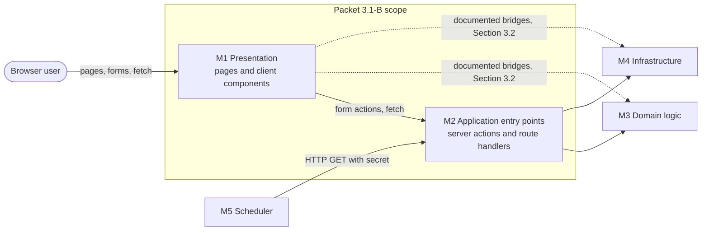

*Figure 3: Context of packet 3.1-B.*

###### 3.1.5.2.4 Variability Mechanisms

- `PYTHON_PATH` selects the Python executable for M2.5.
- `OLLAMA_*` variables select the models used by M2.4 to M2.6 (Appendix A.1).

###### 3.1.5.2.5 Architecture Background

Next.js guidance is to verify authentication and authorization inside every server action, because server actions are reachable by direct POST requests regardless of the page that renders the form. The code follows this guidance with `requireRole` and `getCurrentUser`.

Validation failures in server actions are silent (the action returns without a message). This keeps the actions simple but makes them hard to test from the interface and gives staff no feedback. Returning a result object and showing it with `useActionState` would address both problems.

###### 3.1.5.2.6 Related View Packets

- Parent: 3.1-A. Sibling: 3.1-C.
- In other views: the runtime packets 3.4-B to 3.4-E (behavior) and the layered view 3.2-A (bridges B-1 to B-3).

##### 3.1.5.3 View Packet 3.1-C: Domain Logic and Infrastructure

###### 3.1.5.3.1 Primary Presentation

The leaf modules of M3 and M4 are shown in Figure 2. Table 22 gives their responsibilities and properties.

*Table 22: Leaf modules of M3 and M4.*

| Module | Responsibility | I/O performed | Automated tests | Requirements |
|--------|----------------|---------------|-----------------|--------------|
| M3.1 Order lifecycle and settlement | Expires listings whose window has ended; settles orders whose hold has expired or whose listing has expired or been withdrawn; computes refunds; releases stock; notifies students and staff of paid orders | Database (Prisma singleton) | None | REQ-FUNC-007, 010 AC9, 012, 017 |
| M3.2 Automatic pricing policy | Reviews opted-in listings at most every 10 minutes and applies a 5-point markdown when the rules fire, up to 80% (Appendix A.2); stores a plain-language reason | Database (Prisma singleton) | None | REQ-FUNC-026 |
| M3.3 Rescue routing rules | Pure functions: candidate filtering by safety, allergens, capacity, and handoff time; priority ordering; fallback selection; approval rule; helpers that turn a listing into routing input | None (type-only imports) | 15 cases, all passing | REQ-FUNC-024 |
| M3.4 Rescue dispatch store | Loads active destinations with capacity reduced by the kilograms committed in the last 24 h; resolves dispatch–listing links through `ListingEvent`; event-type names | Database (client passed as a parameter) | None | REQ-FUNC-024 |
| M3.5 Impact estimator | Pure calculation of per-order impact metrics, each with a basis (MEASURED, ESTIMATED, UNAVAILABLE) and notes; emission-factor lookup by category and date; aggregation by dining hall with deduplication and coverage | None | 9 cases, all passing | REQ-FUNC-025 |
| M3.6 Impact sync and reporting | Turns countable orders into `ImpactRecord` rows (upsert keyed by order and method version; removes rows whose order no longer counts); builds aggregate reports | Database (client passed as a parameter) | None | REQ-FUNC-025 |
| M3.7 Order notifications | Composes and stores the notifications sent when a reservation is paid, to the student and to the listing's creator | Database | None | REQ-FUNC-017 |
| M3.8 Assistant tools | Definitions of the four assistant tools, and their execution with the caller's identity | Database (reads; runs settlement first) | None | REQ-FUNC-019 |
| M4.1 Session and access control | Creates, resolves, and deletes database-backed sessions; route guards | Database, cookies | None | REQ-FUNC-001, 003, 004 |
| M4.2 Password hashing | scrypt hashing and timing-safe verification | CPU only | None | CON-3 |
| M4.3 Data access | Single Prisma client per process, using the PostgreSQL driver adapter; generated, typed model API | Database | n/a | All |
| M4.4 Ollama chat client | Non-streaming calls to the chat API; tool-calling loop of at most 5 rounds; maps errors to "unavailable" messages | HTTP to Ollama | None | REQ-FUNC-019 |
| M4.5 Meal image classifier | Command-line script: validates the catalog and image, resizes the image to at most 1024 × 1024 JPEG, asks the vision model for a catalog ID under a JSON schema, and checks the ID against the catalog | Files, HTTP to Ollama | None | REQ-FUNC-020 |

###### 3.1.5.3.2 Element Catalog

**Elements.** See Table 22.

**Relations.**

- M3.6 uses M3.5; M3.8 uses M3.1; M3.4 uses the types of M3.3.
- Every database-bound module uses M4.3.
- M4.1 uses M4.3.
- The uses relation among library modules has no cycles.

**Interfaces.** The table below lists the exported interface of each library module.

*Table 23: Exported interfaces of the library modules.*

| Module | Exported element | Contract |
|--------|------------------|----------|
| M3.1 | `settleUnavailableOrders(now = new Date()): Promise<void>` | Idempotent and safe to run concurrently. (1) Listings that are ACTIVE or SOLD_OUT and whose window has ended become EXPIRED. (2) A PENDING_PAYMENT order older than 10 minutes becomes EXPIRED, and its unit returns to stock (a SOLD_OUT listing becomes ACTIVE). (3) An open order on an expired listing becomes EXPIRED, and on a withdrawn listing becomes CANCELLED. A paid order also gets `refundAmountCents` (meal price plus both fees) and `refundedAt`. (4) For paid orders only, the student and the hall's staff are notified after the transition succeeds |
| M3.2 | `adjustAutomaticListingPrices(now = new Date()): Promise<{ reviewed, adjusted }>`; `AUTO_PRICING_MAX_DISCOUNT_RATE = 80` | Reviews ACTIVE, opted-in listings that have stock, whose window has not ended, and whose last review is at least 10 minutes old. Writes with compare-and-set on `discountRate`, `priceCents`, and `lastAutoPriceReviewAt`. Never raises a price |
| M3.3 | `evaluateRescueRoute(input): RescueRouteRecommendation` | Pure and deterministic. Returns `RECOMMENDED` (the highest-priority eligible destination, plus the other candidates and the fallback) or `NO_FEASIBLE_DESTINATION` (fallback only), together with `requiresApproval`, `estimatedKg`, `minutesUntilDeadline`, `reason`, and `explanation` |
| M3.3 | `buildRescueRouteInput(listing, destinations, now)`, `rescuableUnits(listing, now)`, `isRescueCandidate(listing, now)`, `isListingOpen(listing, now)`; constants `DEFAULT_UNIT_WEIGHT_KG`, `SAFE_HOLDING_MINUTES`, `RESCUE_LOOKBACK_HOURS`, `APPROVAL_KG_THRESHOLD` | Turn a listing (with food and orders) into routing input. Open listings route only unclaimed units; closed listings route every unit not picked up, for up to 6 hours after the window ends. Handoff deadline = window end + 120 minutes. Allergen-flagged food is not safe for external donation |
| M3.4 | `loadRescueDestinations(db, now)`, `getDispatchesForListings(db, listingIds)`, `hasOpenRescueDispatch(db, listingId)`, `getDispatchLink(db, dispatchId)`; `RESCUE_EVENT`; type `RescueCreatedMetadata` | `db` is either the client or a transaction client, so the functions can run inside the caller's transaction. Remaining capacity = configured capacity − kilograms of PLANNED and DISPATCHED dispatches in the last 24 h |
| M3.5 | `class ImpactEstimator(factors, { allowFallback?, fallbackCategory? })` with `estimateOrder(input)`, `estimateOrders(inputs)` (returns `{ impacts, duplicates }`), and `lookupFactor(category, at)`; `aggregateImpacts(items, groupBy)`; `isCountableOrder(order)`; `METHOD_VERSION = "impact-v1.0"` | Only PICKED_UP, non-refunded orders count. Meals are MEASURED; weight and environmental metrics are ESTIMATED or UNAVAILABLE, never silently 0. Savings = (original − paid) × quantity, never negative, excluding fees. Each order is counted at most once |
| M3.6 | `syncImpactRecords(prisma, { from?, to?, allowFallback? })` (returns `{ upserted, removed }`); `getImpactReport(prisma, { from?, to?, diningHallId? })` (returns `{ methodVersion, aggregates }`) | Idempotent upsert in chunks of 50; deletes records whose order stopped counting. The report always contains an `ALL` group |
| M3.7 | `sendOrderPlacedNotifications(orderId)` | Creates the student confirmation notification, and a staff notification containing the pickup code if the listing has a creator |
| M3.8 | `chatTools: ToolDefinition[]` (`get_current_time`, `list_dining_halls`, `get_available_listings { dining_hall?, exclude_allergens? }`, `get_my_orders`); `executeChatTool(name, args, user): Promise<string>` | Results are compact JSON strings (at most 12 listings and 8 orders). Unknown allergen names return an error rather than being ignored. Pickup codes are returned only for the caller's RESERVED orders |
| M4.1 | `createSession(userId)`, `getCurrentUser(): User or null`, `requireRole("STUDENT" or "SUPERVISOR"): User`, `signOutCurrentUser()` | `requireRole` redirects unauthenticated callers to `/login` and callers with the wrong role to their own workspace, so it returns only an authorized user. Expired sessions are deleted when they are encountered |
| M4.2 | `hashPassword(pw)` (returns `"scrypt$salt$key"`); `verifyPassword(pw, stored): boolean` | Values that are not scrypt hashes are rejected |
| M4.3 | Default export `prisma` (a `PrismaClient`) | One instance per process. In development it is cached on `globalThis` to survive hot reloads. Connects with `DATABASE_URL` |
| M4.4 | `runChatWithTools(messages, tools, executeTool): Promise<string>`; types `ChatMessage`, `ToolCall`, `ToolDefinition` | At most 5 tool rounds. Tool errors are returned to the model as text. Raises "Cannot reach Ollama" or "Ollama returned …" errors, which the caller maps to HTTP 503 |
| M4.5 | `python3 classify_meal.py IMAGE --catalog CATALOG.json [--max-bytes N] [--id-only]` | With `--id-only`, prints the matching catalog ID, or nothing when uncertain, and exits with 0. Exits with 1 on failure and 2 on invalid arguments |

**Behavior.** See Section 3.4 for runtime behavior and Appendix A.2 for rule parameters.

**Constraints.**

- M3.3 and M3.5 must remain pure, so that their rules can be unit-tested and reused by previews.
- Every write in M3.1, M3.2, and M3.4 must be a conditional update or run under a row lock (Section 3.4.5.2).
- M3.8 tools must expose only data the caller may see. Their only write is the idempotent settlement call, which is system maintenance rather than a change requested by the user.

###### 3.1.5.3.3 Context Diagram

M3 and M4 are used by M1 (through bridges) and M2. M4 is the only part of the system that talks to PostgreSQL, Ollama, and the Python runtime, except for the inline Ollama call in M2.6 (D-14). See Figure 4.

###### 3.1.5.3.4 Variability Mechanisms

- Emission factors are versioned by `validFrom`; the factor valid at pickup time is used.
- `allowFallback` is off by default.
- Rescue destinations are data-driven.
- All thresholds are named constants (Appendix A.2).

###### 3.1.5.3.5 Architecture Background

The database-bound modules handle the client in two ways. M3.4 and M3.6 receive it as a parameter (dependency injection), so they can join the caller's transaction and be tested with a substitute client. M3.1, M3.2, M3.7, and M3.8 import the shared singleton instead. Adopting the parameter style everywhere would let settlement and pricing run inside a caller's transaction and be tested without a live database.

###### 3.1.5.3.6 Related View Packets

- Parent: 3.1-A. Sibling: 3.1-B.
- In other views: the layered view 3.2-A (layers L3 and L4) and the data model packets 3.3-A to 3.3-C (entities written by these modules).

### 3.2 Layered View

#### 3.2.1 View Description

This view conforms to the Layered viewpoint (Section 1.5.2). It assigns every module of M1 to M4 (Section 3.1) to one of four layers, states the allowed-to-use rules, and lists every place where the code uses a layer that the rules do not allow, together with its justification.

#### 3.2.2 View Packet Overview

The view consists of a single packet, 3.2-A, covering the whole system. The system is small enough for one layer diagram to stay readable.

#### 3.2.3 Architecture Background

SRS §3.5 requires "a layered architecture with clear separation between user interface, service logic, and persistence". The App Router shapes the top two layers: pages and components, then server actions and route handlers. The functional-core approach (AA-4) shapes the domain layer.

The layering is deliberately *relaxed*: each layer below the presentation layer may use any layer beneath it. Presentation code is expected to reach the rest of the system only through the application layer. Where it does not, the use is a documented bridge.

#### 3.2.4 Variability Mechanisms

None.

#### 3.2.5 View Packets

##### 3.2.5.1 View Packet 3.2-A: Layers of SecondHelping

###### 3.2.5.1.1 Primary Presentation

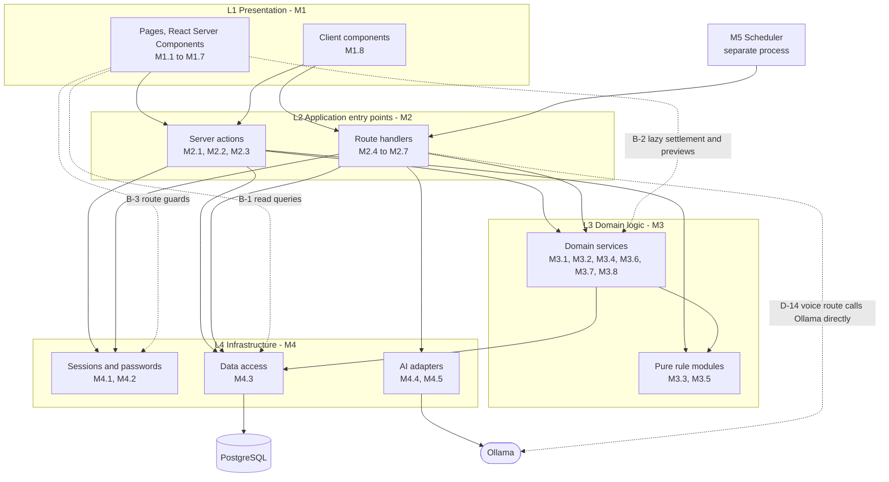

*Figure 4: Layer diagram. Solid arrows are allowed uses; dashed arrows are documented bridges or deviations.*

###### 3.2.5.1.2 Element Catalog

**Elements.**

*Table 24: Layers.*

| Layer | Modules | Responsibility | Allowed to use |
|-------|---------|----------------|----------------|
| L1 Presentation | M1.1 to M1.8 | Render data and collect user input | L1 and L2 only; any other use must be a documented bridge |
| L2 Application entry points | M2.1 to M2.7 | Authenticate and authorize; validate input; orchestrate domain logic; revalidate pages | L3, L4 |
| L3 Domain logic | M3.1 to M3.8 | Business rules and the services that apply them | L3 (no cycles), L4 |
| L4 Infrastructure | M4.1 to M4.5 | Sessions, passwords, database client, AI adapters | External libraries and services only |
| Outside the layers | M5 (scheduler process); M6 and M7 (build-time) | M5 triggers L2 over HTTP; M6 defines the data model consumed by L4; M7 builds and checks | M5 may use L2 only, through its HTTP interface |

**Relations.** The table below lists, for each module, the modules it actually uses, based on the import statements and HTTP calls at commit `9bf5f5b`.

*Table 25: Observed uses, by module.*

| Using module | Uses (allowed) | Uses (bridge or deviation) |
|--------------|----------------|----------------------------|
| M1.1 Overview | M1.7 | M4.3 (B-1), M4.1 (B-3), M3.1 and M3.6 (B-2) |
| M1.2 Authentication pages | M2.2 | M4.1 (B-3) |
| M1.3 Student marketplace | M2.1, M1.7, M1.8 | M4.3 (B-1), M4.1 (B-3), M3.1 (B-2) |
| M1.4 Payment page | M2.1, M1.7, M1.8 | M4.3 (B-1), M4.1 (B-3), M3.1 (B-2) |
| M1.5 Staff dashboard | M2.1, M1.7, M1.8 | M4.3 (B-1), M4.1 (B-3), M3.1, M3.2 (constant only), M3.3, M3.4 (B-2) |
| M1.6 Impact report | M1.7 | M4.3 (B-1), M4.1 (B-3), M3.1 (B-2) |
| M1.7 Dashboard shell | M2.2 (`logout`), M1.8 | M4.3 (B-1, dining-hall name) |
| M1.8 Client components | M2.3 (RPC), M2.4, M2.5, M2.6 (HTTP) | None |
| M2.1 Marketplace actions | M3.1, M3.3, M3.4, M3.7, M4.1, M4.3 | None |
| M2.2 Authentication actions | M4.1, M4.2, M4.3 | None |
| M2.3 Notification actions | M4.1, M4.3 | None |
| M2.4 Assistant API | M3.8, M4.1, M4.3, M4.4 | None |
| M2.5 Image-matching API | M4.1, M4.3, M4.5 (child process) | None |
| M2.6 Voice-listing API | M4.1, M4.3 | Ollama directly, bypassing L4 (D-14) |
| M2.7 Scheduler API | M3.1, M3.2, M4.3 | None |
| M3.1, M3.2, M3.7 | M4.3 | None |
| M3.3 | Generated types only | None |
| M3.4 | M3.3 (types), M4.3 (types; client passed in) | None |
| M3.5 | Nothing | None |
| M3.6 | M3.5, M4.3 (types; client passed in) | None |
| M3.8 | M3.1, M4.3, M4.4 (types only) | None |
| M4.1 | M4.3; Next.js `cookies` and `redirect` | None |
| M4.2, M4.3, M4.4, M4.5 | External libraries and services | None |
| M5 Scheduler | M2.7 (HTTP) | None |

*Table 26: Documented layer bridges.*

| Bridge | From and to | Where | Justification |
|--------|-------------|-------|---------------|
| B-1 | L1 to L4 (data access) | Read queries in every page and in the dashboard shell | React Server Components are designed to fetch their own data. A pass-through query layer would add code without adding rules, and reads have no side effects (except B-2) |
| B-2 | L1 to L3 (domain services and pure rules) | Pages call `settleUnavailableOrders()` (lazy settlement, AA-6) and `getImpactReport()`. The staff dashboard calls the same pure routing functions as the action, so the preview equals the result, and reads the pricing cap constant | Correctness (no stale states) and a single source of truth for rules. **Consequence:** page renders perform writes |
| B-3 | L1 to L4 (sessions) | Pages call `requireRole()` or `getCurrentUser()` before rendering | Defense in depth: pages enforce the same rule as the actions they host |

**Interfaces.**

- The L2 interface is given in Tables 20 and 21.
- The interfaces of L3 and L4 are given in Table 23.

**Behavior.** Not applicable. Layers are a static structure.

**Constraints.**

- **LC-1.** No upward use: no module in L2 to L4 imports from L1, and no module in L3 or L4 imports from L2. The generated Prisma client is physically located under `app/` but logically belongs to L4 (M4.3), so `lib/` may import it.
- **LC-2.** The pure modules M3.3 and M3.5 import nothing but type definitions.
- **LC-3.** State changes requested by users enter only through L2. The only other writes are the idempotent settlement calls of bridge B-2.
- **LC-4.** Client components (M1.8) reach the server only through L2, by server-action RPC or `fetch`. They never import L3 or L4, because that would ship server code to the browser.
- **LC-5.** All access to Ollama goes through an L4 adapter. Module M2.6 currently violates this rule (D-14).

These rules can be checked mechanically. An ESLint `no-restricted-imports` rule (for example, forbidding `@/lib/prisma` in `lib/rescue-routing.ts` and `lib/estimator.ts`, and `@/app/*` in `lib/`) would enforce LC-1 and LC-2 in CI.

###### 3.2.5.1.3 Context Diagram

The environment of the layers (the browser, the scheduler process, PostgreSQL, and Ollama) is shown in Figure 4 and, at runtime, in Figure 12.

###### 3.2.5.1.4 Variability Mechanisms

None.

###### 3.2.5.1.5 Architecture Background

The main risk of relaxed layering is that business logic creeps into pages. It has started to happen in reporting: the term metrics are computed in M1.5, the seven-day impact figures and the 0.8 kg CO₂ heuristic in M1.6, and the sales statistics in M1.1. As a result, two pages compute CO₂ differently (D-6). Moving these calculations into an L3 reporting module, next to M3.6, would give one definition per metric and make the metrics testable.

###### 3.2.5.1.6 Related View Packets

- In the decomposition view: 3.1-A, 3.1-B, and 3.1-C (the modules in each layer).
- In the runtime view: 3.4-A (where each layer executes).
- The layer-to-component mapping is in Section 4.2.

### 3.3 Data Model View

#### 3.3.1 View Description

This view conforms to the Data Model viewpoint (Section 1.5.3). It describes the 22 persistent entities and 10 enumerations defined in `prisma/schema.prisma`, which is the authoritative definition: their attributes, associations, integrity rules, lifecycles, and runtime status. Every entity is stored as a PostgreSQL table with a string identifier generated as a cuid.

#### 3.3.2 View Packet Overview

This view has been divided into the following view packets for convenience of presentation:

*Table 27: View packets of the Data Model view.*

| Packet | Entities | Runtime status |
|--------|----------|----------------|
| 3.3-A Core marketplace | `DiningHall`, `User`, `AuthSession`, `Food`, `Listing`, `Order`, `Notification` (7) | In use |
| 3.3-B Rescue routing and audit | `RescueDestination`, `RescueDispatch`, `ListingEvent` (3) | In use (no migration; D-1) |
| 3.3-C Impact measurement | `EmissionFactor`, `ImpactRecord` (2) | In use (written only by the seed; D-5) |
| 3.3-D Forward-provisioned entities | `ListingDraft`, `MediaAsset`, `PricingPolicy`, `PriceChange`, `ModelVersion`, `DailyProduction`, `WeatherObservation`, `CampaignEvent`, `SurplusForecast`, `SimulationScenario` (10) | Seeded only; no runtime reader or writer (no migration; D-1) |

The set is complete: 7 + 3 + 2 + 10 = 22 entities, the whole schema. It is non-duplicative: each entity's attributes are detailed in exactly one packet, and the other packets show it only as context.

#### 3.3.3 Architecture Background

- **Relational model.** The data is relational because the domain is transactional: inventory, orders, payments, and refunds require foreign keys, unique constraints, and transactions.
- **Food catalog.** Food descriptions and allergens were moved from `Listing` into a shared `Food` catalog (migration `add_food_model`, 2026-10-17), so that allergen data is the same in every dining hall (REQ-FUNC-008 AC4). This catalog is also what the image and voice assistants match against.
- **Deliberate denormalization.** `Order` copies the price and pickup-window fields of its listing (AA-12).
- **PostgreSQL enumerations and arrays.** Statuses and categories are PostgreSQL enums. `Food.allergens` is an enum array, filtered with the `hasSome` and `isEmpty` operators.
- **JSON columns.** JSON is used only where the structure varies by record: the metadata of `ListingEvent`, the inputs and outputs of `SimulationScenario`, and the per-metric notes of `ImpactRecord`.
- **Role name.** The staff role is stored as `SUPERVISOR` for historical reasons; the documentation calls it *Staff Member* (SRS §1.3).

#### 3.3.4 Variability Mechanisms

Some behavior is configured through data rather than code:

- `RescueDestination` records (type, daily capacity, active flag) configure rescue routing.
- `EmissionFactor` records (one per category, versioned by `validFrom`) configure the impact estimate.
- `Food.category` and `Food.unitWeightKg` decide whether weight and environmental metrics can be estimated for a food.

Separately, `ImpactRecord.methodVersion` lets a new calculation method be introduced without overwriting the records produced by an earlier one, because each record is unique for its pair of order and method version.

#### 3.3.5 View Packets

##### 3.3.5.1 View Packet 3.3-A: Core Marketplace

###### 3.3.5.1.1 Primary Presentation

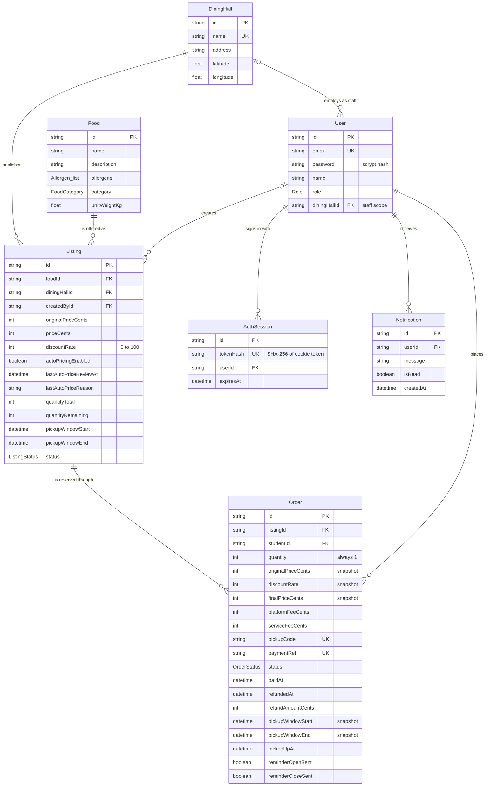

*Figure 5: Core marketplace data model (timestamps `createdAt` and `updatedAt` omitted except where they carry meaning).*

###### 3.3.5.1.2 Element Catalog

**Elements.**

*Table 28: Core marketplace entities.*

| Entity | Purpose | Written by | Read by |
|--------|---------|------------|---------|
| `DiningHall` | A campus food-service location; the scope of its staff members, listings, and reports | M6 seed only (there is no administration interface) | M1, M2.1, M2.4, M3.1, M3.8 |
| `User` | An account with a role (`STUDENT` or `SUPERVISOR`) and, for staff, an assigned dining hall | M2.2 (signup), M6 (seed, password migration) | M4.1, M1, M2, M3.1 |
| `AuthSession` | A server-side login session: the hash of the token and its expiry | M4.1 | M4.1 |
| `Food` | A catalog entry: name, description, allergens, category, and portion weight | M6 seed only | M1, M2.1, M2.5, M2.6, M3.1, M3.6, M3.8 |
| `Listing` | A closing-bag offer: food, prices, discount, quantity, pickup window, status, automatic-pricing state | M2.1, M3.1, M3.2 | M1, M2, M3 |
| `Order` | The reservation of one unit, with a price snapshot, payment, refund, pickup, and reminder state | M2.1, M3.1, M2.7 | M1, M2, M3.1, M3.2, M3.6, M3.7, M3.8 |
| `Notification` | An in-app message to one user, with a read flag | M2.1, M3.1, M3.7, M2.7 | M2.3 |

Enumerations used by this packet:

- `Role`: STUDENT, SUPERVISOR.
- `ListingStatus`: ACTIVE, SOLD_OUT, EXPIRED, WITHDRAWN.
- `OrderStatus`: PENDING_PAYMENT, RESERVED, PICKED_UP, CANCELLED, EXPIRED.
- `Allergen`: GLUTEN, MILK, EGGS, FISH, SHELLFISH, TREE_NUTS, PEANUTS, WHEAT, SOY, SESAME.
- `FoodCategory`: COOKED_MEAT, COOKED_VEGETARIAN, FRESH_PRODUCE, BAKERY_DELI, DAIRY_BASED, MIXED_FOOD.

**Relations.** The associations are those of Figure 5. When a record is deleted, the database applies the following rules:

- Deleting a `User` deletes their `AuthSession` and `Notification` rows (cascade). Their listings keep existing with `createdById` set to null.
- Deleting a `DiningHall` sets the `diningHallId` of its staff to null.
- `Order` restricts the deletion of its `Listing` and of its student.

Indexes support the main access paths:

- `Listing(diningHallId, status, pickupWindowStart)`;
- `Order(studentId, createdAt)`, `Order(listingId, status)`, and `Order(pickupWindowEnd, status)`;
- `Notification(userId, createdAt)`;
- `AuthSession(userId)` and `AuthSession(expiresAt)`.

**Interfaces.** Modules access the data only through the typed client that Prisma generates from the schema (M4.3). The only hand-written SQL is the row lock `SELECT "id" FROM "Listing" WHERE "id" = … FOR UPDATE`, issued by `claimListing` and `recommendRescueRoute`.

**Behavior.** Listings and orders follow the state machines below.

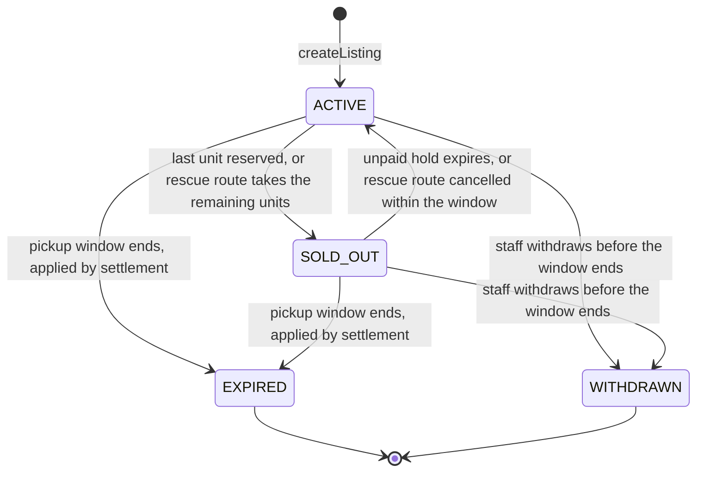

*Figure 6: Listing lifecycle.*

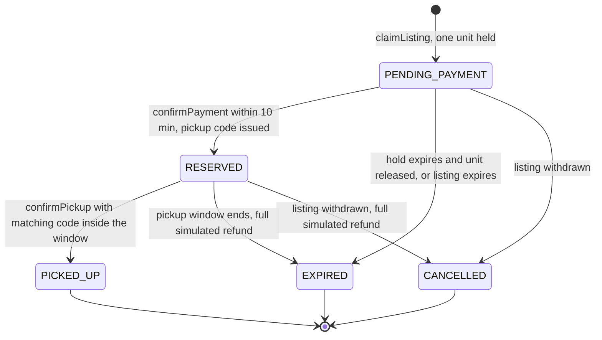

*Figure 7: Order lifecycle (consistent with the diagram in SRS §3.3.3).*

**Constraints.** The following invariants must hold after every transaction. Each states which part of the system enforces it.

*Table 29: Core marketplace invariants.*

| ID | Invariant | Enforced by |
|----|-----------|-------------|
| I-1 | 0 ≤ `quantityRemaining` ≤ `quantityTotal` | Application: conditional decrement (`quantityRemaining ≥ 1`); increments happen only when a hold expires or a rescue route is cancelled |
| I-2 | `priceCents` = round(`originalPriceCents` × (100 − `discountRate`) / 100) | Application: M2.1 `createListing` and M3.2 |
| I-3 | `pickupWindowStart` < `pickupWindowEnd`, and the start is in the future when the listing is created | Application: M2.1 |
| I-4 | No two ACTIVE listings of the same food in the same dining hall with windows that have not ended | Application, checked at creation without a lock or database constraint. Two simultaneous submissions could both pass; the risk is accepted as low |
| I-5 | Every order is for exactly one unit, and a student has at most two open orders (PENDING_PAYMENT or RESERVED) per listing | Application, under the listing's row lock in `claimListing` |
| I-6 | `pickupCode` is unique and is assigned exactly when payment is confirmed; an order that was never paid has none | Database (unique) and application (`confirmPayment`) |
| I-7 | `paymentRef` is unique, in the format `wx_<UUID>` | Database (unique) and application |
| I-8 | `refundedAt` is set only on paid orders that later expired or were cancelled; their `refundAmountCents` = `finalPriceCents` × `quantity` + `platformFeeCents` + `serviceFeeCents`. Unpaid orders that are settled get `refundAmountCents` = 0 | Application: M3.1 |
| I-9 | An order's price fields never change after it is created | Application: no code path updates them |
| I-10 | `User.email` is unique and stored in lowercase; `User.password` always begins with `scrypt$` | Database (unique) and application (M2.2; `migrate-passwords` for legacy data) |
| I-11 | A staff member acts only within their `diningHallId`; a staff member with no dining hall cannot act | Application: every staff action filters by dining hall and returns early when it is null |
| I-12 | `AuthSession.tokenHash` is unique; raw tokens are never stored | Database (unique) and application (M4.1) |

**Personal data.** The table below classifies the personal data stored, for PIPL review (SRS §3.4).

*Table 30: Personal data stored.*

| Entity | Personal data | Purpose | Retention at this baseline |
|--------|---------------|---------|----------------------------|
| `User` | Name, e-mail, password hash, role, assigned dining hall | Display, login and contact, authorization, staff scope | Indefinite; account deletion not implemented |
| `AuthSession` | Token hash, expiry | Authentication | Deleted at logout or when found expired (7-day lifetime) |
| `Order` | A student's reservations, prices paid, pickup codes, timestamps | Reservation and settlement | Indefinite (proposed: 1 year) |
| `Notification` | Messages that may contain food names and pickup codes | Service messages | Indefinite (proposed: 90 days) |

Chat messages, meal images, voice recordings, and transcripts are not persisted. Images and catalog files exist only in a temporary directory for the duration of one request.

###### 3.3.5.1.3 Context Diagram

`Listing` is also referenced by `ListingEvent` (packet 3.3-B) and by the forward-provisioned `PriceChange` and `MediaAsset` (packet 3.3-D). `Order` is referenced by `ImpactRecord` (packet 3.3-C). `DiningHall` is referenced by most entities in packets 3.3-B to 3.3-D.

###### 3.3.5.1.4 Variability Mechanisms

None beyond those described in Section 3.3.4.

###### 3.3.5.1.5 Architecture Background

Integrity rules that involve status, time, or quantity (I-1 to I-5, I-8, and I-11) are enforced by the application rather than by `CHECK` constraints or triggers, so that all rules live in tested TypeScript code next to the transitions that use them (AA-5).

A low-cost safety net would be database `CHECK` constraints for the purely structural rules: I-1, I-3, and a discount between 0 and 100.

###### 3.3.5.1.6 Related View Packets

- Siblings: 3.3-B, 3.3-C, 3.3-D.
- In the runtime view: 3.4-B (the transitions that change these entities).
- The access matrix is in Section 4.2.

##### 3.3.5.2 View Packet 3.3-B: Rescue Routing and Audit

###### 3.3.5.2.1 Primary Presentation

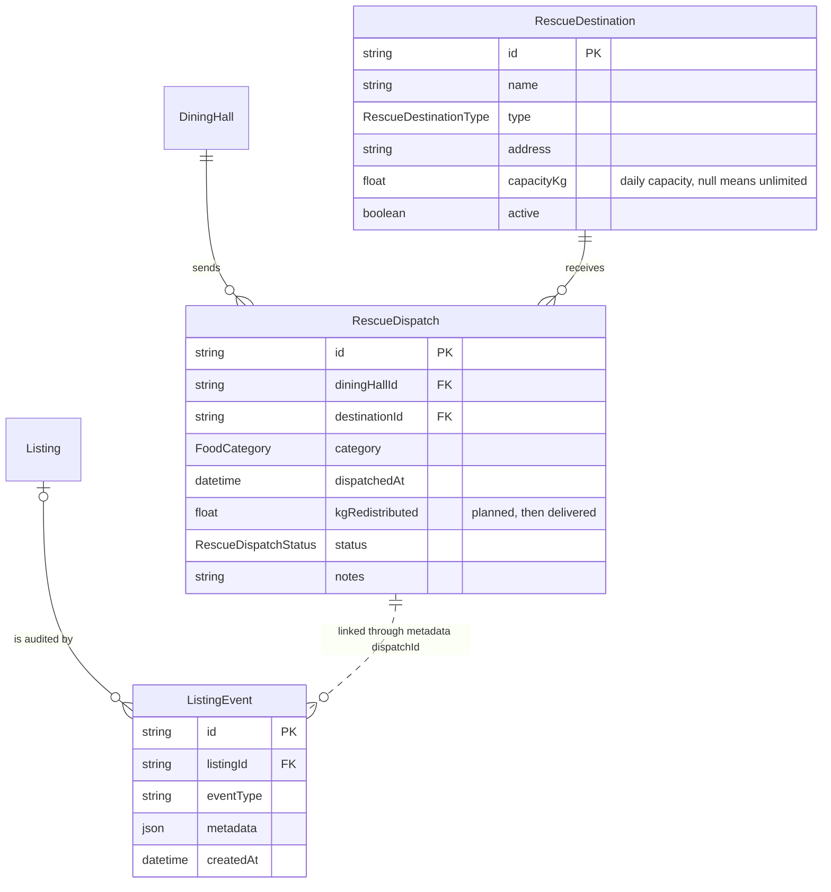

*Figure 8: Rescue routing and audit data model. The dotted line is a logical link held in JSON metadata, not a foreign key.*

###### 3.3.5.2.2 Element Catalog

**Elements.**

- **`RescueDestination`.** A configured recovery or disposal destination. Its type is one of PANTRY, SHELTER, STAFF_KITCHEN, COMPOST, or OTHER. It has an optional daily capacity in kilograms and an active flag.
- **`RescueDispatch`.** A batch of food routed from a dining hall to a destination. It records the weight (first estimated, then the delivered weight once known), the food category, notes, and its status.
- **`ListingEvent`.** An append-only audit record for a listing. Rescue routing writes the following event types:

*Table 31: Rescue-routing events and their metadata.*

| `eventType` | Written when | Metadata fields |
|-------------|--------------|-----------------|
| `RESCUE_ROUTE_CREATED` | A dispatch is created | `dispatchId`, `destinationId`, `destinationName`, `units`, `unitsWithdrawnFromSale`, `estimatedKg`, `dispatchStatus`, `recommendationStatus`, `usedFallback`, `requiresApproval`, `reason`, `explanation`, `candidateDestinationIds` |
| `RESCUE_ROUTE_NO_DESTINATION` | Neither a recommendation nor a fallback exists | `units`, `estimatedKg`, `reason`, `explanation`, `requestedBy` |
| `RESCUE_ROUTE_APPROVED` | A PLANNED dispatch is approved | `dispatchId`, `approvedBy` |
| `RESCUE_ROUTE_COMPLETED` | Delivery is confirmed | `dispatchId`, `deliveredKg`, `confirmedBy` |
| `RESCUE_ROUTE_CANCELLED` | A dispatch is rejected or cancelled | `dispatchId`, `previousStatus`, `unitsRestored`, `cancelledBy` |

**Relations.**

- A `RescueDispatch` has no listing column. Its link to the listing, and the number of units it took off sale, are recorded in the `RESCUE_ROUTE_CREATED` event and resolved through a JSON-path query (M3.4 `getDispatchLink`).
- Dispatches created by the seed have no such event, and therefore no listing link.

**Interfaces.** These entities are accessed through M3.4 (reads) and M2.1 (writes) only.

**Behavior.** Dispatches follow the state machine below.

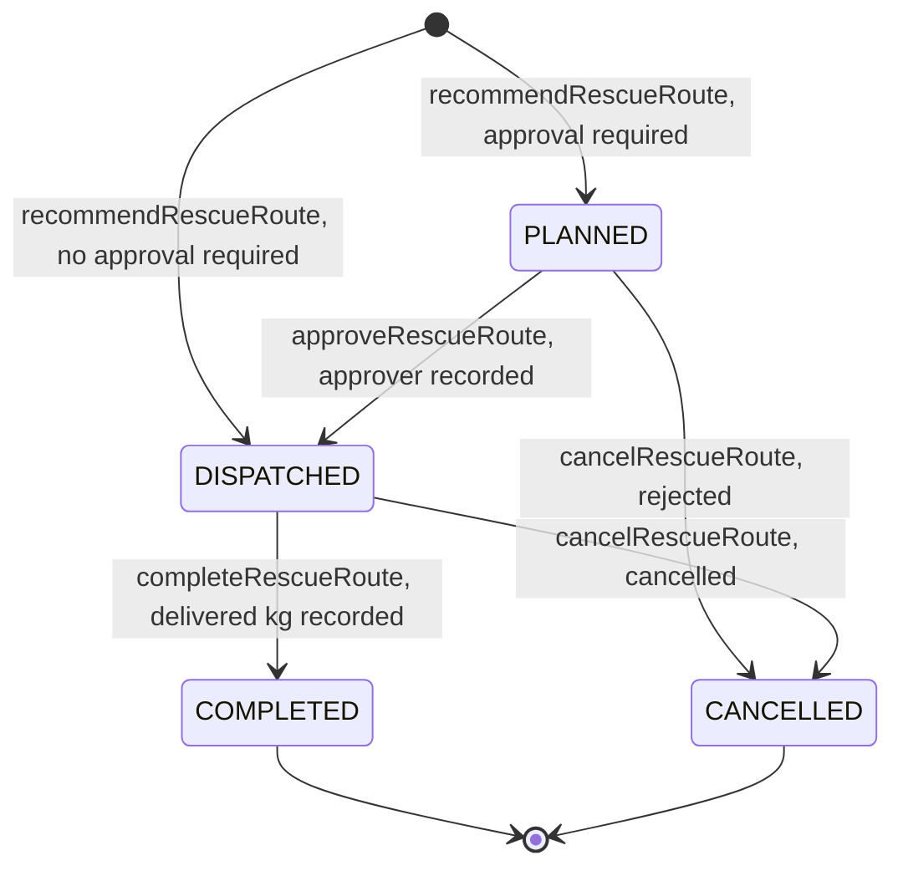

*Figure 9: Rescue dispatch lifecycle.*

**Constraints.**

- At most one *live* (non-cancelled) dispatch exists per listing. This is enforced by the application, under the listing's row lock, and is not a database constraint.
- A destination's capacity is accounted over a rolling 24-hour window, counting dispatches that are PLANNED or DISPATCHED.
- None of these three tables is created by the committed migrations (D-1).

###### 3.3.5.2.3 Context Diagram

`Listing` and `DiningHall` (packet 3.3-A) provide the context: a dispatch originates from a dining hall's listing.

###### 3.3.5.2.4 Variability Mechanisms

Destinations, their capacities, and their active flags are data. At this baseline they are maintained through the seed.

###### 3.3.5.2.5 Architecture Background

The event log was chosen over extra columns so that the full decision is preserved: the recommendation, the candidates, whether a fallback was used, the approval, and the delivery. Each step is a separate, immutable record, which is the auditability that REQ-FUNC-024 requires.

Using the log as the only link between a dispatch and its listing is a trade-off. If the link is ever queried frequently, adding a nullable `listingId` foreign key to `RescueDispatch` would remove the JSON-path lookup without losing the audit trail.

###### 3.3.5.2.6 Related View Packets

- Sibling: 3.3-A.
- In the runtime view: 3.4-E (the rescue routing workflow).

##### 3.3.5.3 View Packet 3.3-C: Impact Measurement

###### 3.3.5.3.1 Primary Presentation

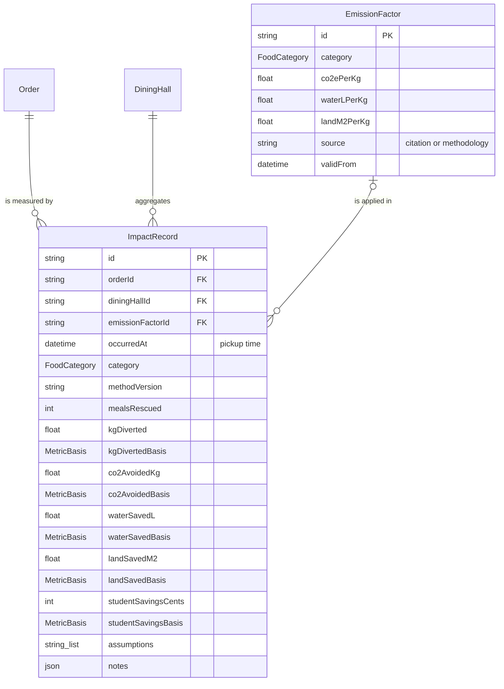

*Figure 10: Impact measurement data model.*

###### 3.3.5.3.2 Element Catalog

**Elements.**

- **`EmissionFactor`.** Gives the kg CO₂e, litres of water, and m² of land saved per kilogram of food diverted, for one food category. Each factor names its source and the date from which it is valid. It is unique for each pair of category and `validFrom`.
- **`ImpactRecord`.** Holds the impact of one picked-up order under one calculation method. Every metric is stored together with its basis (MEASURED, ESTIMATED, or UNAVAILABLE). The record also lists the human-readable assumptions used and a note for each metric. It is unique for each pair of order and `methodVersion`.

**Relations.**

- Deleting an order deletes its impact records (cascade).
- Deleting an emission factor sets the reference to null.

**Interfaces.** These entities are accessed through M3.6 only. `syncImpactRecords` writes them and `getImpactReport` reads them.

**Behavior.** Impact records are *derived data*: they can always be recomputed from `Order`, `Listing`, `Food`, and `EmissionFactor`. The sync upserts a record for each countable order and deletes the records of orders that no longer count, for example after a refund. At this baseline it runs only from the seed (D-5).

**Constraints.**

- Only orders that are PICKED_UP and were never refunded are counted.
- `mealsRescued` is the only MEASURED metric.
- The emission factors in the seed are explicitly illustrative proxies. They must be replaced by factors from documented sources (for example WRAP, FAO, or EPA) before any figure is reported outside the project.

###### 3.3.5.3.3 Context Diagram

`Order` and `DiningHall` (packet 3.3-A) provide the context; the report is scoped by dining hall.

###### 3.3.5.3.4 Variability Mechanisms

- Emission factors are versioned by `validFrom`.
- `methodVersion` (currently `impact-v1.0`) separates the results of different calculation methods.
- The estimator's `allowFallback` option, which is off in the current sync, can substitute the generic MIXED_FOOD factor and record that assumption.

###### 3.3.5.3.5 Architecture Background

Derived records are persisted, rather than computed for each request, for two reasons. First, every figure keeps the assumptions and factor that produced it, so it can be audited. Second, introducing a new method does not silently rewrite historical figures. The cost of this choice is that records must be kept synchronized (D-5).

###### 3.3.5.3.6 Related View Packets

- Sibling: 3.3-A.
- In the decomposition view: 3.1-C (modules M3.5 and M3.6).

##### 3.3.5.4 View Packet 3.3-D: Forward-Provisioned Entities

###### 3.3.5.4.1 Primary Presentation

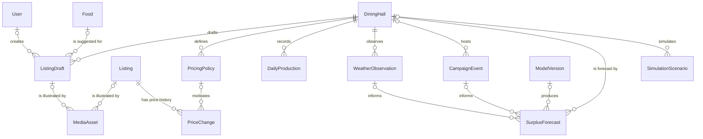

*Figure 11: Forward-provisioned entities and their associations (attributes omitted; see `prisma/schema.prisma`).*

###### 3.3.5.4.2 Element Catalog

**Elements.**

*Table 32: Forward-provisioned entities.*

| Entity | Key attributes | Intended capability |
|--------|----------------|---------------------|
| `ListingDraft` | Optional food, prices, quantity, window; status (DRAFT, PUBLISHED, ARCHIVED); notes | Expanded multimodal listing drafts (REQ-FUNC-020 extensions) |
| `MediaAsset` | Kind (IMAGE, AUDIO, VIDEO); URL; filename; listing or draft | Media attached to listings or drafts |
| `PricingPolicy` | Default, minimum, and maximum discount; `autoApply`; validity period | Configurable pricing policies for the dynamic pricing agent (REQ-FUNC-023) |
| `PriceChange` | Old and new price; reason; policy; time applied | Price history (would resolve D-13 for REQ-FUNC-026) |
| `ModelVersion` | Name, model family, version label, publication date | Tracking which forecasting model produced which output (REQ-FUNC-021) |
| `DailyProduction` | Prepared, sold, and leftover meals and kilograms per dining hall, day, and category (unique) | Training and evaluation data for surplus forecasting (REQ-FUNC-021) |
| `WeatherObservation` | Temperature, precipitation, humidity, condition, source | Contextual input to forecasting (REQ-FUNC-021) |
| `CampaignEvent` | Name, period, expected attendance, category | Campus events as forecasting input (REQ-FUNC-021) |
| `SurplusForecast` | Predicted surplus in meals and kilograms; confidence; model version; weather and event inputs | Output of the predictive surplus engine (REQ-FUNC-021) |
| `SimulationScenario` | Name, date, description, JSON inputs and outputs | Prep copilot and digital-twin scenarios (REQ-FUNC-022) |

None of these entities has a runtime reader or writer at this baseline; only the seed populates them.

**Relations.** As shown in Figure 11. Most associations are optional, so the planned modules can be introduced gradually.

**Interfaces.** None yet. Each entity will be accessed through the domain module that adopts it.

**Behavior.** None yet. `ListingDraft` declares a status lifecycle (DRAFT, PUBLISHED, ARCHIVED) that no code implements.

**Constraints.**

- No runtime feature may read or write these entities until a domain module owns them, and that ownership is documented in a revision of this SAD.
- None of these tables is created by the committed migrations (D-1).

###### 3.3.5.4.3 Context Diagram

They attach to `DiningHall`, `Listing`, `Food`, and `User` (packet 3.3-A), so that future modules extend the core model without changing it (QAS-9).

###### 3.3.5.4.4 Variability Mechanisms

None.

###### 3.3.5.4.5 Architecture Background

See AA-11. These tables let the seed create realistic analytics and forecasting demonstration data, and let the roadmap modules start from an agreed data shape. The risk is that the shapes are speculative. Each one should be reviewed when its module is designed, rather than treated as fixed.

###### 3.3.5.4.6 Related View Packets

- Sibling: 3.3-A.
- In the layered view: 3.2-A (future L3 modules).
- The requirements coverage is in Section 2.2.3.

### 3.4 Runtime Component-and-Connector View

#### 3.4.1 View Description

This view conforms to the Runtime Component-and-Connector viewpoint (Section 1.5.4). It shows the runtime structure: the components that execute and the connectors through which they interact. It also documents the interaction behavior that matters to other elements, namely the main sequences, the concurrency-control mechanism of every state transition, the guardrails of the AI integrations, and failure handling.

#### 3.4.2 View Packet Overview

This view has been divided into the following view packets for convenience of presentation:

*Table 33: View packets of the Runtime C&C view.*

| Packet | Content | Section |
|--------|---------|---------|
| 3.4-A Runtime topology | All components and connectors; trust boundary | 3.4.5.1 |
| 3.4-B Marketplace transactions | Reservation, payment, pickup, withdrawal, settlement; consistency mechanisms | 3.4.5.2 |
| 3.4-C Scheduled background processing | The scheduler tick: settlement, automatic pricing, reminders | 3.4.5.3 |
| 3.4-D Local AI services | Assistant, image matching, voice input; guardrails | 3.4.5.4 |
| 3.4-E Rescue routing workflow | Preview, plan or dispatch, approve, complete, cancel | 3.4.5.5 |

Packet A covers every component and connector. Packets B to E each describe the behavior of one group of interactions, and every connector instance in them appears in packet A, so the set is complete. Each interaction is described in exactly one packet, so it is non-duplicative.

#### 3.4.3 Architecture Background

The runtime structure combines four C&C styles:

1. **Client-server**, between the browser and the Next.js server.
2. **Call-return**, for server actions, which act as remote procedure calls.
3. **Shared data**, with PostgreSQL as the only integration point between requests, scheduler-triggered work, and pages. Components never call each other to exchange state; they read and write the database.
4. **Periodic trigger**, from the scheduler process.

There is no message broker and no push channel. Notifications are rows that the client reads when a page loads. The governing approaches are AA-2, AA-5, AA-6, AA-7, and AA-8.

#### 3.4.4 Variability Mechanisms

- **Ollama location and models.** `OLLAMA_BASE_URL` can point C5 at another host, for example a GPU server. `OLLAMA_MODEL`, `OLLAMA_VISION_MODEL`, and `OLLAMA_ASR_MODEL` select the models. Changing a model requires the AI acceptance evaluation to be re-run (SRS §3.6).
- **Python executable.** `PYTHON_PATH` selects the Python used for C6.
- **Scheduler authentication.** `CRON_SECRET` must have the same value for C2 and C3.
- **Production mode.** `NODE_ENV=production` makes the session cookie `Secure` and disables the development-time caching of the Prisma client.
- **Replication.** Running several instances of C2 is safe for every transaction (AA-5), but not yet for reminders (D-9). Running C3 on another host requires removing the hard-coded URL (D-11).

#### 3.4.5 View Packets

##### 3.4.5.1 View Packet 3.4-A: Runtime Topology

###### 3.4.5.1.1 Primary Presentation

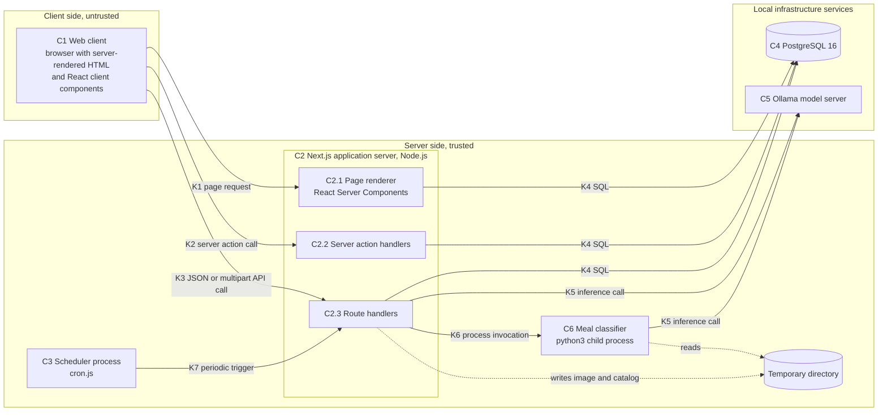

*Figure 12: Runtime components and connectors. Boxes are components, cylinders are data stores, and arrows point from the initiator of each connector.*

###### 3.4.5.1.2 Element Catalog

**Elements.** The tables below describe the components and the connectors.

*Table 34: Runtime components.*

| ID | Component | Technology | Responsibility | Lifetime and state |
|----|-----------|------------|----------------|--------------------|
| C1 | Web client | Browser running server-rendered HTML and React client components | Displays pages, submits forms, runs the client widgets, records audio and converts it to WAV | One per browser tab. Holds the session cookie and the open chat conversation |
| C2 | Next.js application server | Node.js process (`next dev` or `next start`) on port 3000 | Hosts C2.1 to C2.3; executes the server parts of M1, and M2, M3, M4.1 to M4.4 | Long-running. Keeps no state between requests other than the database connection pool |
| C2.1 | Page renderer | React Server Components | Renders pages from live data; runs lazy settlement | One execution per request |
| C2.2 | Server action handlers | Next.js Server Actions | Execute mutations; revalidate or redirect | One execution per request |
| C2.3 | Route handlers | Next.js Route Handlers | The assistant, image-matching, voice-listing, and scheduler endpoints | One execution per request |
| C3 | Scheduler | Node.js process (`node cron.js`), launched with C2 by `concurrently` | Sends the periodic trigger | Long-running; stateless |
| C4 | PostgreSQL | PostgreSQL 16 in a Docker container | Stores all persistent data; the shared integration point for all components | Long-running; all persistent state (Docker volume `postgres_data`) |
| C5 | Ollama | Local model server; HTTP port 11434 | Hosts the chat model (default `qwen2:7b`), the vision model (`qwen2.5vl:3b`), and the speech-recognition model (`frozenlab/qwen3-asr:0.6b`) | Long-running. Keeps models loaded in memory; the vision model is kept alive for 10 minutes after use |
| C6 | Meal classifier | Short-lived `python3` process, one per image request | Resizes the image, queries the vision model, prints the catalog ID | Lives for one request; stateless |

*Table 35: Runtime connectors.*

| ID | Connector | Protocol and data | Initiator and target | Interaction | Authentication | Timeout | Failure behavior |
|----|-----------|-------------------|----------------------|-------------|----------------|---------|------------------|
| K1 | Page request | HTTP GET; returns HTML and the React Server Components payload | C1 to C2.1 | Synchronous | Session cookie; optional on public pages | Browser default | Next.js error page |
| K2 | Server action call | HTTP POST with form data, identified by a framework action ID; the response revalidates pages or redirects | C1 to C2.2 | Synchronous | Session cookie, checked by each action | Browser default | The action returns without effect, or redirects (for example to `/login`) |
| K3 | API call | HTTP POST: JSON for chat, multipart for image and WAV uploads | C1 to C2.3 | Synchronous | Session cookie and role | None on the client side | A JSON `error` with an HTTP status; the interface shows the message |
| K4 | Database connection | PostgreSQL protocol over TCP 5432, through Prisma Client and a `node-postgres` pool; supports transactions and row locks | C2 to C4 | Synchronous | Credentials in `DATABASE_URL` | Driver defaults | The error propagates and the request fails |
| K5 | Inference call | HTTP POST to `/api/chat`, non-streaming JSON with tools, a format schema, or base64 images and audio | C2.3 and C6 to C5 | Synchronous | None (local service) | Chat: none (D-7). Voice: 120 s and 90 s. Image: 180 s | Mapped to HTTP 503 for the client |
| K6 | Process invocation | `execFile(python, [script, image, "--catalog", file, "--id-only"])`; standard output carries the ID; exit code; the child inherits the environment | C2.3 to C6 | Synchronous | Operating-system process | 180 s | Mapped to HTTP 503; the temporary directory is always removed |
| K7 | Periodic trigger | HTTP GET `/api/notifications` with the `x-cron-secret` header, every 60 s (`setInterval`) | C3 to C2.3 | Asynchronous with respect to users | Shared secret | None | Logs a warning and tries again on the next tick |

**Relations.** Connector roles are attached to component ports as listed in the "Initiator and target" column. Only C2 holds connections to C4. The Prisma command-line tools (M6) also connect to C4, but only during setup.

**Interfaces.** The externally visible ports are:

- C2: HTTP on port 3000 (pages, server actions, and `/api/*`; see Tables 20 and 21).
- C4: TCP on port 5432.
- C5: HTTP on port 11434, endpoint `/api/chat`.
- C6: its command-line arguments, standard output, exit code, and two temporary files.

**Behavior.**

- C2 handles each request on the Node.js event loop and keeps no request state in memory. All coordination between concurrent requests happens in C4 (AA-5).
- Notifications are *pulled*. The bell component loads the list when the page is mounted and does not poll, so a new notification appears after the next page load.

**Constraints.** These constraints define the trust boundary:

- Everything that comes from C1 is untrusted and is validated in C2.
- Output from C5 and C6 is also treated as untrusted and validated before use. Catalog IDs must belong to the catalog that was sent; numbers must be within range; dates must be in the future. Chat answers are only displayed and never acted upon.
- C3 authenticates to C2 with the shared secret.
- No component other than C2 accesses C4 at runtime.

###### 3.4.5.1.3 Context Diagram

See Figure 1. The users, the scheduler, and Ollama are the environment of the runtime system.

###### 3.4.5.1.4 Variability Mechanisms

See Section 3.4.4.

###### 3.4.5.1.5 Architecture Background

C6 runs as a separate process rather than inside C2 because the image matcher was first developed as a standalone Python experiment (commits `d33b6d5` and `6455f30`). Keeping it as a command-line tool preserved that work and isolates image decoding from the Node.js process.

The cost is a dependency on a Python runtime on the server, and a third Ollama client (D-14). If the Python script is ever retired, C2 could resize the image and call C5 directly, as the voice route does.

###### 3.4.5.1.6 Related View Packets

- Children: 3.4-B to 3.4-E.
- In the deployment view: 3.5-A (where each component runs).

##### 3.4.5.2 View Packet 3.4-B: Marketplace Transactions

###### 3.4.5.2.1 Primary Presentation

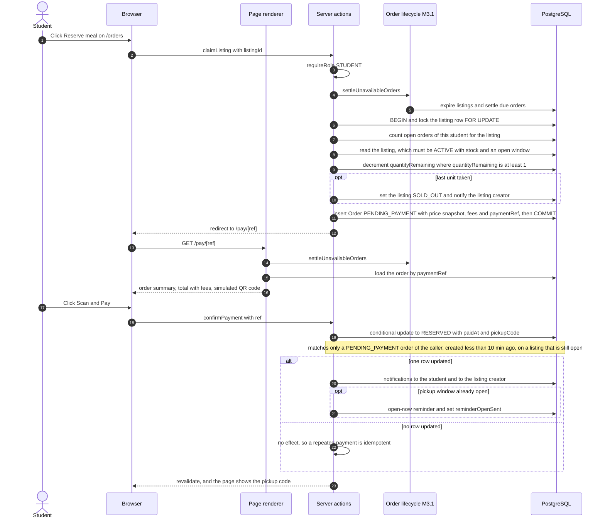

*Figure 13: Reservation and simulated payment.*

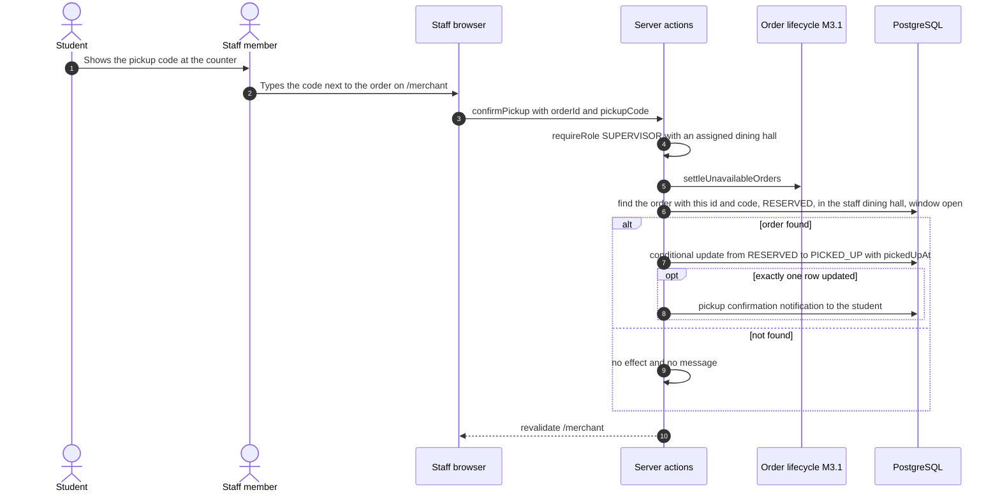

*Figure 14: Pickup confirmation.*

###### 3.4.5.2.2 Element Catalog

**Elements.** C1, C2.1, C2.2, and C4. The modules involved are M2.1, M3.1, M3.7, and M4.1.

**Relations.** As shown in Figures 13 and 14.

**Interfaces.** The server actions of Table 20.

**Behavior.**

*Withdrawal and settlement.*

- `withdrawListing` marks an ACTIVE or SOLD_OUT listing of the staff member's dining hall as WITHDRAWN, if its window has not ended, and then runs settlement.
- Settlement cancels the listing's open orders. Paid orders are refunded in full: meal price plus the platform fee and the service fee, ¥0.25 each.
- For each paid order, settlement notifies the student and every staff member of the dining hall. It sends these notifications only *after* the order's conditional transition has succeeded, so no notification is ever sent for a transition that did not happen.

*Notification delivery.* Except for the sold-out notice, which is written inside the reservation transaction, notifications are created after the transition has been committed. A crash between the two steps loses the notification but never duplicates the transition; delivery is therefore at-most-once.

*Consistency mechanisms.* The table below gives the concurrency-control mechanism of every state transition in the system, including the transitions of packets 3.4-C and 3.4-E.

*Table 36: Concurrency-control mechanism of every state transition.*

| Transition | Entry point | Mechanism | Guarantee |
|------------|-------------|-----------|-----------|
| Reserve one unit | M2.1 `claimListing` | Interactive transaction; `SELECT … FOR UPDATE` on the listing; conditional decrement (`quantityRemaining ≥ 1`, status ACTIVE) | No overbooking; the open-order limit is counted under the lock (QAS-1) |
| Confirm payment | M2.1 `confirmPayment` | A single conditional update: owner, PENDING_PAYMENT, created less than 10 minutes ago, listing still open | Exactly one transition; late payment rejected (QAS-2) |
| Confirm pickup | M2.1 `confirmPickup` | Conditional update: RESERVED, matching code, window open | At most one pickup and one notification |
| Withdraw listing | M2.1 `withdrawListing` | Conditional update: own dining hall, ACTIVE or SOLD_OUT, window open; then settlement | Listings that are expired or already withdrawn cannot be withdrawn |
| Expire listings | M3.1 | Conditional bulk update: ACTIVE or SOLD_OUT, window ended | Idempotent |
| Settle an order | M3.1 | One transaction per order; conditional update on the order's previous status (and on its creation time, for holds); stock released in the same transaction | Each order settled at most once; stock released exactly once (QAS-2) |
| Automatic markdown | M3.2 | Conditional update on `discountRate`, `priceCents`, and `lastAutoPriceReviewAt`, as well as status, stock, and window | No double markdown; a newer state is never overwritten (QAS-8) |
| Create rescue route | M2.1 `recommendRescueRoute` | Interactive transaction; `SELECT … FOR UPDATE` on the listing; open-dispatch check under the lock | At most one live dispatch per listing; no race with reservations |
| Approve, complete, or cancel a route | M2.1 | Transaction; conditional update on the dispatch's current status | Each transition applied once; units restored once |
| Write impact records | M3.6 | Upsert on the unique pair (`orderId`, `methodVersion`) | Running it again never double-counts |
| Send reminders | M2.7 | Check-then-act: read the flag, create the notification, set the flag | Not guaranteed when ticks overlap (D-9) |
| Create listing | M2.1 `createListing` | Check-then-insert: duplicate check without a lock | A duplicate active listing is possible if two forms are submitted simultaneously (I-4) |

**Constraints.**

- Every new state transition must use one of the mechanisms above and be added to Table 36.
- The payment hold is 10 minutes.
- Each order is for one unit, and a student may have at most two open orders per listing.
- The fees are ¥0.25 each.
- The pickup code consists of 10 characters drawn from a 30-character alphabet that excludes easily confused characters, formatted `XXXX-XXXX-XX`.

###### 3.4.5.2.3 Context Diagram

See Figure 12. This packet uses connectors K1, K2, and K4.

###### 3.4.5.2.4 Variability Mechanisms

The fee and hold constants (Appendix A.2).

###### 3.4.5.2.5 Architecture Background

See AA-5, AA-6, and AA-12. The row lock in `claimListing` is needed in addition to the conditional decrement because the open-order limit is a count over several rows. Without the lock, two concurrent reservations by the same student could both see one open order and both proceed.

###### 3.4.5.2.6 Related View Packets

- Parent: 3.4-A. Siblings: 3.4-C and 3.4-E, whose transitions appear in Table 36.
- In the data model view: 3.3-A (state machines and invariants).

##### 3.4.5.3 View Packet 3.4-C: Scheduled Background Processing

###### 3.4.5.3.1 Primary Presentation

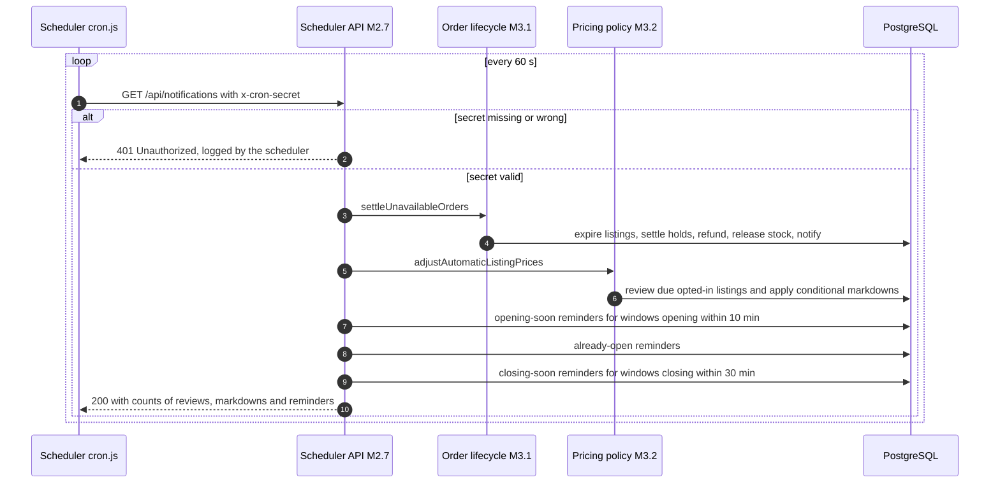

*Figure 15: One scheduler tick.*

###### 3.4.5.3.2 Element Catalog

**Elements.** C3, C2.3 (M2.7), M3.1, M3.2, and C4.

**Relations.** C3 is attached to C2.3 by connector K7.

**Interfaces.** `GET /api/notifications` (Table 21).

**Behavior.** The order of the steps in a tick matters.

1. **Settlement runs first.** As a result, the reminder sweeps never select an order that has just expired, and the pricing review never selects a listing whose window has just ended.
2. **Automatic pricing** reviews ACTIVE, opted-in listings that have stock, whose window has not ended, and whose last review is at least 10 minutes old. For each listing it computes:
   - the elapsed share of the period from publication to the end of the window;
   - paid sell-through, counting RESERVED and PICKED_UP orders;
   - the remaining inventory ratio;
   - recent paid demand, counting units paid for in the last 20 minutes. Demand is weak when fewer than max(1, ⌈20% of the quantity⌉) units were paid for.

   A 5-point markdown is applied, up to 80%, when either rule fires:
   - **Mid-window rule:** at least 40% of the period has elapsed, at least 40% of the stock remains, sell-through is below 60% of the elapsed share, and demand is weak.
   - **Late rule:** at most 15 minutes remain, at least 20% of the stock remains, sell-through is below 80%, and demand is weak.

   Every review stores a reason, whether or not the price changed.
3. **Reminders.** Three sweeps select RESERVED orders whose relevant flag is still false:
   - windows opening within the next 10 minutes;
   - windows that are already open, which receive the "open now" reminder;
   - windows closing within the next 30 minutes.

   Each sweep creates the notification and then sets the flag.

**Constraints.**

- The interval is a fixed 60 seconds (`setInterval`), and ticks are not serialized.
- The first tick fires 60 seconds after the scheduler starts.
- The server must be reachable at `http://localhost:3000` (D-11).
- While the development server is compiling, ticks fail and are logged as warnings. This is harmless, because the next tick repeats the work.

###### 3.4.5.3.3 Context Diagram

See Figure 12. This packet uses connectors K7 and K4.

###### 3.4.5.3.4 Variability Mechanisms

- `CRON_SECRET`.
- The interval, which is a constant in `cron.js`.
- The pricing and reminder thresholds (Appendix A.2).

###### 3.4.5.3.5 Architecture Background

See AA-6 and AA-7. A one-minute tick, plus up to one minute of processing, keeps due work within the 2-minute target of REQ-NFR-04 while the scheduler runs. When it does not run, lazy settlement preserves correctness but not timeliness, and reminders and markdowns stop.

###### 3.4.5.3.6 Related View Packets

- Parent: 3.4-A. Sibling: 3.4-B, which contains the consistency table.
- In the deployment view: 3.5-A (co-location of C3 and C2).

##### 3.4.5.4 View Packet 3.4-D: Local AI Services

###### 3.4.5.4.1 Primary Presentation

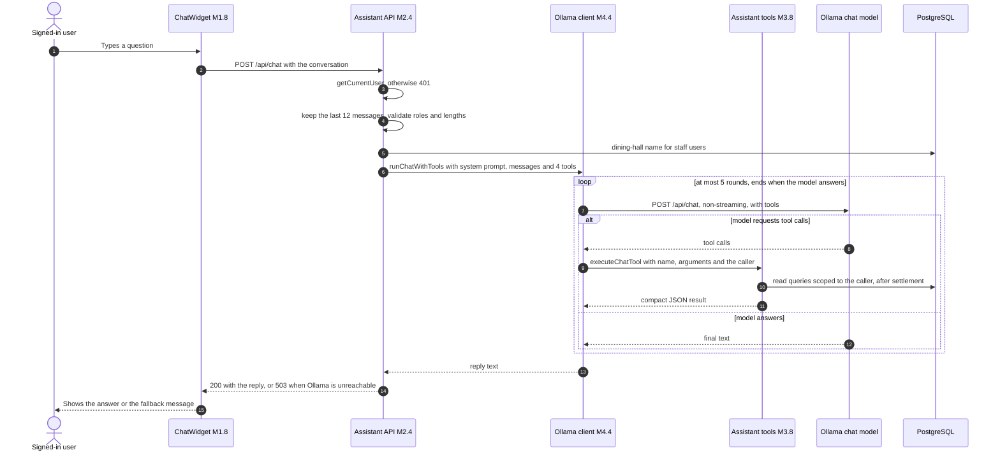

*Figure 16: Conversational assistant with tool calling.*

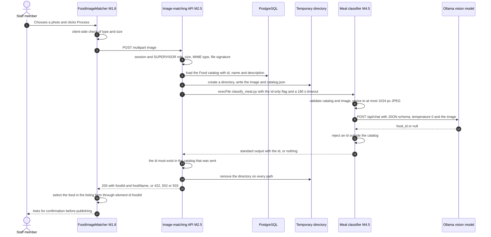

*Figure 17: Meal image matching.*

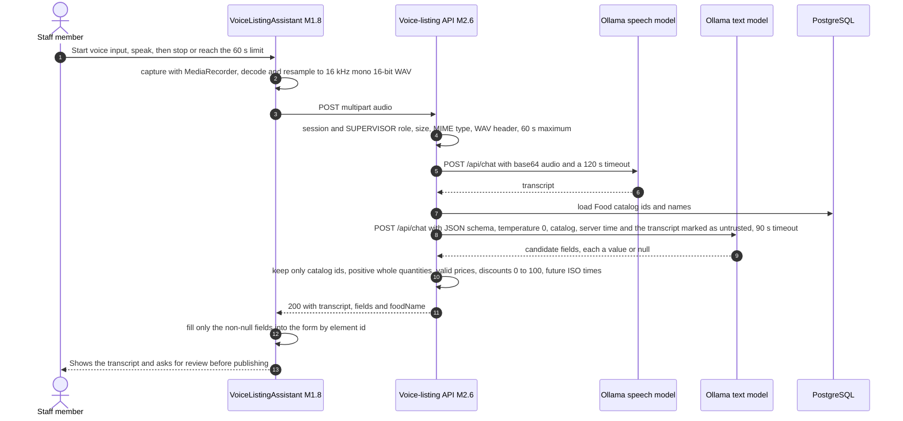

*Figure 18: Voice listing input.*

###### 3.4.5.4.2 Element Catalog

**Elements.** C1 (with M1.8), C2.3 (M2.4, M2.5, M2.6), M4.4, M3.8, C6 (M4.5), and C5 with its three models.

**Relations.** As shown in Figures 16, 17, and 18.

**Interfaces.** The HTTP endpoints of Table 21; the assistant tools and the classifier command line of Table 23.

**Behavior.** The three integrations share the guardrails summarized below.

*Table 37: Guardrails of the AI integrations.*

| Guardrail | Assistant (M2.4) | Image matching (M2.5) | Voice input (M2.6) |
|-----------|------------------|-----------------------|--------------------|
| Who may call | Any signed-in user | `SUPERVISOR` | `SUPERVISOR` |
| Input limits | Last 12 messages, each at most 2000 characters | At most 10 MiB; JPEG, PNG, WebP, or GIF; file signature checked | WAV, mono, 16 kHz, 16-bit; at most 60 s and 16 MiB |
| Model | `OLLAMA_MODEL` | `OLLAMA_VISION_MODEL` | `OLLAMA_ASR_MODEL`, then `OLLAMA_MODEL` |
| Output constraint | Only 4 read-only tools; at most 5 rounds | JSON schema with a single field, `food_id` (a string or null); temperature 0; at most 16 tokens | JSON schema of 6 nullable fields; temperature 0 |
| Server-side validation | Allergen names in tool arguments are validated; tool results are scoped to the caller; pickup codes are returned only for RESERVED orders | The ID must belong to the catalog that was sent, checked both in Python and in the route | Catalog ID membership; integer ranges; times must be in the future |
| Prompt-injection posture | System-prompt rules; tools cannot write; data is scoped to the caller | The prompt says to ignore any text in the image | The prompt says the transcript is untrusted data, not instructions |
| Persistence | None (the conversation is kept in the browser) | Temporary files deleted on every path | None (audio and transcript are kept only in memory) |
| On failure | HTTP 503 or 500; the interface says Ollama must be running | HTTP 503, 422, or 502; manual selection remains available | HTTP 503 or 422; the manual form remains available |

**Constraints.**

- AI output never writes to the database.
- Publication is always a separate, explicit action by staff.
- The models require a host with at least 16 GB of RAM (REQ-NFR-07).

###### 3.4.5.4.3 Context Diagram

See Figure 12. This packet uses connectors K3, K5, K6, and K4.

###### 3.4.5.4.4 Variability Mechanisms

The model and base-URL variables (Appendix A.1). Changing any model requires the AI acceptance evaluation of SRS §3.6 to be run again.

###### 3.4.5.4.5 Architecture Background

See AA-8. Constraining output with a schema and validating it against the catalog turns probabilistic model output into an input that can be checked deterministically. A model that hallucinates can at worst produce "no match" or a wrong suggestion, which the staff member sees and corrects.

###### 3.4.5.4.6 Related View Packets

- Parent: 3.4-A.
- In the decomposition view: 3.1-B and 3.1-C (modules M2.4 to M2.6, M3.8, M4.4, and M4.5).

##### 3.4.5.5 View Packet 3.4-E: Rescue Routing Workflow

###### 3.4.5.5.1 Primary Presentation

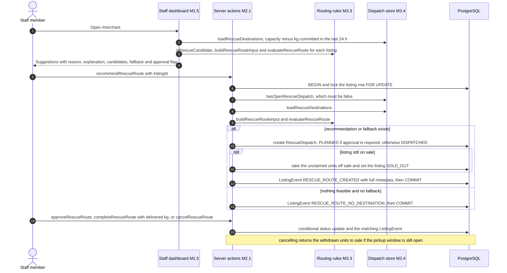

*Figure 19: Rescue routing workflow.*

###### 3.4.5.5.2 Element Catalog

**Elements.** C1, C2.1 (M1.5), C2.2 (M2.1), M3.3, M3.4, and C4.

**Relations.** As shown in Figure 19.

**Interfaces.** The rescue actions of Table 20; the interfaces of M3.3 and M3.4 in Table 23.

**Behavior.** The routing rules of M3.3 are summarized below. Their authoritative statement is in SRS REQ-FUNC-024, and their constants are in Appendix A.2.

1. **Candidates.** A listing is a candidate if it has units that can be routed: unclaimed units while its window is open, or units not picked up within 6 hours after the window ended.
2. **Handoff deadline.** The deadline is the end of the window plus 120 minutes. Once the deadline has passed, the food is unfit for people.
3. **Weight.** The weight is the number of units times the food's unit weight, or 0.45 kg per unit when no weight is recorded.
4. **Eligibility.** A destination is eligible when it is active and all of the following hold:
   - its remaining capacity covers the weight;
   - for human-facing destinations, the food is still fit for people;
   - for a pantry or shelter, the food has no allergen flags;
   - for human-facing destinations, enough time remains for the handoff: 45 minutes for a pantry or shelter, 20 for the staff kitchen.
5. **Priority.** Pantry, then shelter, then staff kitchen, then compost, then other.
6. **Fallback.** The highest-priority compost or other destination that is not the recommendation, preferably one with enough capacity.
7. **Approval.** Approval is required when the weight is at least 8 kg, when the destination is a pantry or shelter, when a human-facing destination has less than 60 minutes left, or when only the fallback is available.

The dashboard preview and the action evaluate the same pure function. The action re-evaluates it under the lock, so a route is never created from a stale preview.

**Constraints.**

- There is at most one live dispatch per listing.
- There is no separate approver role at this baseline: the staff member who plans a route may also approve it, and the approver is recorded (SRS §4.3).
- The three rescue tables require a migration (D-1).

###### 3.4.5.5.3 Context Diagram

See Figure 12. This packet uses connectors K1, K2, and K4.

###### 3.4.5.5.4 Variability Mechanisms

- Destinations and their capacities are data.
- The thresholds are constants (Appendix A.2).

###### 3.4.5.5.5 Architecture Background

See AA-4, AA-9, and AA-11. The rule core is deliberately not an AI model: food-safety decisions must be predictable, explainable, and testable. Future AI assistance may only rank or explain destinations that have already passed every rule (SRS §3.6).

###### 3.4.5.5.6 Related View Packets

- Parent: 3.4-A.
- In the data model view: 3.3-B (rescue entities and the dispatch state machine).
- In the decomposition view: 3.1-C (M3.3 and M3.4).

### 3.5 Deployment View

#### 3.5.1 View Description

This view conforms to the Deployment viewpoint (Section 1.5.5). It allocates the runtime components of Section 3.4 to the execution environment of the reference local deployment, documents the ports, configuration, and persistence of that environment, and describes the continuous-integration environment in which the software is built and checked.

#### 3.5.2 View Packet Overview

This view has been divided into the following view packets for convenience of presentation:

*Table 38: View packets of the Deployment view.*

| Packet | Content | Section |
|--------|---------|---------|
| 3.5-A Reference local deployment | Client device, application host, database container, Ollama service | 3.5.5.1 |
| 3.5-B CI and quality environment | GitHub repository, GitHub Actions runner, CodeQL | 3.5.5.2 |

Together, the two packets cover every environment in which SecondHelping software is run or built, and each environment appears in exactly one packet.

#### 3.5.3 Architecture Background

A local deployment on a single host is the only supported environment in this phase (SRS §2.5 and §3.1.2). The host runs the web application and the scheduler natively, PostgreSQL in Docker, and Ollama as a native service. A production deployment is outside the scope of this phase. The prerequisites for one are listed in Section 3.5.5.1.5.

#### 3.5.4 Variability Mechanisms

- **Host ports.** `POSTGRES_PORT` changes the host port of the database. `DATABASE_URL` must match it.
- **Ollama location.** `OLLAMA_BASE_URL` moves the Ollama service to another host, for example one with a GPU.
- **Execution mode.** `pnpm dev` runs development mode, with hot reload. `pnpm build` followed by `pnpm start` runs production mode.

All parameters are listed in Appendix A.1.

#### 3.5.5 View Packets

##### 3.5.5.1 View Packet 3.5-A: Reference Local Deployment

###### 3.5.5.1.1 Primary Presentation

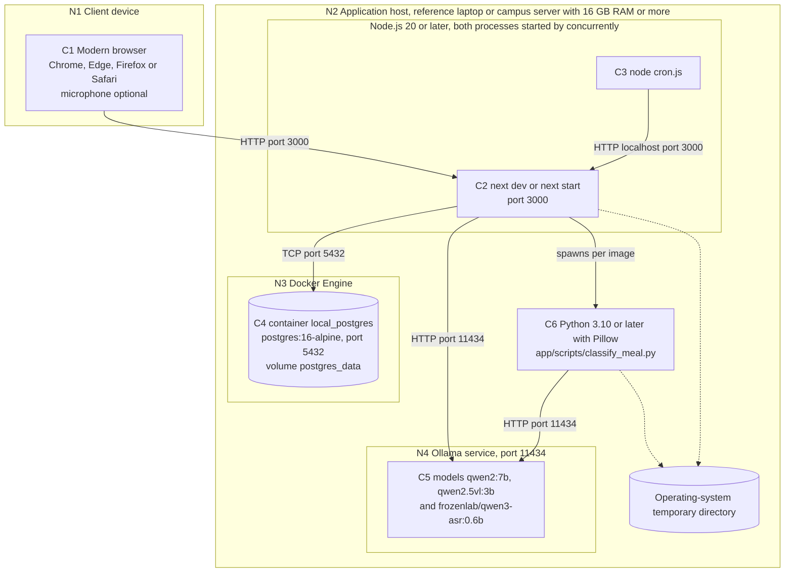

*Figure 20: Reference local deployment. N4 runs on the application host by default; `OLLAMA_BASE_URL` can place it on another host.*

###### 3.5.5.1.2 Element Catalog

**Elements.**

*Table 39: Environment elements.*

| Node | Platform and resources | Software that must be installed | Components hosted | Ports |
|------|------------------------|--------------------------------|-------------------|-------|
| N1 Client device | Any operating system with a current Chrome, Edge, Firefox, or Safari (REQ-NFR-06) | None | C1 | None |
| N2 Application host | macOS, Linux, or Windows. Reference: at least 16 GB of RAM (REQ-NFR-07). Inference on CPU only is supported, without latency guarantees | Node.js 20 or later (CI uses 22), pnpm 12.5.1, Python 3.10 or later with Pillow, Docker Engine, Ollama | C2, C3, C6 | 3000 (HTTP) |
| N3 Database container `local_postgres` | Image `postgres:16-alpine`; restart policy `unless-stopped`; health check `pg_isready` every 10 s; environment from `.env`; `init-scripts/` mounted read-only (currently empty); bridge network `local_net` | Docker Engine on N2 | C4 | 5432, mapped from `POSTGRES_PORT` |
| N4 Ollama service | Native service on N2 by default, or a remote host | The three models, pulled with `ollama pull` | C5 | 11434 |

**Relations.**

*Table 40: Allocation of software elements.*

| Software element | Allocated to | Notes |
|------------------|--------------|-------|
| C1 Web client and the client components (M1.8) | N1 | Server-rendered by C2, then hydrated in the browser |
| C2 Next.js server: M1 server parts, M2, M3, M4.1 to M4.4 | N2 | One process |
| C3 Scheduler (M5) | N2 | Must be co-located with C2 (D-11) |
| C6 Meal classifier (M4.5) | N2 | Needs Python and Pillow on the same host as C2 |
| C4 PostgreSQL | N3 (on N2) | Data persists in the named volume `postgres_data` |
| C5 Ollama | N4 (on N2 by default) | Located by `OLLAMA_BASE_URL` |
| Build artifacts: `.next/` (`pnpm build`) and `app/generated/prisma/` (`pnpm db:generate`) | File system of N2 | Not version-controlled |
| `.env` (secrets and configuration) | File system of N2 | Ignored by Git; created from `.env.example` |

**Interfaces.** The configuration parameters are listed in Appendix A.1. The network paths are those of Figure 20.

**Behavior.** The startup procedure documented in the README, with this SAD's annotations, is:

1. `pnpm install`.
2. Create `.env` from `.env.example`, and set `DATABASE_URL` and a random `CRON_SECRET`.
3. `docker compose up -d` starts N3.
4. `pnpm db:migrate`, then `pnpm db:generate`, apply the committed migrations and generate the client. **At this baseline, the migrations do not create 13 of the tables (D-1).**
5. `pnpm db:seed` loads the demonstration data. This step is destructive.
6. `ollama pull` each of the three models, and make sure `ollama serve` is running.
7. Install Python 3.10 or later and Pillow. The README does not mention this step (D-10).
8. `pnpm dev`, or `pnpm build` followed by `pnpm start`, starts C2 and C3 together.

`docker compose down` stops the database but keeps its volume.

**Constraints.**

- C3 calls `http://localhost:3000`, so C2 must listen on port 3000 of the same host (D-11).
- The Docker Compose file publishes port 5432 on all of the host's network interfaces. On any machine reachable from a network, it should be bound to `127.0.0.1`.
- The session cookie is marked `Secure` only when `NODE_ENV=production`. A production deployment therefore needs HTTPS.

###### 3.5.5.1.3 Context Diagram

The users' devices (N1) reach N2 over the local network or the campus network. No external internet service is called at runtime. The fonts loaded through `next/font/google` are downloaded when the application is built, or when the development server first compiles it, and are then served by C2.

###### 3.5.5.1.4 Variability Mechanisms

See Section 3.5.4 and Appendix A.1.

###### 3.5.5.1.5 Architecture Background

Only PostgreSQL is containerized. The application runs natively, which gives fast hot reload during development, and Ollama runs natively so that it can use the host's GPU or Apple Metal acceleration. This keeps the development setup simple, at the cost of more manual installation steps.

Before any deployment beyond a developer's machine, the following must be in place:

1. Resolve D-1 by committing the missing migration.
2. Terminate HTTPS in front of C2 and set `NODE_ENV=production`.
3. Supervise C2 and C3 with a process manager (for example systemd) instead of `concurrently` in a terminal.
4. Use strong values for `CRON_SECRET` and `POSTGRES_PASSWORD`, and remove the demonstration accounts. Never run the seed.
5. Bind PostgreSQL and Ollama to private interfaces.
6. Back up the `postgres_data` volume.
7. Implement login rate limiting, retention enforcement, and account deletion (SRS §3.4 and §4.3).
8. Make the scheduler's target URL configurable (D-11).

###### 3.5.5.1.6 Related View Packets

- Sibling: 3.5-B.
- In the runtime view: 3.4-A (the components allocated here).

##### 3.5.5.2 View Packet 3.5-B: CI and Quality Environment

###### 3.5.5.2.1 Primary Presentation

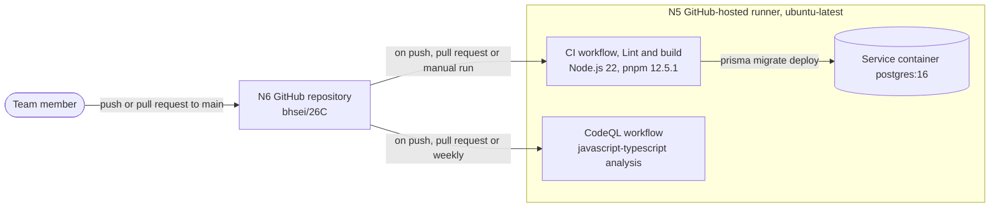

*Figure 21: Continuous-integration environment.*

###### 3.5.5.2.2 Element Catalog

**Elements.**

- **N6 GitHub repository.** The source of truth for code, documentation, and this SAD.
- **N5 GitHub-hosted runner.** Runs two workflows:
  - **`ci.yml`, job "Lint and build"** (15-minute timeout; read-only permissions; concurrent runs of the same branch cancel each other). Steps: check out; set up pnpm 12.5.1 and Node.js 22; `pnpm install --frozen-lockfile`; `pnpm db:generate`; `pnpm db:validate`; `pnpm db:migrate` against a `postgres:16` service container; `pnpm lint`; `pnpm build`.
  - **`codeql.yml`.** CodeQL analysis of JavaScript and TypeScript, with permission to write security events. It runs on pushes and pull requests to `main`, and weekly on Mondays at 06:23 UTC.

**Relations.** Pushes and pull requests to `main` trigger both workflows. The CI job applies the migrations to its own service database.

**Interfaces.** Results appear as GitHub check runs on commits and pull requests. CodeQL findings appear in the repository's code-scanning alerts.

**Behavior.** A pull request is considered healthy when both workflows pass.

**Constraints.** CI does not run the unit tests, and it does not compare the migration history with the schema. Both gaps let regressions such as D-1 pass unnoticed (Section 2.2.2).

###### 3.5.5.2.3 Context Diagram

The team's development machines (instances of N2) push to N6.

###### 3.5.5.2.4 Variability Mechanisms

None.

###### 3.5.5.2.5 Architecture Background

The CI job builds the production bundle against a real PostgreSQL service, so that a broken migration or a type error tied to the schema fails the build. Adding `pnpm test` and a migration-drift check to the same job would cover the remaining gaps.

###### 3.5.5.2.6 Related View Packets

- Sibling: 3.5-A.
- In the decomposition view: 3.1-A (module M7).

## 4. Relations Among Views

Each view in Section 3 gives a different perspective on the system, and each is valid and useful in its own right. The views are not independent, however: elements of one view are related to elements of other views. For example, a module of the decomposition view executes inside one of the runtime components of the C&C view, and that component is allocated to a node of the deployment view. In general, mappings between views are many to many. Section 4 describes these relations and, as ANSI/IEEE 1471-2000 requires, the known inconsistencies among the views.

### 4.1 General Relations Among Views

- **Decomposition and layered views.** The two module views share one set of modules. Every module of M1 to M4 belongs to exactly one layer, and the layer follows from the top-level module (M1 is L1, M2 is L2, M3 is L3, M4 is L4). M5 to M7 are outside the layers.
- **Module views and runtime view.** All TypeScript modules except M1.8 and M5 execute inside the runtime component C2. M1.8 executes in C1, M5 is C3, and M4.5 is C6.
- **Data model and the other views.** The data model view is related to the module views through the access matrix in Section 4.2, and to the runtime view through the state machines, whose transitions are the connectors' effects listed in Table 36.
- **Runtime view and deployment view.** Every runtime component is allocated to exactly one environment element (Table 40).

**Known inconsistencies.** The following inconsistencies are known, both among the views and between the views and other artifacts:

1. **Schema and migrations.** The data model view describes the schema in `prisma/schema.prisma`. A database built from the committed migrations lacks 13 of the 22 tables (D-1), so the runtime view's rescue-routing packet (3.4-E) cannot run on such a database.
2. **Unowned entities.** The forward-provisioned entities (packet 3.3-D) have no owning module in the decomposition view. This is intentional (AA-11) and must be resolved when their modules are added.
3. **Writes from the presentation layer.** Layer rule LC-3 says user-requested writes enter through L2, while the runtime view shows page renders (K1) performing settlement writes. The two views are reconciled by bridge B-2.
4. **Location of the generated client.** It lives physically under `app/`, which corresponds to L1 and L2 in the decomposition view, but belongs logically to L4 (M4.3).
5. **Voice route.** The voice route (M2.6) calls C5 directly, outside the L4 adapters of the layered view (D-14).
6. **Older diagrams.** The entity-relationship diagrams in `docs/database/` are older than the data model view (D-15).

### 4.2 View-to-View Relations

**Module, layer, runtime component, and node.**

*Table 41: Mapping of modules to layers, runtime components, and deployment nodes.*

| Module | Layer (Section 3.2) | Runtime component (Section 3.4) | Deployment node (Section 3.5) |
|--------|---------------------|---------------------------------|-------------------------------|
| M1.1 to M1.7 Pages and shell | L1 | C2.1 (rendered on the server; the HTML is shown in C1) | N2 (and N1) |
| M1.8 Client components | L1 | C1, after being rendered by C2.1 | N1 |
| M2.1 to M2.3 Server actions | L2 | C2.2 | N2 |
| M2.4 to M2.7 Route handlers | L2 | C2.3 | N2 |
| M3.1 to M3.8 Domain logic | L3 | Inside C2, wherever called from (C2.1, C2.2, C2.3) | N2 |
| M4.1 to M4.4 Infrastructure | L4 | Inside C2 | N2 |
| M4.5 Meal image classifier | L4 | C6 | N2 |
| M5 Scheduler | Outside the layers | C3 | N2 |
| M6 Schema and migrations | Outside the layers | Used at build time by M4.3; applied to C4 by the Prisma command-line tools | N2 and N3 |
| M6 Seed and password migration | Outside the layers | Short-lived Node.js processes run by developers | N2 |
| M7 Build, verification and operations | Outside the layers | Build-time only | N2 and N5 |

**Modules and data entities.** The access matrix below relates the module views to the data model view. C = create, R = read, U = update, D = delete. Accesses made through another module are attributed to the module that executes the query.

*Table 42: Access matrix (modules × entities).*

| Module | DiningHall | User | AuthSession | Food | Listing | Order | Notification | RescueDestination | RescueDispatch | ListingEvent | EmissionFactor | ImpactRecord | Forward-provisioned (10) |
|--------|------------|------|-------------|------|---------|-------|--------------|-------------------|----------------|--------------|----------------|--------------|---------------------------|
| M1 Pages | R | R | – | R | R | R | – | – | R | – | – | – | – |
| M2.1 Marketplace actions | R | R | – | R | CRU | CRU | C | – | CRU | C | – | – | – |
| M2.2 Authentication actions | – | CR | – | – | – | – | – | – | – | – | – | – | – |
| M2.3 Notification actions | – | – | – | – | – | – | RU | – | – | – | – | – | – |
| M2.4 Assistant API | R | – | – | – | – | – | – | – | – | – | – | – | – |
| M2.5 and M2.6 Image and voice APIs | – | – | – | R | – | – | – | – | – | – | – | – | – |
| M2.7 Scheduler API | – | – | – | R | R | RU | C | – | – | – | – | – | – |
| M3.1 Settlement | R | R | – | R | RU | RU | C | – | – | – | – | – | – |
| M3.2 Automatic pricing | – | – | – | – | RU | R | – | – | – | – | – | – | – |
| M3.4 Dispatch store | – | – | – | – | – | – | – | R | R | R | – | – | – |
| M3.6 Impact sync and report | – | – | – | R | R | R | – | – | – | – | R | CRUD | – |
| M3.7 Order notifications | R | R | – | R | R | R | C | – | – | – | – | – | – |
| M3.8 Assistant tools | R | – | – | R | R | R | – | – | – | – | – | – | – |
| M4.1 Sessions | – | R | CRD | – | – | – | – | – | – | – | – | – | – |
| M6 Seed | CD | CD | D | CD | CD | CD | CD | CD | CD | CD | CD | D (creation through M3.6) | CD |
| M6 Password migration | – | RU | – | – | – | – | – | – | – | – | – | – | – |

Reading the matrix:

- Every entity in use has at least one runtime writer, except `DiningHall`, `Food`, `RescueDestination`, and `EmissionFactor`. These are reference data with no administration interface (SRS §4.3), so the seed maintains them.
- `ImpactRecord` has no runtime writer, which is deviation D-5.
- The forward-provisioned entities are touched only by the seed.

## 5. Referenced Materials

*Table 43: Referenced materials.*

| Key | Reference |
|-----|-----------|
| Barbacci 2003 | Barbacci, M.; Ellison, R.; Lattanze, A.; Stafford, J.; Weinstock, C.; and Wood, W. *Quality Attribute Workshops (QAWs), Third Edition* (CMU/SEI-2003-TR-016). Pittsburgh, PA: Software Engineering Institute, Carnegie Mellon University, 2003. |
| Bass 2003 | Bass, L.; Clements, P.; and Kazman, R. *Software Architecture in Practice*, second edition. Addison-Wesley, 2003. |
| Clements 2001 | Clements, P.; Kazman, R.; and Klein, M. *Evaluating Software Architectures: Methods and Case Studies*. Addison-Wesley, 2001. |
| Clements 2002 | Clements, P.; Bachmann, F.; Bass, L.; Garlan, D.; Ivers, J.; Little, R.; Nord, R.; and Stafford, J. *Documenting Software Architectures: Views and Beyond*. Addison-Wesley, 2002. |
| Clements 2010 | Clements, P.; Bachmann, F.; Bass, L.; Garlan, D.; Ivers, J.; Little, R.; Merson, P.; Nord, R.; and Stafford, J. *Documenting Software Architectures: Views and Beyond*, second edition. Addison-Wesley, 2010. Source of the decomposition, uses, layered, data model, C&C, and deployment styles used in this SAD. |
| IEEE 1471 | ANSI/IEEE 1471-2000, *IEEE Recommended Practice for Architectural Description of Software-Intensive Systems*, 21 September 2000. |
| ISO 42010 | ISO/IEC/IEEE 42010:2011, *Systems and software engineering — Architecture description*. The successor of IEEE 1471. |
| SEI 2006 | Software Engineering Institute. *"Views and Beyond" Architecture Documentation Template*, 05 February 2006. The template this SAD instantiates. |
| SRS | The Debuggers. *Software Requirements Specification for SecondHelping*, version 1.5, 2026/11/21. `docs/SRS.md`. |
| README | The Debuggers. *SecondHelping README*: setup, commands, and project structure. `README.md`. |
| TEAM_LOG | The Debuggers. *Team Contributions Log*. `docs/TEAM_LOG.md`. |
| Schema | `prisma/schema.prisma` and `prisma/migrations/`, at commit `9bf5f5b`. |
| ERD 2026-10-17 | Entity-relationship diagrams, `docs/database/` (`.png` and `.drawio`). Historical; superseded by Section 3.3. |
| Next.js | Vercel. *Next.js Documentation* (App Router, Server Components, Server Actions, Route Handlers). https://nextjs.org/docs |
| Prisma | Prisma Data. *Prisma Documentation* (schema, migrations, client, transactions). https://www.prisma.io/docs |
| PostgreSQL | PostgreSQL Global Development Group. *PostgreSQL 16 Documentation* (row locking, isolation). https://www.postgresql.org/docs/ |
| Ollama | Ollama. *Ollama documentation and HTTP API* (`/api/chat`, tool calling, structured outputs). https://ollama.com |
| Mermaid | Mermaid. *Mermaid diagram syntax* (flowchart, sequence, state, and entity-relationship diagrams). https://mermaid.js.org |
| PIPL | *Personal Information Protection Law of the People's Republic of China*, effective 1 November 2021. |

## 6. Directory

### 6.1 Index

The index lists the identifiers and names used for architectural elements, relations, and properties, with the section where each is defined and the sections where it is used.

*Table 44: Index of architectural elements, relations, and properties.*

| Name | Kind | Defined in | Used in |
|------|------|------------|---------|
| AA-1 to AA-12 | Architectural approach | 2.2.1 | 2.2.3, 3.1 to 3.5 (architecture background) |
| B-1 to B-3 | Layer bridge | 3.2.5.1 | 3.1.5.2, 4.1 |
| C1 to C6 (and C2.1 to C2.3) | Runtime component | 3.4.5.1 | 3.4.5.2 to 3.4.5.5, 3.5.5.1, 4.2 |
| CON-1 to CON-8 | Constraint | 2.1.2 | 2.2.1, 2.2.3 |
| D-1 to D-15 | Deviation (conformance finding) | 2.2.2 | 2.2.3, 3.1 to 3.5, 4.1 |
| FD-1 to FD-6 | Functional driver | 2.1.3 | 2.2.1 |
| G1 to G5 | Architectural goal | 2.1.2 | 2.2.1 |
| I-1 to I-12 | Data invariant | 3.3.5.1 | 2.2.3, 3.4.5.2 |
| K1 to K7 | Runtime connector | 3.4.5.1 | 3.4.5.2 to 3.4.5.5, 3.5.5.1 |
| L1 to L4 | Layer | 3.2.5.1 | 3.1.5.1, 4.1, 4.2 |
| LC-1 to LC-5 | Layer constraint | 3.2.5.1 | 2.2.2, 4.1 |
| M1 to M7 | Top-level module | 3.1.5.1 | 3.2, 3.4, 4.2 |
| M1.1 to M1.8, M2.1 to M2.7 | Presentation and entry-point modules | 3.1.5.2 | 2.2.3, 3.2.5.1, 3.4, 4.2 |
| M3.1 to M3.8, M4.1 to M4.5 | Domain and infrastructure modules | 3.1.5.3 | 2.2.3, 3.2.5.1, 3.4, 4.2 |
| N1 to N4 | Environment element (local deployment) | 3.5.5.1 | 4.2 |
| N5, N6 | Environment element (CI) | 3.5.5.2 | 4.2 |
| QAS-1 to QAS-11 | Quality-attribute scenario | 2.1.3 | 2.2.1, 2.2.2, 3.4 |
| `DiningHall`, `User`, `AuthSession`, `Food`, `Listing`, `Order`, `Notification` | Data entity | 3.3.5.1 | 3.4.5.2, 4.2 |
| `RescueDestination`, `RescueDispatch`, `ListingEvent` | Data entity | 3.3.5.2 | 3.4.5.5, 4.2 |
| `EmissionFactor`, `ImpactRecord` | Data entity | 3.3.5.3 | 2.2.2, 4.2 |
| `ListingDraft`, `MediaAsset`, `PricingPolicy`, `PriceChange`, `ModelVersion`, `DailyProduction`, `WeatherObservation`, `CampaignEvent`, `SurplusForecast`, `SimulationScenario` | Data entity (forward-provisioned) | 3.3.5.4 | 2.2.3, 4.1, 4.2 |
| Packets 3.1-A to 3.5-B | View packet | 3.1.2, 3.2.2, 3.3.2, 3.4.2, 3.5.2 | Section 3 |
| *is-part-of* | Relation | 1.5.1, 3.1 | 3.1.5.1 |
| *allowed-to-use*, *uses* | Relation | 1.5.2, 3.2 | 3.2.5.1, 4.1 |
| Association (with cardinality) | Relation | 1.5.3, 3.3 | 3.3.5.1 to 3.3.5.4 |
| *attachment* | Relation | 1.5.4, 3.4 | 3.4.5.1 |
| *allocated-to*, *communicates-via* | Relation | 1.5.5, 3.5 | 3.5.5.1, 4.2 |
| Purity | Module property | 1.5.1 | 3.1.5.3, 3.2.5.1 |
| Runtime status (in use or forward-provisioned) | Entity property | 1.5.3 | 3.3.2, 3.3.5.4 |
| Personal-data classification | Entity property | 1.5.3 | 3.3.5.1 |
| Timeout, authentication, failure behavior | Connector properties | 1.5.4 | 3.4.5.1 |

### 6.2 Glossary

*Table 45: Glossary.*

| Term | Definition |
|------|------------|
| Allowed-to-use relation | The relation between layers that states which layer's modules may use which other layer's modules. |
| Bridge (layer bridge) | A documented use that skips a layer, for example a page that queries the database directly. |
| Closing bag | A discounted offer of surplus food published by a dining hall near closing time. |
| Compare-and-set (conditional update) | A database update whose `WHERE` clause restates the expected current state. Success is judged from the number of rows affected, which makes concurrent and repeated transitions safe. |
| Component | A runtime element: a process, service, or subprocess (Section 3.4). |
| Connector | A runtime interaction mechanism between components, such as an HTTP request, SQL over TCP, or a process invocation. |
| Dining hall | A campus food-service location; the scope of its staff members, listings, and reports. |
| Element catalog | The part of a view packet that details its elements, relations, interfaces, behavior, and constraints. |
| Emission factor | A per-kilogram conversion from diverted food to avoided CO₂e, saved water, and saved land, for one food category and validity date. |
| Forward-provisioned entity | A table defined in the schema for a planned capability. It has no runtime reader or writer yet. |
| Functional core | The pure rule modules (M3.3 and M3.5), which perform no I/O and can therefore be unit-tested deterministically. |
| Guest | An unauthenticated visitor who can browse the overview and the listings. |
| Impact record | A derived row holding one picked-up order's impact metrics, their bases, and their assumptions, under one method version. |
| Lazy settlement | Running the idempotent settlement routine at the start of page renders and actions, in addition to the periodic scheduler. |
| Listing | A meal offer with prices, discount, quantity, pickup window, and status, referencing a catalog food. |
| Listing event | An append-only audit record attached to a listing, used by rescue routing. |
| Metric basis | Whether an impact metric is MEASURED, ESTIMATED, or UNAVAILABLE. |
| Module | A unit of implementation with an assigned responsibility (Section 3.1). |
| Order | The reservation of one unit of a listing, with a price snapshot and payment, refund, pickup, and reminder state. |
| Payment hold | The 10-minute period during which an unpaid order keeps one unit reserved. |
| Pickup code | A unique code in the format `XXXX-XXXX-XX`, issued when payment is confirmed and checked by staff at pickup. |
| Pickup window | The period during which a listing's food can be collected. |
| Price snapshot | The price, discount, fee, and pickup-window fields copied from a listing into an order at reservation time. |
| React Server Component (RSC) | A React component that renders on the server and can read data directly. |
| Rescue destination | A configured recovery or disposal pathway (pantry, shelter, staff kitchen, compost, or other) with a capacity. |
| Rescue dispatch | A routed batch of unsold food from a dining hall to a rescue destination. |
| Route handler | A Next.js HTTP endpoint under `app/api/`. |
| Safe holding time | 120 minutes after the end of the pickup window. After it, food is routed only to disposal pathways. |
| Server action | A Next.js server function invoked from a form as an RPC over HTTP POST. |
| Settlement | Expiring listings and moving outstanding orders to EXPIRED or CANCELLED, with refunds and stock release as appropriate. |
| Software architecture | The structure or structures of the system, which comprise software elements, the externally visible properties of those elements, and the relationships among them [Bass 2003]. |
| Staff member | A user with the role `SUPERVISOR`, assigned to a dining hall. |
| Student | A user with the role `STUDENT`, who reserves and collects meals. |
| Tool calling | The pattern in which the language model asks the server to run a bounded function and receives its result. |
| View | A representation of a whole system from the perspective of a related set of concerns [IEEE 1471]. A view conforms to a viewpoint. |
| View packet | The smallest package of architectural documentation that could usefully be given to a stakeholder. The documentation of a view consists of one or more view packets. |
| Viewpoint | A specification of the conventions for constructing and using a view: its concerns, element and relation types, notations, and analysis techniques [IEEE 1471]. |

### 6.3 Acronym List

*Table 46: Acronyms.*

| Acronym | Meaning |
|---------|---------|
| AI | Artificial Intelligence |
| API | Application Programming Interface |
| ASR | Automatic Speech Recognition |
| ATAM | Architecture Tradeoff Analysis Method |
| C&C | Component-and-Connector |
| CI | Continuous Integration |
| CO₂e | Carbon-dioxide equivalent |
| CRUD | Create, Read, Update, Delete |
| ER | Entity-Relationship |
| FK | Foreign Key |
| GPU | Graphics Processing Unit |
| HTML | HyperText Markup Language |
| HTTP(S) | HyperText Transfer Protocol (Secure) |
| IEEE | Institute of Electrical and Electronics Engineers |
| JSON | JavaScript Object Notation |
| LLM | Large Language Model |
| MIME | Multipurpose Internet Mail Extensions (media type) |
| NFR | Non-Functional Requirement |
| ORM | Object-Relational Mapping |
| PIPL | Personal Information Protection Law (of the PRC) |
| PK | Primary Key |
| QAS | Quality-Attribute Scenario |
| QAW | Quality Attribute Workshop |
| RAM | Random-Access Memory |
| RPC | Remote Procedure Call |
| RSC | React Server Component |
| SAD | Software Architecture Document |
| SEI | Software Engineering Institute |
| SQL | Structured Query Language |
| SRS | Software Requirements Specification |
| TCP | Transmission Control Protocol |
| TLS | Transport Layer Security |
| UI | User Interface |
| UK | Unique Key (in entity-relationship diagrams) |
| UML | Unified Modeling Language |
| URL | Uniform Resource Locator |
| UTC | Coordinated Universal Time |
| VLM | Vision-Language Model |
| WAV | Waveform Audio File Format |

## Appendix A: Configuration Parameters and Business-Rule Constants

This appendix lists the variability mechanisms referred to throughout Section 3. Section 1.8 requires it to be updated whenever a parameter or constant changes.

### A.1 Configuration Parameters

*Table 47: Environment variables.*

| Variable | Read by | Default | Purpose |
|----------|---------|---------|---------|
| `POSTGRES_USER`, `POSTGRES_PASSWORD`, `POSTGRES_DB` | Docker container N3 (through `env_file`) and its health check | Example values in `.env.example` | Database bootstrap credentials |
| `POSTGRES_PORT` | `docker-compose.yml` (host port mapping) | `5432` | Host port of PostgreSQL |
| `DATABASE_URL` | M4.3 (`lib/prisma.ts`), `prisma7.config.ts` (command-line tools), seed, password migration | None (required) | Connection string |
| `DB_HOST`, `DB_PORT`, `DB_NAME`, `DB_USER`, `DB_PASSWORD` | Nothing | Example values | Present in `.env.example` but unused. Candidates for removal |
| `OLLAMA_BASE_URL` | M4.4, M2.6, and M4.5 (inherited from the environment) | `http://localhost:11434` | Location of C5 |
| `OLLAMA_MODEL` | M4.4 (chat) and M2.6 (field extraction) | `qwen2:7b` | Text model with tool support |
| `OLLAMA_VISION_MODEL` | M4.5 | `qwen2.5vl:3b` | Vision model for meal matching |
| `OLLAMA_ASR_MODEL` | M2.6 | `frozenlab/qwen3-asr:0.6b` | Speech-recognition model |
| `PYTHON_PATH` | M2.5 | `python` on Windows, otherwise `python3` | Python executable for C6 |
| `CRON_SECRET` | M2.7 and M5 | None. When unset, the endpoint rejects every call | Shared secret for the scheduler endpoint |
| `NODE_ENV` | M4.1 (`Secure` cookie flag) and M4.3 (development-time client caching) | Set by Next.js | Development or production behavior |

### A.2 Business-Rule and Operational Constants

*Table 48: Business-rule and operational constants.*

| Area | Constant and value | Location | Requirement |
|------|--------------------|----------|-------------|
| Fees | `PLATFORM_FEE_CENTS = 25`, `SERVICE_FEE_CENTS = 25` (¥0.25 each, refunded) | `app/actions.ts` | REQ-FUNC-006 AC3 |
| Payment hold | 10 minutes (`PAYMENT_HOLD_MS`; repeated as a literal in `lib/order-lifecycle.ts`, D-14) | `app/actions.ts`, `lib/order-lifecycle.ts` | REQ-FUNC-010 AC9, 011 AC6 |
| Reservation limits | 1 unit per order; at most 2 open orders per student per listing | `app/actions.ts` | REQ-FUNC-010 AC10 |
| Pickup code | 10 characters from `23456789ABCDEFGHJKMNPQRSTVWXYZ`, formatted `XXXX-XXXX-XX`, cryptographically random | `app/actions.ts` | REQ-FUNC-013 |
| Sessions | `SESSION_DAYS = 7`; cookie `secondhelping_session` (HTTP-only, `SameSite=Lax`) | `lib/auth.ts` | REQ-FUNC-004 |
| Passwords | scrypt with a 16-byte salt and a 64-byte key; minimum length 8 | `lib/password.ts`, `app/auth-actions.ts` | REQ-FUNC-002; CON-3 |
| Automatic pricing | `AUTO_PRICING_MAX_DISCOUNT_RATE = 80`; review interval 10 minutes; recent-demand window 20 minutes; step 5 points; weak demand = fewer than max(1, ⌈0.2 × quantity⌉) paid units; mid-window rule: elapsed ≥ 40%, stock ≥ 40%, sell-through < 0.6 × elapsed; late rule: ≤ 15 minutes left, stock ≥ 20%, sell-through < 80%. A listing published with automatic pricing must start at a discount of 80% or less | `lib/dynamic-pricing.ts`, `app/actions.ts` | REQ-FUNC-026 |
| Rescue routing | `DEFAULT_UNIT_WEIGHT_KG = 0.45`; `SAFE_HOLDING_MINUTES = 120`; `RESCUE_LOOKBACK_HOURS = 6`; `APPROVAL_KG_THRESHOLD = 8`; minimum handoff time 45 minutes for a pantry or shelter, 20 for the staff kitchen, 0 for compost or other; human-facing destinations need approval below 60 minutes; priority pantry, shelter, staff kitchen, compost, other; capacity window 24 hours | `lib/rescue-routing.ts`, `lib/rescue-dispatch.ts` | REQ-FUNC-024 |
| Impact estimation | `METHOD_VERSION = "impact-v1.0"`; fallback category `MIXED_FOOD` (fallback off by default); 0.45 kg inferred portion weight when only a forecast is available | `lib/estimator.ts` | REQ-FUNC-025 |
| Impact page heuristic | 0.8 kg CO₂e per rescued meal (D-6) | `app/impact/page.tsx` | REQ-FUNC-016 |
| Assistant | At most 12 messages; at most 2000 characters per message; at most 5 tool rounds; at most 12 listings and 8 orders per tool result | `app/api/chat/route.ts`, `lib/ollama.ts`, `lib/chat-tools.ts` | REQ-FUNC-019 |
| Image matching | At most 10 MiB; JPEG, PNG, WebP, or GIF; 180 s timeout; image resized to at most 1024 × 1024, JPEG quality 80; temperature 0; at most 16 output tokens; model kept loaded for 10 minutes | `app/api/food-image-match/route.ts`, `app/scripts/classify_meal.py` | REQ-FUNC-020; REQ-NFR-03 |
| Voice input | At most 16 MiB; WAV mono 16 kHz 16-bit, at most 60 s; 120 s transcription timeout and 90 s extraction timeout; temperature 0; quantity at most 100 000; price at most 100 000 000 cents | `app/api/voice-listing-assistant/route.ts`, `app/components/VoiceListingAssistant.tsx` | REQ-FUNC-020 |
| Scheduler and reminders | Tick every 60 s; opening reminder 10 minutes before the window opens; closing reminder 30 minutes before it closes | `cron.js`, `app/api/notifications/route.ts` | REQ-FUNC-018; REQ-NFR-04 |
| Reporting period | "This term" = from the first day of the month four months before the current month | `app/merchant/page.tsx` | REQ-FUNC-015 AC3 |
