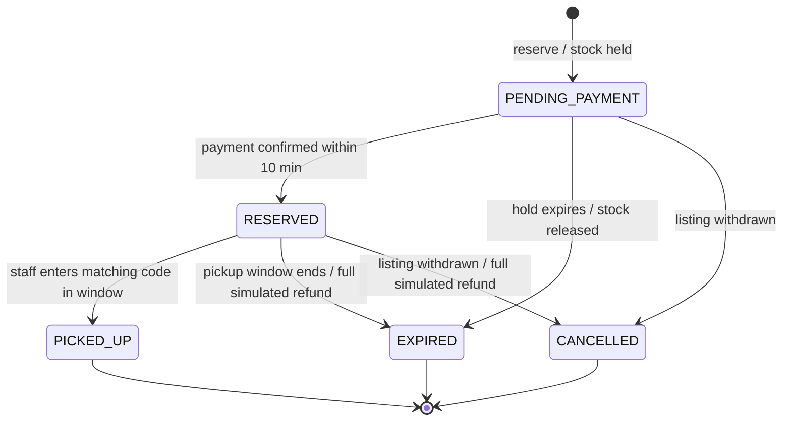
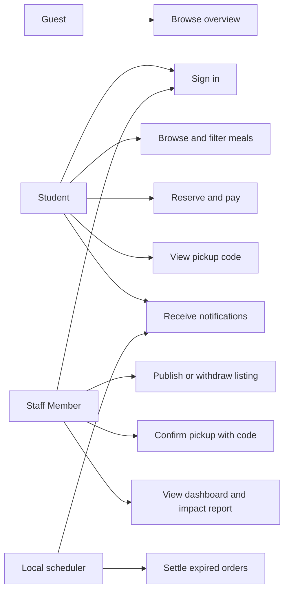

# Software Requirements Specification
## For SecondHelping

Version 1.3

Prepared by Bianca Zavadisk, Geming Wu, Gabriel Silva, Marwen Jadlaoui and Zamo Rzgar

Beihang University · Software Engineering · Team: The Debuggers

2026/10/28

## Table of Contents
* [1. Introduction](#1-introduction)
  * [1.1 Document Purpose](#11-document-purpose)
  * [1.2 Product Scope](#12-product-scope)
  * [1.3 Definitions, Acronyms, and Abbreviations](#13-definitions-acronyms-and-abbreviations)
  * [1.4 References](#14-references)
  * [1.5 Document Overview](#15-document-overview)
* [2. Product Overview](#2-product-overview)
  * [2.1 Product Perspective](#21-product-perspective)
  * [2.2 Product Functions](#22-product-functions)
  * [2.3 Product Constraints](#23-product-constraints)
  * [2.4 User Characteristics](#24-user-characteristics)
  * [2.5 Assumptions and Dependencies](#25-assumptions-and-dependencies)
  * [2.6 Apportioning of Requirements](#26-apportioning-of-requirements)
* [3. Requirements](#3-requirements)
  * [3.1 External Interfaces](#31-external-interfaces)
  * [3.2 Functional Requirements](#32-functional-requirements)
  * [3.3 Quality of Service](#33-quality-of-service)
  * [3.4 Compliance](#34-compliance)
  * [3.5 Design and Implementation](#35-design-and-implementation)
  * [3.6 AI/ML](#36-aiml)
* [4. Verification](#4-verification)
* [5. Appendices](#5-appendices)

## Revision History

| Name | Date | Reason for changes | Version |
|------|------|--------------------|---------|
| Initial baseline | 2026/10/12 | Initial requirements baseline for the current prototype | 0.1 |
| Future AI expansion | 2026/10/12 | Added roadmap for predictive surplus, dynamic pricing, and food-circulation optimization | 0.2 |
| Detailed requirements | 2026/10/19 | Expanded functional requirements with status, priority, preconditions, and acceptance criteria | 0.3 |
| AI chat assistant | 2026/10/21 | Documented the implemented conversational assistant (REQ-FUNC-015), added the Ollama software interface, and updated the route and data-model appendices | 0.4 |
| AI meal image matching | 2026/10/26 | Documented staff member photo-to-food selection, local vision-model configuration, fallback, and partial REQ-FUNC-011 implementation | 0.5 |
| Peer-review baseline | 2026/10/27 | Corrected requirement statuses and acceptance criteria to match the verified implementation (notably REQ-FUNC-002 and REQ-FUNC-003), added notification and payment-lifecycle requirements (REQ-FUNC-016, REQ-FUNC-017), added a requirements summary table and a verification traceability table, and documented known prototype limitations | 1.0 |
| Requirement decomposition | 2026/10/28 | Expanded the catalog from 17 to 25 functional requirements by splitting composite requirements into atomic ones (login/session, publication/withdrawal, browsing/filtering, payment/settlement, code generation/confirmation, dashboard/impact report, notifications/reminders) and adding guest browsing; reordered requirements so implemented features precede the future roadmap | 1.1 |
| Peer review remediation | 2026/11/08 | Clarified lifecycle rules, security and privacy constraints, pricing, reminders, allergen behavior, measurable quality targets, verification status, roadmap priority, and design references; aligned implemented fixes with the prototype | 1.2 |
| Voice listing input | 2026/11/08 | Extended REQ-FUNC-020 with local voice capture, speech transcription, and selective extraction of explicitly spoken listing fields; updated setup and verification guidance | 1.3 |

## 1. Introduction
SecondHelping is a campus food-recovery and food-circulation application designed to reduce surplus food waste while helping students access low-cost meals before dining halls close. The current prototype is a reactive marketplace in which staff members post closing-bag listings and students reserve remaining meals. It includes a simulated payment and refund lifecycle, in-app notifications with timed pickup reminders, a conversational AI assistant that answers questions over live marketplace data, and image-based meal recognition for staff members. The future product direction extends the system from a simple rescue marketplace into an autonomous campus food-circulation network that predicts surplus before it happens, prevents avoidable waste, routes remaining food to its next best use, and measures environmental and social impact.

### 1.1 Document Purpose
This Software Requirements Specification (SRS) describes the functionality and constraints of SecondHelping at two maturity levels: the current operational prototype and the planned future AI-driven system. The document is intended for product stakeholders, developers, testers, peer reviewers, and campus operators who need a shared understanding of what the system must do and how future improvements connect to the present product. It defines the product behavior, constraints, and verification expectations without describing a single implementation strategy.

### 1.2 Product Scope
The current system scope includes role-based login, student browsing, dining-hall listing creation, image-based food catalog suggestions, reservation flow with simulated payment and refunds, pickup confirmation, in-app notifications with timed pickup reminders, a conversational AI assistant, and summary reporting. The planned future scope adds predictive surplus forecasting, prep optimization, expanded multimodal listing assistance, dynamic pricing, route-based food redistribution, and environmental impact estimation. The system may therefore evolve from a closing-bag marketplace into a broader campus circular-economy platform.

The in-scope features for the near term are: student and staff member user accounts, listing publication, allergen-aware filtering, order management, simulated payment and refunds, pickup code confirmation, in-app notifications and pickup reminders, the AI chat assistant, image-based food selection for staff members, and operational metric dashboards. Out-of-scope items for the current phase include integrated real payment processing, push or email notification channels, full supply-chain optimization, and advanced autonomous decision-making across multiple campuses.

### 1.3 Definitions, Acronyms, and Abbreviations

| Term | Definition |
|------|------------|
| AI | Artificial intelligence used for forecasting, decision support, the conversational assistant, and meal image recognition. |
| Closing Bag | A discounted offer of surplus food published by a dining hall near closing time. |
| Dining Hall | A campus food-service location that publishes meal listings and manages food recovery. |
| Guest | An unauthenticated visitor who can browse the public overview and marketplace preview. |
| Listing | A meal or closing-bag offer containing information such as price, quantity, allergens, and pickup window. |
| LLM | Large Language Model; the assistant runs a local model through Ollama. |
| MoSCoW | Prioritization scheme used in this document: Must have, Should have, Could have, Won't have (this phase). |
| Ollama | A local model server that hosts the LLM and vision model used by the AI features, avoiding external API dependencies. |
| Order | A reservation created when a student claims a listing, with simulated payment and pickup states. |
| Pickup Code | A unique code that supports meal validation when a reservation is picked up. |
| SRS | Software Requirements Specification. |
| Student | A user role that browses available meals, reserves food, and collects pickup codes. |
| Staff Member | A user role responsible for listing meals, confirming pickup, and monitoring operations; stored as `SUPERVISOR` in the current database. |
| Tool Calling | The pattern in which the assistant invokes bounded server-side functions to read live system data. |
| UI | User Interface. |
| VLM | Vision-Language Model for image-based meal or inventory recognition. |

### 1.4 References

| Title | Author/Owner | Version/Date | Type | Location |
|------|--------------|--------------|------|----------|
| Next.js Documentation | Vercel | Current | Informative | https://nextjs.org/docs |
| Prisma Documentation | Prisma | Current | Informative | https://www.prisma.io/docs |
| PostgreSQL Documentation | PostgreSQL Global Development Group | Current | Informative | https://www.postgresql.org/docs/ |
| Ollama Documentation | Ollama | Current | Informative | https://ollama.com |
| Project Repository | The Debuggers | Current | Internal | https://github.com/bhsei/26C |

### 1.5 Document Overview
Section 2 describes the product context and expected evolution from a reactive marketplace to a predictive and autonomous food-circulation system. Section 3 defines the requirements for current functionality and future AI-driven enhancements. Section 4 specifies verification criteria and a traceability table for implemented requirements, while Section 5 includes supporting appendices and operational notes.

## 2. Product Overview
### 2.1 Product Perspective
SecondHelping is a new campus food-recovery product designed to tackle the operational problem of surplus food near closing time. In its current form, it is a web application that helps dining-hall staff publish discounted meals and allows students to find and reserve food before it is discarded. Students receive in-app reminders before their pickup windows open and close. A conversational AI assistant, running on a locally hosted language model, helps signed-in users query live marketplace data in natural language, and a local vision model helps staff members identify dishes from photos when publishing listings. The next product direction reframes the system as an autonomous campus food-circulation network that predicts surplus before it happens, reduces avoidable waste, reroutes what remains, and tracks societal and environmental impact.

The system depends on a central relational database, a web-based interface, and role-based operational workflows. The current prototype is self-contained and uses Next.js, Prisma, and PostgreSQL, plus a local Ollama server for the AI features. Future AI modules can be layered on top of that foundation using prediction, optimization, multimodal input processing, dynamic pricing, and routing logic without replacing the underlying transaction infrastructure.

### 2.2 Product Functions
The current product provides the following core functions:

- Student registration and login.
- Role-based access to the student and staff member dashboards.
- Listing publication with price, discount, quantity, pickup timing, and allergens.
- Student browsing and filtering by dining hall and allergen preferences.
- Meal reservation and inventory reduction.
- Simulated payment with automatic refund handling for expired or withdrawn listings.
- Pickup-code generation and pickup confirmation.
- In-app notifications for order events and timed reminders before pickup windows open and close.
- AI chat assistant that answers questions about meals, dining halls, orders, pickup codes, and general topics using live marketplace data through local tool calling.
- Image-based suggestions for existing Food catalog entries during listing creation.
- Metrics for rescued meals, saved money, and order totals.

The planned future product provides additional functions:

- Predictive surplus forecasting from sales, menu patterns, weather, and campus events.
- Prep optimization to reduce overproduction before excess food appears.
- Expanded multimodal listing creation from photos or voice input, including suggestions for fields beyond the existing image-to-food catalog selection.
- Dynamic pricing based on inventory, time left, and fairness rules.
- Rescue routing to food banks, shelters, staff meal channels, or compost streams.
- Real-time impact estimation for meals diverted, carbon avoided, and water saved.

### 2.3 Product Constraints
The system shall operate under the following constraints:

- The current product must use the existing web stack based on Next.js, React, TypeScript, Prisma, and PostgreSQL.
- The system must preserve secure session-based access and role-based authorization.
- User passwords must not be stored in plaintext.
- The solution shall remain usable by standard web browsers and shall not depend on a mobile app in the initial release.
- The AI features must run against locally hosted models (Ollama) and must not send user data to external AI services.
- Payments are simulated for demonstration purposes; no real payment provider is integrated in this phase.
- AI-based future features must incorporate human oversight and fairness protections when price or allocation decisions affect students or community recipients.

### 2.4 User Characteristics
The primary user groups are:

1. Students: they want simple access to affordable meals, clear pickup information, timely reminders, and a frictionless booking flow.
2. Dining-hall staff members: they need a quick way to publish closing bags, monitor reservations, and confirm meal pickup.
3. Campus operations staff and administrators: they need visibility into food recovery rates, operational trends, and impact metrics.
4. Future AI operators and analysts: they will monitor model predictions, pricing recommendations, and routing suggestions to ensure the system remains fair and effective.

### 2.5 Assumptions and Dependencies
The current and future product depends on the following assumptions:

- PostgreSQL remains available for persistent application data.
- A local Ollama server with a tool-capable chat model (default `qwen2:7b`) and a vision model (default `qwen2.5vl:3b`) is available for the AI features; when it is unavailable, the rest of the marketplace continues to function.
- The notification reminder scheduler runs alongside the web application in the local deployment environment.
- The project continues to operate in a campus dining environment with a manageable number of dining halls and user roles.
- Product data such as menu records, sales history, ingredient usage, and reservation behavior will be available for forecasting and analytics when the AI features are introduced.
- Staff Member assignments and dining-hall mappings remain valid for listing publication and pickup operations.
- External solution components, such as event data, menu metadata, or routing services, may be added later through APIs or internal services.

If these assumptions fail, predictive features and routing decisions may need manual fallback behavior or reduced automation.

### 2.6 Apportioning of Requirements

| Requirement area | Current version | Future version |
|------------------|-----------------|----------------|
| User access | Login, signup, role-based route guards | Same plus privilege-aware AI operations |
| Listing management | Publish, view, filter, reserve | AI-assisted listing creation and optimization |
| Inventory control | Quantity tracking and reservation logic | Predictive prep reduction and surplus forecasting |
| Pricing | Fixed discount model | Dynamic, fairness-constrained pricing |
| Payments | Simulated payment, automatic refunds | Real payment provider integration |
| Notifications | In-app messages and timed pickup reminders | Push, email, and preference-based channels |
| Routing | Manual pickup confirmation | Rescue router for pantry, shelter, and compost paths |
| Analytics | Saved meals and order totals | CO₂e, water, waste, and social-impact calculations |
| Assistant | Tool-based chat over live marketplace data (local LLM) | Multimodal listing copilot and personalized guidance |

## 3. Requirements
### 3.1 External Interfaces
#### 3.1.1 User Interfaces
The application shall provide browser-based web interfaces for all user roles. The current system includes a public overview page, login, signup, student marketplace and orders views, a dining-hall dashboard, a simulated payment page, an impact report, a notifications bell with unread-count badge, and a floating chat assistant for signed-in users. Future interfaces may include AI dashboards, forecasting outputs, pricing recommendation panels, and food-routing status views.

- The login page shall allow an authenticated user to access the correct dashboard.
- The signup page shall create a student account with valid email and password validation.
- The student dashboard shall display available listings and a pickup code after reservation.
- The staff member dashboard shall allow publication of new listings and confirmation of pickup.
- Signed-in users shall have access to a notifications panel showing order events and pickup reminders, with the ability to mark items as read.
- Signed-in users shall have access to a floating chat assistant that answers questions about available meals, dining halls, their own orders and pickup codes, and general topics.
- Future AI dashboards shall show forecast confidence, recommended prep changes, pricing suggestions, and impact metrics to campus operators.

#### 3.1.2 Hardware Interfaces
The system shall run on standard laptop and desktop hardware connected to the internet using a modern browser. The AI features require a machine (typically the developer's or a campus server) capable of running local language and vision models through Ollama. The proposed future AI features may require additional computational resources, but they are not required for the baseline version.

#### 3.1.3 Software Interfaces
The application shall integrate with the following technical interfaces:

- Next.js runtime and App Router for server rendering and route handling.
- PostgreSQL for persistent data storage.
- Prisma ORM for schema management and data access.
- Browser client interfaces for form actions and user interaction.
- Local Ollama model server (chat API with tool calling and image input) powering the conversational assistant and meal image matching; default models `qwen2:7b` (chat) and `qwen2.5vl:3b` (vision), configurable via environment variables.
- Local Python 3 runtime (standard library only) for the meal image matching script.
- Optional future AI services for forecasting, multimodal input analysis, pricing optimization, and routing decisions.

### 3.2 Functional Requirements

The catalog contains **25 functional requirements**: REQ-FUNC-001 through REQ-FUNC-020 describe the current prototype and REQ-FUNC-021 through REQ-FUNC-025 describe the planned future system. Priority ranks importance within the roadmap; status independently indicates delivery phase. Implemented requirements without recorded verification evidence are treated as **Implemented (verification pending)** until the evidence table is completed. The current repository has no automated test suite, so implementation status alone is not evidence of verification.

| ID | Title | Priority | Status |
|----|-------|----------|--------|
| REQ-FUNC-001 | User login | Must have | Implemented |
| REQ-FUNC-002 | Student registration | Must have | Implemented |
| REQ-FUNC-003 | Role-based access control | Must have | Implemented |
| REQ-FUNC-004 | Session management and logout | Must have | Implemented |
| REQ-FUNC-005 | Public overview and guest browsing | Could have | Implemented |
| REQ-FUNC-006 | Listing publication | Must have | Implemented |
| REQ-FUNC-007 | Listing withdrawal and status lifecycle | Must have | Implemented |
| REQ-FUNC-008 | Listing browsing | Must have | Implemented |
| REQ-FUNC-009 | Listing filtering | Must have | Implemented |
| REQ-FUNC-010 | Reservation management | Must have | Implemented |
| REQ-FUNC-011 | Simulated payment | Must have | Implemented |
| REQ-FUNC-012 | Automatic settlement and refunds | Must have | Implemented |
| REQ-FUNC-013 | Pickup code generation | Must have | Implemented |
| REQ-FUNC-014 | Pickup confirmation | Must have | Implemented |
| REQ-FUNC-015 | Operational summary reporting | Should have | Implemented |
| REQ-FUNC-016 | Impact reporting | Could have | Implemented |
| REQ-FUNC-017 | In-app notifications | Should have | Implemented |
| REQ-FUNC-018 | Timed pickup reminders | Should have | Implemented |
| REQ-FUNC-019 | Conversational marketplace assistant | Should have | Implemented |
| REQ-FUNC-020 | Multimodal listing assistant | Should have | Implemented (verification pending) |
| REQ-FUNC-021 | Predictive surplus engine | Should have | Planned |
| REQ-FUNC-022 | Prep copilot and digital twin | Could have | Planned |
| REQ-FUNC-023 | Dynamic pricing agent | Could have | Planned |
| REQ-FUNC-024 | Rescue routing | Should have | Planned |
| REQ-FUNC-025 | Impact estimator | Should have | Planned |

#### REQ-FUNC-001 — User Login

**Status:** Implemented
**Priority:** Must have

**Statement:**

The system shall allow a registered user to sign in with an email and password and shall route the user to the appropriate dashboard based on role. If authentication fails, the system shall display a generic error message and shall not grant access to protected resources.

**Rationale:**

Authentication is required to protect user accounts and ensure that students and staff members can access only the functionality authorized for their roles.

**Preconditions:**
- The user has an existing account.
- The application is available.

**Acceptance Criteria:**

1. When a user submits valid credentials, the system authenticates the user and redirects them to the appropriate dashboard (`/orders` for students, `/merchant` for staff members).
2. When a user submits an incorrect email or password, the system displays a generic error message and does not grant access.
3. After successful authentication, the user cannot access resources restricted to another role.
4. Passwords are verified against scrypt hashes; plaintext passwords are never stored or logged.
5. Legacy accounts with unhashed passwords are transparently upgraded to scrypt-hashed storage on their next successful login.

**Verification Method:** Demonstration and inspection of stored credentials.

#### REQ-FUNC-002 — Student Registration

**Status:** Implemented
**Priority:** Must have

**Statement:**

The system shall allow a user to create a student account with a name, a syntactically valid email address, and a password of at least eight characters, confirmed by a matching second entry. Registration shall be rejected when any of these inputs is invalid or when the email address is already registered.

**Rationale:**

Registration establishes user identity while preventing malformed or duplicate accounts.

**Preconditions:**

- The user provides a name, a valid email address, and a password meeting the minimum length requirement.

**Acceptance Criteria:**

1. Successful signup creates a new student account, starts a session, and redirects to the student orders page.
2. An invalid email format, an empty name, a password shorter than eight characters, or a mismatched password confirmation is rejected with a corresponding error message.
3. A duplicate email address is rejected with an error message, and no second account is created.
4. The password is hashed before storage; it is never stored in plaintext.
5. Accounts created through signup always receive the STUDENT role; staff member accounts are provisioned separately.

**Verification Method:** Demonstration and form-validation tests.

#### REQ-FUNC-003 — Role-Based Access Control

**Status:** Implemented
**Priority:** Must have

**Statement:** The system shall enforce authorization so that a user can access only the dashboards and actions permitted for their role. Unauthenticated users and users with the wrong role shall be redirected rather than granted access.

**Rationale:**

Role-based access control protects staff member operations (listing publication, pickup confirmation, impact reporting) from unauthorized use.

**Preconditions:**

- The user is authenticated and has a valid role, or is unauthenticated and requests a protected resource.

**Acceptance Criteria:**

1. An unauthenticated user requesting a protected dashboard is redirected to the login page.
2. A student requesting the staff member dashboard (`/merchant`) or impact report (`/impact`) is redirected to their own workspace, and a staff member requesting a student-only resource is likewise redirected.
3. Server actions enforce the same authorization: listing creation, withdrawal, and pickup confirmation require the SUPERVISOR role regardless of how the request is submitted.
4. Staff members can act only on listings and orders belonging to their assigned dining hall.

**Verification Method:** Demonstration with both roles and direct requests to protected routes.

#### REQ-FUNC-004 — Session Management and Logout

**Status:** Implemented
**Priority:** Must have

**Statement:**

The system shall maintain server-side login sessions for authenticated users, expire them after a defined lifetime, and allow users to log out, which shall invalidate the current session.

**Rationale:**

Session management keeps authentication state secure and revocable, and prevents indefinite access from a leaked or stale browser cookie.

**Preconditions:**

- The user has completed login (REQ-FUNC-001) or registration (REQ-FUNC-002).

**Acceptance Criteria:**

1. Successful authentication creates a server-side session with a seven-day expiry and sets an HTTP-only cookie containing a random session token.
2. Session tokens are stored only as SHA-256 hashes in the AuthSession records; the raw token exists only in the user's browser cookie.
3. Requests with a valid, unexpired session identify the current user for dashboards and server actions.
4. Requests with an expired session are treated as unauthenticated, and the expired session record is deleted.
5. Logging out deletes the current session record and clears the browser cookie, after which protected resources require a new login.

**Verification Method:** Demonstration of login persistence and logout, and inspection of AuthSession records.

#### REQ-FUNC-005 — Public Overview and Guest Browsing

**Status:** Implemented
**Priority:** Could have

**Statement:**

The system shall provide a public overview page that presents the marketplace to unauthenticated visitors, including a preview of available listings, and shall invite guests to sign in before reserving.

**Rationale:**

Public browsing lets students discover the service and evaluate available meals before committing to an account, lowering the barrier to adoption.

**Preconditions:**

- The application is available; no authentication is required.

**Acceptance Criteria:**

1. Unauthenticated visitors can open the overview page (`/`) and see the product presentation and currently available listings.
2. Guests are clearly identified as browsing as guests and are offered sign-in and sign-up entry points.
3. Guests cannot reserve meals, view other users' orders, or access role-restricted dashboards; attempting to do so leads to the login page.
4. Signed-in users see their personalized workspace instead of the guest presentation.

**Verification Method:** Demonstration in a signed-out browser session.

#### REQ-FUNC-006 — Listing Publication

**Status:** Implemented
**Priority:** Must have

**Statement:**

The system shall allow an authorized staff member to create and publish a meal listing by selecting a catalog food and specifying quantity, price, discount, and pickup window. Allergen information is provided by the selected catalog food.

**Rationale:**

Listing publication allows dining-hall staff members to make surplus food available to students before it is discarded.

**Preconditions:**

- The staff member is authenticated and authorized for the relevant dining hall.
- The listing form is accessible.

**Acceptance Criteria:**

1. The system accepts a listing when all required fields contain valid values.
2. The system rejects non-positive quantities or prices, discounts outside 0–100%, and pickup windows that start in the past or end before they start.
3. The entered price is the original price in cents. Final meal price is `round(originalPrice × (100 − discountRate) / 100)` to the nearest cent. Each order adds fixed ¥0.25 platform and ¥0.25 service fees, shown on the simulated payment page; both fees are refunded on withdrawal or expiry. No fee recipient is defined while payments are simulated.
4. A successfully published listing is stored in the database and becomes visible to eligible students.
5. Only authorized staff members can create or modify listings for their assigned dining hall.
6. A listing that has not been published is not displayed as an active offer.
7. A duplicate active listing for the same food at the same dining hall is rejected.

**Verification Method:** Demonstration and form-validation tests.

#### REQ-FUNC-007 — Listing Withdrawal and Status Lifecycle

**Status:** Implemented
**Priority:** Must have

**Statement:**

The system shall track each listing through its lifecycle states (ACTIVE, SOLD_OUT, EXPIRED, WITHDRAWN) and shall allow an authorized staff member to withdraw an unexpired listing of their own dining hall, triggering settlement of its outstanding orders.

**Rationale:**

Lifecycle management ensures students only see offers that can actually be fulfilled, and gives staff members a safe way to retract food that is no longer available.

**Preconditions:**

- For withdrawal: the staff member is authenticated and the listing belongs to their dining hall and has not expired.

**Acceptance Criteria:**

1. A listing whose inventory reaches zero is marked SOLD_OUT and can no longer be reserved.
2. A listing whose pickup window has passed is marked EXPIRED by the settlement process (REQ-FUNC-012).
3. A staff member can withdraw an ACTIVE or SOLD_OUT listing before its pickup window ends; the listing is then marked WITHDRAWN and hidden from students.
4. Withdrawal cancels and refunds the listing's paid reservations as defined in REQ-FUNC-012 and notifies affected users as defined in REQ-FUNC-017.
5. Staff members cannot withdraw listings belonging to other dining halls, and already expired or withdrawn listings cannot be withdrawn again.

**Verification Method:** Demonstration of withdrawal and inspection of listing state transitions.

#### REQ-FUNC-008 — Listing Browsing

**Status:** Implemented
**Priority:** Must have

**Statement:**

The system shall present currently available listings to students and guests with the information needed to choose a meal: food name and description, dining hall, original and discounted prices, remaining quantity, allergens, and pickup window.

**Rationale:**

Clear, complete listing information is the basis for informed reservation decisions and allergen-aware choices.

**Preconditions:**

- Listings have been published (REQ-FUNC-006) and are active.

**Acceptance Criteria:**

1. Only listings that are active, have remaining quantity, and have not passed their pickup window are presented as available.
2. Each listing card displays the food name, description, dining hall, original and discounted prices, remaining quantity, allergens, and pickup window.
3. Expired, withdrawn, and sold-out listings are excluded from the available view.
4. Listing information is read from live database records and reflects the shared Food catalog, so allergen and description data are consistent across dining halls.

**Verification Method:** Demonstration and comparison with database records.

#### REQ-FUNC-009 — Listing Filtering

**Status:** Implemented
**Priority:** Must have

**Statement:**

The system shall allow students to filter active listings by dining hall and allergen preferences.

**Rationale:**

Filtering helps students find relevant meal offers and make more informed choices about the available food.

**Preconditions:**

- The student is accessing the marketplace.
- Active listings are available in the system.

**Acceptance Criteria:**

1. The system displays active listings that are available for reservation.
2. Students can filter listings by dining hall.
3. Students can exclude listings containing allergens selected in their preferences.
4. When any allergen exclusion is active, listings with no recorded allergen values are hidden. Listing cards label missing data as “Allergen information not provided” and direct severe-allergy users to staff.
5. The system updates the displayed results when filters are changed, and filters can be cleared to restore the full list.

**Verification Method:** Demonstration and filter tests against known catalog data.

#### REQ-FUNC-010 — Reservation Management

**Status:** Implemented
**Priority:** Must have

**Statement:**

The system shall allow an authenticated user to reserve an active listing only when sufficient inventory is available. Inventory validation, order creation, and inventory decrement shall be performed atomically to prevent overbooking.

**Rationale:**

Reservation management allows students to claim available meals while preventing overbooking and inconsistent inventory records.

**Preconditions:**

- The user is authenticated with the Student role.
- The listing exists and is active.
- One unit is available; each order is exactly one unit.

**Acceptance Criteria:**

1. A valid reservation creates an order in PENDING_PAYMENT status and reduces available inventory by the reserved quantity.
2. A reservation exceeding available inventory is rejected without changing inventory.
3. Concurrent reservations shall not cause inventory to become negative or exceed available stock; conditional database updates guarantee this even under parallel requests.
4. If order creation fails, the inventory change is rolled back by the surrounding transaction.
5. A sold-out or expired listing cannot be reserved.
6. The student is redirected to the simulated payment page for the new order.
7. The last available unit is marked SOLD_OUT on the listing when inventory reaches zero.
8. Staff Member accounts cannot reserve listings.
9. A pending payment holds one unit for 10 minutes. On expiry, the order becomes EXPIRED and the unit returns to inventory; a SOLD_OUT listing returns to ACTIVE.
10. At most two open orders (PENDING_PAYMENT or RESERVED) per student per listing are permitted.

**Verification Method:** Demonstration and integration tests, including concurrent reservation tests. No automated test evidence is currently recorded; verification is pending.

#### REQ-FUNC-011 — Simulated Payment

**Status:** Implemented
**Priority:** Must have

**Statement:**

The system shall simulate a payment step for each reservation, presenting a payment page with a QR-style placeholder and allowing the student to confirm payment, which shall mark the order as RESERVED and issue its pickup code.

**Rationale:**

A realistic payment step makes the reservation flow complete and testable while keeping the prototype independent of external payment providers.

**Preconditions:**

- An order exists in PENDING_PAYMENT status and the student is authenticated as its owner.

**Acceptance Criteria:**

1. A reservation creates an order with a unique payment reference and redirects the student to a simulated payment page (`/pay/[ref]`).
2. The payment page displays the order summary, including food, dining hall, price, fees, and pickup window.
3. Confirming payment is atomic and idempotent: only a PENDING_PAYMENT order transitions to RESERVED, exactly once, even if the action is repeated.
4. A user can only confirm payment for their own order, and payment cannot be confirmed after the pickup window has ended or the listing has been withdrawn.
5. Paid orders record the payment timestamp (`paidAt`) and receive a pickup code as defined in REQ-FUNC-013.
6. Payment succeeds only if the order remains PENDING_PAYMENT and its creation time is within the 10-minute hold; a late payment is rejected.

**Verification Method:** Demonstration of the payment flow and repeated-confirmation checks.

#### REQ-FUNC-012 — Automatic Settlement and Refunds

**Status:** Implemented
**Priority:** Must have

**Statement:**

The system shall automatically settle outstanding orders when listings expire or are withdrawn. Paid orders that cannot be fulfilled shall receive a full simulated refund covering the meal price and all fees; unpaid orders shall expire without charge.

**Rationale:**

Automatic settlement keeps order and listing states consistent over time and guarantees that students are not left paying for meals they could not collect.

**Preconditions:**

- Orders exist in PENDING_PAYMENT or RESERVED status.
- The associated listing has expired or been withdrawn.

**Acceptance Criteria:**

1. When a listing's pickup window ends, the listing is marked EXPIRED; its RESERVED orders are marked EXPIRED and refunded in full (meal price plus platform and service fees), with `refundAmountCents` and `refundedAt` recorded.
2. When a staff member withdraws a listing, affected RESERVED orders are marked CANCELLED and refunded in full in the same way.
3. Orders that were never paid expire without any refund record.
4. Settlement is safe to run repeatedly and concurrently: conditional updates ensure each order is settled at most once.
5. Settlement runs on the one-minute scheduler and on relevant pages/actions, and processes due work within 2 minutes while the scheduler is running.
6. Expiry of an unpaid payment hold releases its stock exactly once.
7. Paid orders that are not collected by the pickup-window end are currently marked EXPIRED and fully refunded. A separate NO_SHOW state and distinct no-show refund policy require a product decision and are not implemented.

**Verification Method:** Settlement tests for expiry, withdrawal, and repeated settlement runs.

#### REQ-FUNC-013 — Pickup Code Generation

**Status:** Implemented
**Priority:** Must have

**Statement:**

The system shall generate a unique, human-readable pickup code for each order at the moment payment is confirmed, and shall make that code available to the student who owns the order.

**Rationale:**

The pickup code is the shared secret that links a student's reservation to a physical meal collection, so it must be unique, readable, and available only when the reservation is actually paid.

**Preconditions:**

- An order transitions to RESERVED through payment confirmation (REQ-FUNC-011).

**Acceptance Criteria:**

1. Each paid reservation receives a unique pickup code in the format `XXXX-XXXX-XX`, using an alphabet without easily confused characters.
2. Codes are generated with a cryptographically secure random source and stored uniquely per order.
3. The pickup code is visible to the student on their orders page and in pickup reminders (REQ-FUNC-018).
4. Unpaid orders have no pickup code, and codes are never exposed to other students.

**Verification Method:** Demonstration and inspection of generated codes across multiple orders.

#### REQ-FUNC-014 — Pickup Confirmation

**Status:** Implemented (verification pending; staff must enter the pickup code; camera QR scanning is a future extension)

**Priority:** Must have

**Statement:**

The system shall allow an authorized staff member to confirm pickup of paid reservations belonging to their dining hall, validating the order's eligibility at confirmation time.

**Rationale:**

Pickup confirmation provides a reliable way to verify meal collection and distinguish completed pickups from reservations that remain uncollected.

**Preconditions:**

- The student has a paid reservation (RESERVED status).
- The order has an associated pickup code.
- The staff member is authenticated and authorized for the relevant dining hall.

**Acceptance Criteria:**

1. A staff member can confirm pickup for an eligible order belonging to their own dining hall.
2. The submitted code must match the order. A wrong code, code from another dining hall, used code, expired order, or order outside its pickup window cannot be confirmed.
3. A successfully confirmed order is marked as PICKED_UP and its pickup timestamp is recorded.
4. A completed pickup cannot be confirmed a second time.
5. The student receives a pickup confirmation notification with the pickup time, as defined in REQ-FUNC-017.
6. Conditional transition from RESERVED ensures concurrent pickup and settlement, and repeated pickup requests, produce at most one successful pickup and notification.

**Verification Method:** Demonstration and integration tests across dining halls and order states.

#### REQ-FUNC-015 — Operational Summary Reporting

**Status:** Implemented
**Priority:** Should have

**Statement:**

The system shall display operational summaries on the staff member dashboard based on recorded listings and orders, including completed pickups, student savings, and order totals.

**Rationale:**

Operational reporting helps staff members monitor food recovery activities and understand the use of the marketplace.

**Preconditions:**

- Operational listing and order data are available.
- The user is authorized to access the relevant dashboard.

**Acceptance Criteria:**

1. The dashboard displays aggregate metrics calculated from recorded system data.
2. Completed pickups are distinguished from pending, cancelled, expired, and uncollected reservations; only PICKED_UP orders count toward rescued-meal metrics.
3. Student savings are calculated as Σ((original price − final meal price) × quantity) over PICKED_UP orders; the dashboard period is called “this term” and includes orders created since the first day of the month four months before the current month.
4. The displayed totals are consistent with the underlying records for the selected reporting period.
5. Users cannot access reports outside their authorized scope.

**Verification Method:** Analysis and reconciliation against database records.

#### REQ-FUNC-016 — Impact Reporting

**Status:** Implemented
**Priority:** Could have

**Statement:**

The system shall provide a staff-facing impact report (`/impact`) that summarizes the food-recovery outcomes of their dining hall over time, including rescued meals and recovered value.

**Rationale:**

Impact reporting demonstrates the value of the marketplace to dining halls and provides the measurement foundation for the future environmental impact estimator (REQ-FUNC-025).

**Preconditions:**

- The staff member is authenticated and assigned to a dining hall.
- Pickup and order records exist for that dining hall.

**Acceptance Criteria:**

1. The report covers the most recent seven days for the staff member's own dining hall and shows rescued meals, student savings, and recovered value calculated from PICKED_UP orders. Student savings = Σ((original price − final meal price) × quantity); recovered value = Σ(final meal price × quantity).
2. The report includes a day-by-day view of rescued meals for the most recent seven-day period.
3. Refunded, expired, and cancelled orders do not count toward impact metrics.
4. The report is restricted to staff members and scoped to their own dining hall; students cannot access it.

**Verification Method:** Demonstration and reconciliation against order records.

#### REQ-FUNC-017 — In-App Notifications

**Status:** Implemented
**Priority:** Should have

**Statement:**

The system shall create in-app notifications for users when order lifecycle events occur, and shall present them in a notifications panel with unread tracking and per-item read control.

**Rationale:**

Lifecycle notifications keep both students and staff members informed of reservations, pickups, expiries, and refunds without requiring them to watch the dashboard.

**Preconditions:**

- The user is authenticated.
- An order lifecycle event has occurred.

**Acceptance Criteria:**

1. The notifications panel lists the signed-in user's notifications newest first, shows an unread-count badge, and allows marking individual notifications as read.
2. Order events generate notifications: reservation placed, pickup confirmed (with timestamp), order expired after a missed pickup window, and order cancelled with refund after a listing withdrawal.
3. Listing withdrawal and pickup expiry notify both the affected student and the staff members of the relevant dining hall.
4. Notifications include the food name and, where relevant, the pickup code or refund outcome.
5. Users can only read and mark as read their own notifications.

**Verification Method:** Demonstration of event-triggered notifications and panel interactions.

#### REQ-FUNC-018 — Timed Pickup Reminders

**Status:** Implemented
**Priority:** Should have

**Statement:**

The system shall generate at most two timed reminders per paid reservation: one opening reminder (either “opens in 10 minutes” or “open now”) and one closing reminder.

**Rationale:**

Timed reminders reduce missed pickups and the resulting food waste and refunds.

**Preconditions:**

- The student has a paid reservation (RESERVED status) with a future or ongoing pickup window.
- The local reminder scheduler is running alongside the application.

**Acceptance Criteria:**

1. The opening reminder is sent within ±1 minute of the ten-minute pre-opening time, or immediately as “open now” when payment is confirmed after opening; these alternatives share `reminderOpenSent`. The closing reminder is sent within ±1 minute of 30 minutes before the window ends using `reminderCloseSent`.
2. Reminders include the food name and the order's pickup code.
3. The two per-order reminder flags ensure each reminder is sent at most once, even when the scheduler runs repeatedly. Windows shorter than 30 minutes can receive the closing reminder soon after the opening reminder.
4. Reminders are only generated for orders still in RESERVED status; picked-up, expired, or cancelled orders receive no further reminders.
5. The scheduler invokes the reminder sweep automatically every minute without user interaction.

**Verification Method:** Scheduler-driven tests with controlled pickup windows and repeated sweep runs.

#### REQ-FUNC-019 — Conversational Marketplace Assistant

**Status:** Implemented
**Priority:** Should have

**Statement:**

The system shall provide signed-in users with a conversational AI assistant that answers questions about available meals, dining halls, the user's own orders and pickup codes, and the current time by calling bounded data-access tools against live system records, and that answers general questions and small talk without tools. The assistant shall run on a locally hosted language model and shall not modify any system data.

**Rationale:**

A conversational interface lowers the effort needed to find suitable meals, check pickup details, and understand account state. It also establishes the local, privacy-preserving AI foundation on which the planned AI modules will build.

**Preconditions:**

- The user is authenticated.
- A local Ollama server with a tool-capable model (default `qwen2:7b`) is reachable.

**Acceptance Criteria:**

1. Unauthenticated requests to the assistant endpoint are rejected (HTTP 401).
2. Questions about available meals, dining halls, or pickup windows are answered from live database records through the defined tools, not from model memory.
3. The assistant only exposes the signed-in user's own orders, and reveals pickup codes only for orders in RESERVED status.
4. Allergen exclusion is applied by a database query over catalog data; the model only supplies filter names. Unsupported allergen names are reported to the user, never silently ignored. The assistant must not describe a meal as safe and must advise the user to check listing information with staff.
5. Small talk and general questions are answered briefly without invoking data tools.
6. The assistant cannot create, pay for, cancel, or modify orders; it directs users to the app controls instead.
7. If the Ollama server is unreachable, the interface reports the assistant as unavailable and the rest of the application continues to function.

**Verification Method:** Demonstration and endpoint tests across authenticated, unauthenticated, and service-unavailable scenarios.

#### REQ-FUNC-020 — Multimodal Listing Assistant

**Status:** Implemented (verification pending; image matching and voice-based field extraction are available, with evaluation evidence pending)

**Priority:** Should have

**Statement:**

The system shall allow an authorized staff member to use a meal image or a short voice recording to prepare a listing form. Image input suggests an existing Food catalog item. Voice input is transcribed locally and may populate the selected food, quantity, original price, discount, and pickup-window times when those values are clearly spoken. Listing publication always remains a separate staff action.

**Rationale:**

Image and voice input can reduce repetitive entry while keeping the staff member in control of the resulting values and publication.

**Preconditions:**

- An authorized staff member is authenticated.
- A supported image and an existing Food catalog are available.
- For image input, the local Ollama vision model and Python matcher are available.
- For voice input, microphone permission and the local Ollama speech-recognition and text models are available.

**Acceptance Criteria:**

1. The staff member can upload and preview a JPEG, PNG, WebP, or GIF image of up to 10 MB from Publish Listings.
2. Selecting Process invokes the local vision matcher with the current Food catalog and suggests only an existing catalog entry.
3. A successful prediction selects the corresponding item in the existing Food selector.
4. The staff member can review or change the selected food before publishing.
5. Image processing does not set price, discount, quantity, or pickup information and does not publish a listing.
6. If processing fails or no match is returned, manual food selection and listing creation remain available.
7. Uploaded images and generated catalog files are removed from temporary storage after processing.
8. The staff member can record up to 60 seconds of speech describing one listing; the browser converts the recording to WAV and sends it to the authenticated server endpoint.
9. Voice audio is transcribed and interpreted using local Ollama models. Neither audio nor transcript is persisted by the application or sent to an external AI service.
10. Only explicitly stated, unambiguous values are extracted: catalog food, whole-number quantity, original price, discount percentage, pickup start, and pickup end. Relative date/time phrases are resolved only when unambiguous against the current server time.
11. A food suggestion must resolve to an exact existing Food catalog ID. The system must not create catalog entries or infer omitted values.
12. Each non-null extracted value fills only its corresponding form field. Null, omitted, uncertain, or invalid values leave the current form field unchanged, preserving any value entered manually or supplied by image matching.
13. The recognized transcript and populated form are shown for staff review. Staff may correct every field and must submit the form separately to publish.
14. If microphone access, local transcription, or extraction is unavailable, the staff member can continue with the existing manual form or image matcher.

**Verification Method:** Demonstration, authenticated endpoint checks, image format and size checks, voice duration and WAV-format checks, exact catalog-ID validation, extraction cases for explicitly stated and omitted fields, preservation of manually entered fields, manual fallback checks, and evaluation against labeled meal photos and voice recordings. Results are pending entry in §4.1.

#### REQ-FUNC-021 — Predictive Surplus Engine

**Status:** Planned
**Priority:** Should have

**Statement:**

The future system shall estimate surplus food quantities for each meal type and dining-hall service using historical operational data and relevant contextual information, such as menu patterns, weather, and campus events when available.

**Rationale:**

Predicting surplus before food is prepared can help dining halls reduce overproduction and prevent avoidable food waste.

**Preconditions:**

- Sufficient historical data are available.
- The required input data have been validated.
- A forecasting model or baseline prediction method has been configured.

**Acceptance Criteria:**

1. The system generates a predicted leftover quantity for the specified meal type and service.
2. The system reports the prediction timestamp and the data used to produce the forecast.
3. Where supported by the model, the system provides a prediction interval or uncertainty estimate.
4. Forecast performance is evaluated on held-out data using documented metrics, including comparison with a baseline model.
5. The evaluation report documents performance across relevant meal categories or dining halls.
6. If prediction services or required inputs are unavailable, the existing marketplace remains operational.

**Verification Method:** Offline model evaluation, comparison with baseline forecasts, and operational analysis.

#### REQ-FUNC-022 — Prep Copilot and Digital Twin

**Status:** Planned
**Priority:** Could have

**Statement:**

The future system shall allow authorized staff members to simulate alternative meal-preparation quantities and estimate their potential effects on surplus food, meal availability, and operational outcomes.

**Rationale:**

Simulation can help staff members assess production adjustments before applying them in real dining-hall operations.

**Preconditions:**

- Relevant historical or estimated preparation and demand data are available; in the prototype phase, simulated proxy data will be used.
- The staff member is authorized to access the planning interface.
- A simulation or optimization model is available.

**Acceptance Criteria:**

1. The staff member can specify alternative preparation quantities or other supported operational parameters.
2. The system generates projected outcomes for each valid scenario.
3. The system compares scenarios using documented metrics, including expected surplus and potential meal shortages.
4. Recommendations include the assumptions and relevant uncertainty associated with the projections.
5. Simulations do not modify actual production plans unless an authorized user explicitly approves the proposed change.
6. If the simulation service is unavailable, normal listing and reservation functionality remains operational.

**Verification Method:** Demonstration, scenario-based testing, and comparison with historical operational outcomes where available.

#### REQ-FUNC-023 — Dynamic Pricing Agent

**Status:** Planned
**Priority:** Could have

**Statement:**

The future system shall recommend listing prices or discount ranges based on defined operational factors, including remaining inventory, time until pickup-window closure, and observed demand, subject to documented pricing and fairness constraints.

**Rationale:**

Context-aware pricing can encourage timely food recovery while balancing affordability, waste reduction, and dining-hall operational objectives.

**Preconditions:**

- Valid listing, inventory, and relevant demand data are available.
- Pricing rules and fairness constraints have been configured.
- The pricing recommendation service is available.

**Acceptance Criteria:**

1. The system generates a price or discount recommendation for eligible listings.
2. Recommendations respect configured minimum and maximum prices and discount limits.
3. The system identifies the main operational factors that contributed to a recommendation.
4. The system evaluates recommendations against documented affordability and fairness criteria.
5. Recommended prices do not change published prices automatically unless an explicitly authorized pricing policy permits the change.
6. If the recommendation service is unavailable, the system continues using the configured default pricing rules.

**Verification Method:** Automated rule tests, offline pricing evaluation, fairness analysis, and operational review.

#### REQ-FUNC-024 — Rescue Routing

**Status:** Planned
**Priority:** Should have

**Statement:**

The future system shall recommend an appropriate destination for eligible unsold food, considering food safety and handling requirements, destination capacity, time constraints, and operational feasibility.

**Rationale:**

Rescue routing can help ensure that food remaining after the student marketplace closes is directed toward an appropriate recovery or disposal pathway.

**Preconditions:**

- The system has information about the unsold food and its handling constraints.
- Candidate destinations and their relevant capabilities are available.
- The routing service is available.

**Acceptance Criteria:**

1. The system identifies candidate destinations that satisfy the configured eligibility and operational constraints.
2. The system recommends a destination when at least one feasible option exists.
3. The system explains the principal factors behind the recommendation.
4. Food that does not satisfy the required safety or handling conditions is not recommended for human consumption or donation.
5. If no feasible destination exists, the system reports that condition and identifies an appropriate fallback pathway when one is configured.
6. High-impact routing decisions require review and approval by an authorized operator.
7. The system records the recommendation and the final disposition when that information is available.

**Verification Method:** Scenario-based tests, operational demonstrations, and review against food-handling and destination constraints.

#### REQ-FUNC-025 — Impact Estimator

**Status:** Planned
**Priority:** Should have

**Statement:**

The future system shall estimate the social and environmental impact of food-recovery activities using recorded transaction data and documented calculation methods, extending the current operational impact report (REQ-FUNC-016) with environmental indicators.

**Rationale:**

Impact estimates can help students and campus operators understand the potential benefits of food recovery and monitor sustainability objectives.

**Preconditions:**

- Relevant listing, order, pickup, and quantity data are available.
- Calculation methods and applicable conversion factors have been documented.
- The required reference data are available.

**Acceptance Criteria:**

1. The system reports completed meal pickups and other defined food-recovery metrics.
2. Where sufficient data are available, the system estimates diverted food weight, avoided greenhouse-gas emissions expressed as CO₂e, and other configured environmental indicators.
3. Student savings are calculated using a documented reference price and transaction methodology.
4. Each environmental estimate uses identifiable conversion factors and documented assumptions.
5. The system distinguishes estimated impacts from directly measured quantities.
6. Aggregate reports use consistent calculation methods and avoid counting the same transaction more than once.
7. If required data are missing, the system identifies the affected metric as unavailable or provides a clearly documented estimate with its assumptions.

**Verification Method:** Automated calculation tests, reconciliation against transaction records, and analysis of environmental assumptions.

### 3.3 Quality of Service
#### 3.3.1 Performance
The following are target requirements, not measured results. Until measurements are recorded in §4.1, their status is verification pending.

| ID | Requirement | Verification target |
|---|---|---|
| REQ-NFR-01 | Marketplace browse, reserve, simulated payment, and pickup actions shall respond at p95 ≤ 1.0 s under 20 concurrent users on the reference local setup. | Timed workload against 50 listings, 500 orders, and 200 users. |
| REQ-NFR-02 | Chat requests shall return a complete response at p95 ≤ 15 s and time out within 60 s with an unavailable message. | Timed representative chat evaluation. |
| REQ-NFR-03 | Image matching shall return at p95 ≤ 20 s and time out within 60 s with manual catalog selection available. | Timed labeled image set. |
| REQ-NFR-04 | Settlement and reminder processing shall complete within 2 minutes of their due time while the scheduler is running. | Timestamped idle-system scenario and scheduler logs. |

#### 3.3.2 Security
The application shall enforce authenticated sessions and role-based access. Passwords shall be stored only as scrypt hashes. Before deployment, operators shall run `pnpm db:migrate-passwords`; verification shall confirm zero stored passwords without the `scrypt$` prefix. New seed accounts shall also use scrypt. Login rejects any non-scrypt stored value. The reminder endpoint requires the `x-cron-secret` header to match `CRON_SECRET`. The conversational assistant shall expose only the signed-in user's order data. The image-matching endpoint shall require the Staff Member role and validate uploaded files by type, size, and signature. Notification queries and mutations shall be scoped to the signed-in user. Login rate limiting remains an open implementation requirement and must be completed before non-local deployment.

#### 3.3.3 Reliability
The system shall maintain consistent inventory and order status by using conditional database updates. Payment holds last 10 minutes; expired unpaid orders release one unit of stock and a SOLD_OUT listing returns to ACTIVE. Payment succeeds only while the order remains PENDING_PAYMENT and within its hold. Pickup requires a matching code and only one RESERVED-to-PICKED_UP transition may succeed. Settlement runs from the one-minute local scheduler as well as on application requests. Paid orders that reach the end of their pickup window currently receive a full simulated refund and enter EXPIRED; listing withdrawal refunds paid orders and marks them CANCELLED. A separate NO_SHOW state and distinct no-show refund policy are deferred pending an approved product decision. The chat assistant is read-only and must fail gracefully without blocking marketplace features when Ollama is unavailable.

Order lifecycle overview (current behavior):



#### 3.3.4 Availability
| ID | Requirement | Verification target |
|---|---|---|
| REQ-NFR-05 | Core marketplace workflows shall remain usable when Ollama is unavailable. | Disable Ollama and complete listing, reservation, payment, and pickup workflows. |
| REQ-NFR-06 | The interface shall support current Chrome, Edge, Firefox, and Safari, keyboard navigation, and programmatic labels for form fields. | Browser spot checks and keyboard-only review. |
| REQ-NFR-07 | The local reference environment shall provide at least 16 GB RAM; CPU-only inference is supported with no guaranteed AI latency. Ollama is a separate persistent service hosting `qwen2:7b` and `qwen2.5vl:3b`. | Record host configuration and verify degraded behavior when models are unavailable. |
| REQ-NFR-08 | The service shall target 99% availability during dining-hall operating hours, excluding planned maintenance. | Measure uptime across a one-week operating-period window; evidence pending. |

### 3.4 Compliance
The system shall handle student and staff account data in accordance with the Personal Information Protection Law of the PRC (PIPL). Stored personal data are name (display), email (login/contact), role (authorization), dining hall (staff scope), orders (reservation and settlement), notifications (service messages), and sessions (authentication). Chat messages and uploaded meal images are processed locally and are not persisted by the application; temporary image files are deleted after processing. Account deletion and retention periods are not currently implemented and are release requirements to resolve before production use; proposed targets are sessions 7 days, notifications 90 days, and orders 1 year. Dining-hall operators own food-safety and allergen rules. Listing pages must direct users with severe allergies to verify information with staff; catalog data are operator-provided and are not a safety guarantee.

Use-case participants are Guest, Student, Staff Member, and the local scheduler. Guests browse the public overview; Students browse/filter, reserve, pay, view pickup codes, and receive reminders; Staff Members publish/withdraw listings, confirm pickups, and view reports; the scheduler settles due orders and sends reminders. Detailed sequence and class diagrams belong in a design document.



### 3.5 Design and Implementation
The system shall continue to use a layered architecture with clear separation between user interface, service logic, and persistence. The current data model includes User, DiningHall, Food, Listing, Order, Notification, and AuthSession; future AI features can extend this model with prediction outputs, pricing policies, routing records, and impact metrics.

Key implementation units of the current prototype:

- Conversational assistant: authenticated API route (`app/api/chat/route.ts`), local Ollama client with a tool-calling loop (`lib/ollama.ts`), bounded data-access tools (`lib/chat-tools.ts`), floating chat widget (`app/components/ChatWidget.tsx`).
- Image-based food selection: authenticated staff member endpoint (`app/api/food-image-match/route.ts`), client upload component (`app/components/FoodImageMatcher.tsx`), Python matcher (`app/scripts/classify_meal.py`) using `OLLAMA_VISION_MODEL` independently of the chat model.
- Notifications: event triggers in server actions and the order-lifecycle module, a timed reminder endpoint (`app/api/notifications/route.ts`), a scheduler sidecar (`cron.js`) started together with the development server, and the notifications panel (`app/components/Notifications.tsx`).
- Payment and settlement: reservation and payment server actions (`app/actions.ts`) and the settlement module (`lib/order-lifecycle.ts`).

### 3.6 AI/ML
Two AI components are operational in the current prototype, both running on locally hosted Ollama models:

1. Conversational Marketplace Assistant (REQ-FUNC-019)
   - Answers questions over live data through read-only tool calling (listings, dining halls, own orders, current time).
   - Handles general questions and small talk without tools; fails gracefully when the model server is unavailable.

2. Multimodal Listing Copilot (REQ-FUNC-020; image and voice-assisted form population available, model evaluation pending)
   - Accepts meal photos and suggests an existing Food catalog item in the staff member listing form, using constrained JSON output and catalog-ID validation.
   - The staff member confirms the food and enters listing details manually; image processing does not set price or discount and does not publish the listing.
   - Voice input and automated suggestions for descriptions, pricing, or pickup information remain future extensions.

These components demonstrate the privacy-preserving, locally hosted approach that the future modules will follow. The future product direction adds the following AI modules:

AI acceptance targets for the current locally hosted features (not yet measured): the chat evaluation set shall contain 40 questions across live listings, own orders, pickup codes, allergens, time, small talk, prompt injection, cross-user data requests, and prohibited order changes; run each three times. Allergen filtering and privacy cases require 100% correct outcomes, and other answers require at least 90% correctness. The image matcher shall be measured on labeled images in `docs/sample_food_images/` plus 20 additional labeled images, with ≥80% top-1 accuracy and 100% invalid-file rejection. Re-evaluation is required when `OLLAMA_MODEL` or `OLLAMA_VISION_MODEL` changes. The additional 20-image set and recorded evaluation results are not yet present.

1. Predictive Surplus Engine (REQ-FUNC-021)
   - Inputs: POS sales, menu data, recipes, weather, campus events, class schedules, historical waste, day-of-week patterns, exam periods, and holidays.
   - Outputs: expected leftovers, probability of surplus, confidence intervals, and recommended prep reductions.

2. Prep Copilot + Digital Twin (REQ-FUNC-022)
   - Simulates how reducing prep quantities or shifting meal availability changes surplus outcomes.
   - Uses forecasting, simulation, and optimization logic.

3. Dynamic Pricing Agent (REQ-FUNC-023)
   - Uses contextual pricing to balance student savings, waste reduction, merchant outcomes, and fairness constraints.
   - The system shall enforce fairness caps to avoid price exploitation.

4. Rescue Router (REQ-FUNC-024)
   - Recommends the next best destination for unsold food, such as pantry, shelter, staff use, another campus kitchen, or composting.
   - Optimizes routing and volunteer logistics in a circular-economy flow.

5. Impact Estimator (REQ-FUNC-025)
   - Measures meals rescued, kilograms diverted, CO₂e avoided, water saved, and student savings.
   - Provides a real-time account of impact for each transaction or operational cycle.

The AI components shall include human review for any decision that materially affects pricing, donation destination, or large-scale operational commitments.

## 4. Verification
Verification is performed at two levels: the current prototype and the future AI extension. Current requirements are verified through functional validation, demonstration, and inspection. Future AI features shall be validated through model evaluation, operational review, and fairness checks in addition to functional testing.

- Prototype requirements are verified by login, reservation, payment, pickup, notification, and dashboard workflows.
- The chat assistant is verified through authenticated and unauthenticated endpoint tests, tool-usage demonstrations (listings, orders, allergens, time), and service-unavailable fallback checks.
- The image matcher is verified through upload validation checks, catalog-constrained matching against labeled meal photos, and manual-fallback checks.
- AI forecasting requirements shall be evaluated on accuracy, confidence calibration, and operational usefulness.
- Pricing recommendations shall be reviewed for fairness, transparency, and avoidance of exploitative behavior.
- Routing recommendations shall be checked against destination feasibility and campus operational constraints.
- Impact calculations shall be validated against transaction data and environmental assumptions.

### 4.1 Verification Traceability for Functional Requirements

| ID | Verification activity | Expected evidence | Test ID | Run date | Result |
|----|----------------------|-------------------|---------|----------|--------|
| REQ-FUNC-001 | Sign in with valid and invalid credentials | Correct dashboard after login; generic error on failure | — | — | Verification pending |
| REQ-FUNC-002 | Sign up with valid, malformed, and duplicate inputs | Account created and redirected; clear errors for invalid or duplicate inputs | — | — | Verification pending |
| REQ-FUNC-003 | Request `/merchant` and `/impact` as a student and while signed out | Redirects in both cases; staff member actions rejected for students | — | — | Verification pending |
| REQ-FUNC-004 | Log in, inspect the session record, then log out | Hashed token with expiry in AuthSession; record deleted and cookie cleared on logout | — | — | Verification pending |
| REQ-FUNC-005 | Open `/` signed out and try to reserve | Listings preview visible; reservation attempt leads to login | — | — | Verification pending |
| REQ-FUNC-006 | Publish valid and invalid listings | Valid listing appears for students; invalid inputs rejected | — | — | Verification pending |
| REQ-FUNC-007 | Withdraw an active listing and attempt to reserve it | Listing WITHDRAWN and hidden; paid orders cancelled and refunded | — | — | Verification pending |
| REQ-FUNC-008 | Compare listing cards with database records | Only available listings shown, with complete and accurate details | — | — | Verification pending |
| REQ-FUNC-009 | Filter by hall and exclude allergens | Matching listings only; excluded-allergen meals hidden | — | — | Verification pending |
| REQ-FUNC-010 | Reserve a listing, including the last unit and a sold-out listing | Inventory decrements atomically; SOLD_OUT at zero; no overbooking | — | — | Verification pending |
| REQ-FUNC-011 | Pay for an order and confirm payment twice | Single PENDING_PAYMENT → RESERVED transition; `paidAt` recorded | — | — | Verification pending |
| REQ-FUNC-012 | Expire and withdraw listings; settle twice | Full refunds recorded once; unpaid orders expire without refund | — | — | Verification pending |
| REQ-FUNC-013 | Pay for two orders and inspect the codes | Unique `XXXX-XXXX-XX` codes visible only to the order owner | — | — | Verification pending |
| REQ-FUNC-014 | Confirm pickup as the owning hall and as another hall | PICKED_UP for the owning hall only; no double confirmation | — | — | Verification pending |
| REQ-FUNC-015 | Compare dashboard metrics with database records | Totals reconcile; only PICKED_UP orders counted | — | — | Verification pending |
| REQ-FUNC-016 | Open `/impact` as a staff member and as a student | Seven-day rescued-meal view for own hall; students redirected | — | — | Verification pending |
| REQ-FUNC-017 | Trigger order events and open the notifications panel | Event notifications appear once per event; unread badge and mark-as-read work | — | — | Verification pending |
| REQ-FUNC-018 | Run the reminder sweep twice against controlled pickup windows | Each timed reminder sent exactly once, with food name and pickup code | — | — | Verification pending |
| REQ-FUNC-019 | Ask listing, order, allergen, and time questions with and without a session | Live-data answers for signed-in users; HTTP 401 otherwise | — | — | Verification pending |
| REQ-FUNC-020 | Upload a labeled meal photo and an invalid file | Correct catalog selection; invalid files rejected; manual fallback works | — | — | Verification pending |

### 4.2 Non-Functional Verification

| ID | Verification activity | Expected evidence | Test ID | Run date | Result |
|----|-----------------------|-------------------|---------|----------|--------|
| REQ-NFR-01 | Measure core workflows under the reference workload | p95 ≤ 1.0 s at 20 concurrent users | — | — | Verification pending |
| REQ-NFR-02 | Measure chat response and timeout behavior | p95 ≤ 15 s; timeout by 60 s | — | — | Verification pending |
| REQ-NFR-03 | Measure image matching and fallback | p95 ≤ 20 s; timeout by 60 s | — | — | Verification pending |
| REQ-NFR-04 | Observe settlement/reminder timing while idle | Due work completed within 2 minutes | — | — | Verification pending |
| REQ-NFR-05–08 | Test degraded operation, browser/accessibility support, reference setup, and availability | Recorded manual review and uptime results | — | — | Verification pending |

### 4.3 Known Limitations of the Current Prototype

The following limitations are known and accepted for this phase; they are documented here so that reviewers can distinguish design decisions from defects.

- Payments and refunds are simulated; no real money moves and no external payment provider is integrated.
- Notifications are in-app only; there is no push, SMS, or email channel.
- The reminder endpoint requires `CRON_SECRET`; the scheduler and application must be configured with the same value.
- Staff Member accounts are provisioned through the seed script or directly in the database, not through self-service signup.
- Students cannot cancel a reservation themselves; refunds occur only when a listing expires or is withdrawn.
- Login rate limiting, account deletion, retention enforcement, and backup policy are not implemented and must be resolved before production deployment.
- Reservation is limited to one unit per order, Student accounts, and two open orders per student per listing.
- Listing administration, dining-hall management, and staff-account management have no user interface in this phase; the development team maintains these records through seed data or database operations.
- The system currently uses EXPIRED and a full simulated refund for paid orders that miss their pickup window. A separate NO_SHOW state and a distinct refund policy remain a product decision.
- Chat assistant answer quality depends on the locally hosted model; small models may occasionally summarize imperfectly even though the underlying data is correct.
- The meal image matcher only selects from existing catalog foods; it does not create new catalog entries or fill other listing fields.

## 5. Appendices
### Appendix A: Current Core Routes

| Route | Description |
|-------|-------------|
| `/` | Public overview page (marketplace preview for guests) |
| `/login` | Login page |
| `/signup` | Student account creation |
| `/student` | Legacy entry point; redirects to `/orders` |
| `/orders` | Student workspace: available meals, reservations, and pickup codes |
| `/merchant` | Staff Member dashboard for listing publication and pickup confirmation |
| `/impact` | Staff Member impact report (rescued meals, savings) |
| `/pay/[ref]` | Simulated payment page for a reservation |
| `/api/chat` | Authenticated conversational-assistant endpoint |
| `/api/food-image-match` | Staff-only image-to-food catalog suggestion endpoint |
| `/api/notifications` | Secret-protected reminder and settlement endpoint invoked by the local scheduler |

### Appendix B: Current Data Model Summary

- User: identity, role, dining hall assignment, authentication, and session relationships.
- DiningHall: dining location and associated staff members/listings.
- Food: catalog entry with name, description, and allergens; allergen preferences are page filters only and are not stored on user accounts.
- Listing: meal offer with price, quantity, discount, and pickup schedule, linked to a Food record.
- Order: reservation with simulated payment state, refund fields, pickup confirmation state, and per-order reminder flags (`reminderOpenSent`, `reminderCloseSent`).
- Notification: in-app message addressed to one user, with read/unread state and timestamp.
- AuthSession: hashed session token with expiry tracking.

### Appendix C: Future AI Roadmap Summary

- Sense → Predict → Prevent → Price → Personalize → Pickup → Prove → Learn
- Multi-objective optimization across food recovery, student access, campus sustainability, and operational ease.
- Human oversight remains required for any high-impact allocation or pricing decision.

### Appendix D: Local Development Commands

```bash
pnpm install
docker compose up -d
pnpm prisma migrate deploy
pnpm prisma generate
pnpm prisma db seed
ollama pull qwen2:7b      # local model for the chat assistant
   ollama pull qwen2.5vl:3b  # local vision model for meal photo matching
   ollama pull frozenlab/qwen3-asr:0.6b # local voice transcription for listing input
pnpm dev                  # starts Next.js and the notification reminder scheduler
```
